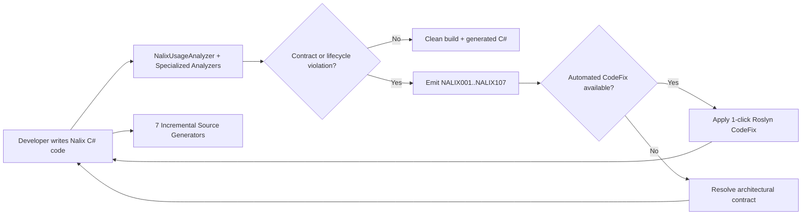

`Nalix.Analyzers` and `Nalix.Analyzers.Generators` provide **75 compile-time Roslyn diagnostics** (`NALIX001`–`NALIX107`), **16 automated code fix providers**, and **7 incremental source generators**. Both analyzer assemblies are bundled automatically inside the `Nalix.Abstractions` NuGet package.

## Source Mapping

- `analyzers/Nalix.Analyzers/Diagnostics/DiagnosticDescriptors.cs` (67 analyzer descriptors)
- `analyzers/Nalix.Analyzers.Generators/Internal/GeneratorDiagnosticDescriptors.cs` (8 source-generator descriptors)
- `analyzers/Nalix.Analyzers/Analyzers/NalixUsageAnalyzer.cs`
- `analyzers/Nalix.Analyzers/Analyzers/NalixUsageAnalyzer.SymbolSet.cs`
- `analyzers/Nalix.Analyzers/Analyzers/NalixUsageAnalyzer.InvocationAnalysis.cs`
- `analyzers/Nalix.Analyzers/Analyzers/NalixUsageAnalyzer.RpcService.cs`
- `analyzers/Nalix.Analyzers.CodeFixes/*.cs` (16 code fix providers)
- `analyzers/Nalix.Analyzers.Generators/*.cs` (7 incremental source generators)

## Analyzer Workflow

## Diagnostic Surface (`NALIX001`–`NALIX107`)

The active descriptor set comprises **75 diagnostics** (67 in `Nalix.Analyzers` and 8 in `Nalix.Analyzers.Generators`). Identifiers `NALIX007`, `NALIX019`, `NALIX029`, `NALIX031`, `NALIX049`, and `NALIX053` were retired when `INetworkBufferMiddleware` and legacy reflection paths were removed.

| Area | Codes | Purpose |
| --- | --- | --- |
| **Controller dispatch & packet registration** | `NALIX001`–`NALIX005`, `NALIX008`–`NALIX012`, `NALIX017`–`NALIX018`, `NALIX035`–`NALIX036`, `NALIX047`–`NALIX048`, `NALIX050`, `NALIX052`, `NALIX054`–`NALIX056`, `NALIX058`, `NALIX067`–`NALIX068`, `NALIX106` | Validates `[PacketHandler]` controllers, `IPacketContext<TPacket>` handler signatures, `[FromScope]` parameters, opcode uniqueness (`StaticOpCode` & `[PacketOpcode]`), dispatch loop bounds (`1..64`), and `Deserialize` contracts. |
| **Middleware & routing metadata** | `NALIX006`, `NALIX025`–`NALIX026`, `NALIX030`, `NALIX032`–`NALIX033`, `NALIX038` | Enforces `[MiddlewareOrder]`, middleware packet-type compatibility, `AlwaysExecute` stage rules, metadata builder guards, and XML opcode consistency. |
| **Serialization & schema layout** | `NALIX013`–`NALIX016`, `NALIX021`–`NALIX022`, `NALIX034`, `NALIX046`, `NALIX051`, `NALIX059`–`NALIX060` | Validates `SerializeLayout.Explicit`, `[SerializeOrder]`, `[SerializeHeader]` conflicts, `IFixedSizeSerializable`, static `Create()` on `[GenerateFormatter]` reference types, and `partial` modifiers on `PacketBase<TSelf>` types. |
| **DI, configuration, RPC, SDK & hosting** | `NALIX020`, `NALIX023`–`NALIX024`, `NALIX027`–`NALIX028`, `NALIX037`, `NALIX039`–`NALIX045`, `NALIX057`, `NALIX063`–`NALIX066`, `NALIX100`–`NALIX105`, `NALIX107` | Checks `ResetForPool()` completeness, `.ini` property bindability, `RequestOptions` bounds, `IBufferLease` disposal, `NetworkApplicationBuilder` setup, `[Injectable]` / `SingletonBase<T>` constructors, `[Inject]` field mutability, and `[RpcService]` contracts. |
| **Security, pooling & AOT** | `NALIX071`–`NALIX076`, `NALIX078` | Prevents `IPacketContext<T>` escaping handler scope (`NALIX076`), enforces `using` on `PacketScope<T>` (`NALIX075`), and guards Nalix Core assemblies against unreviewed crypto, hot-path endpoint allocations, unguarded catches, and AOT-unsafe reflection. |

For the complete table of all 75 diagnostics, see [Diagnostic Codes](./diagnostic-codes.md).

## Automated Code Fix Coverage

`Nalix.Analyzers.CodeFixes` provides 16 targeted Roslyn code fix providers covering **20 active diagnostic IDs** (plus retired `NALIX031`):

| Category | Code Fix Providers | Fixed Diagnostics |
| --- | --- | --- |
| **Packet & controller shape** | `PacketHandlerCodeFixProvider`, `PacketOpcodeCodeFixProvider`, `PacketDeserializeCodeFixProvider`, `PacketRegistryDeserializerCodeFixProvider`, `PacketSelfTypeCodeFixProvider`, `GenericPacketHandlerCodeFixProvider` | `NALIX002`, `NALIX008`, `NALIX009`, `NALIX010`, `NALIX011`, `NALIX012`, `NALIX052`, `NALIX058` |
| **Serialization attributes** | `SerializeOrderMissingCodeFixProvider`, `DuplicateSerializeOrderCodeFixProvider`, `SerializationConflictCodeFixProvider` | `NALIX013`, `NALIX014`, `NALIX015` |
| **Middleware & dispatch setup** | `MiddlewareCodeFixProvider`, `NullMiddlewareCodeFixProvider`, `DispatchLoopCountCodeFixProvider` | `NALIX030`, `NALIX032`, `NALIX047`, `NALIX056` |
| **Configuration & SDK options** | `ConfigurationIgnoreCodeFixProvider`, `RequestOptionsConsistencyCodeFixProvider` | `NALIX023`, `NALIX024`, `NALIX057` |
| **Pooling & lifecycle cleanup** | `ResetForPoolCodeFixProvider`, `RedundantPacketCastCodeFixProvider` | `NALIX020`, `NALIX055` |

See [Code Fixes Reference](./code-fixes.md) for the exact transformations performed by each provider.

## Incremental Source Generators

`Nalix.Analyzers.Generators` includes 7 compile-time generators:

1. [**Packet Handler Generator** (PacketHandlerGenerator)](./autogen/packet-handler-generator.md) — Compiles `[PacketHandler]` controllers into zero-reflection `IPacketHandlerCompiler` delegates and generates `InitializeDependencies()` for `[Inject]` members.
2. [**Instance Generator** (InstanceGenerator)](./autogen/instance-generator.md) — Emits AOT-safe multi-constructor activation delegates for `[Injectable]` services and `SingletonBase<T>` subclasses.
3. [**Serialization Generator** (SerializeFormatterGenerator)](./autogen/serialization-generator.md) — Generates `IFormatter<T>` and `IFillableFormatter<T>` implementations for `[GenerateFormatter]` types.
4. [**Packet Registry Generator** (PacketRegistryGenerator)](./autogen/packet-registry-generator.md) — Emits `PacketRegistryGenerated.Initialize()` calling `PacketRegistry.RegisterGenerated<TPacket>` for concrete `IPacket` types.
5. [**Packet Schema Generator** (PacketSchemaGenerator)](./autogen/packet-schema-generator.md) — Emits `Length`, `ResetForPool()`, and `Size` (when implementing `IFixedSizeSerializable`) for `partial` `PacketBase<TSelf>` types.
6. [**Configuration Generator** (ConfigurationGenerator)](./autogen/configuration-generator.md) — Emits `CopyPropertiesTo`, `BindProperties`, and `ValidateDataAnnotations` for `ConfigurationLoader` subclasses.
7. [**RPC Client Generator** (RpcClientGenerator)](./autogen/index.md#rpc-client-generator-rpcclientgenerator) — Generates `<Service>_RpcClient` implementations registered via `RpcExtensions.RegisterFactory` for `[RpcService]` interfaces.

## Related APIs

- [Diagnostic Codes](./diagnostic-codes.md)
- [Code Fixes Reference](./code-fixes.md)
- [Source Generators Overview](./autogen/index.md)
- [Network Application Builder](../hosting/network-application.md)
- [Serialization Basics](../codec/serialization/serialization-basics.md)
- [Packet Registry](../codec/packets/packet-registry.md)
