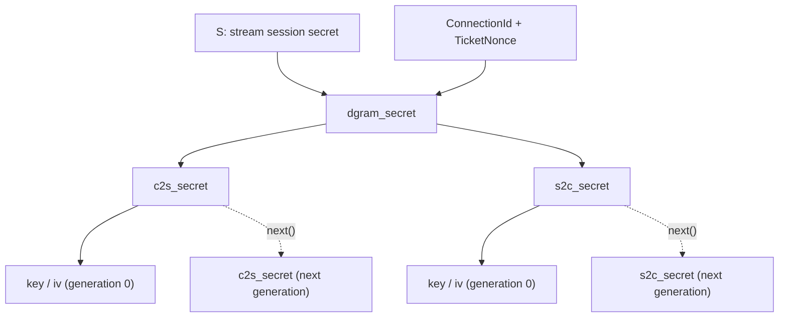

**Namespace:** `Nalix.Codec.Security.Datagram`  
**Assembly:** `Nalix.Codec`

This page covers the AEAD protection of Nalix Datagram Protocol (NDP v1) sessions: `ChaCha20Poly1305DatagramProtection`, its stateless factory `ChaCha20Poly1305DatagramProtectionFactory`, and the static `DatagramKeySchedule` that derives every key, IV and nonce. The contracts they implement, `IDatagramProtection` and `IDatagramProtectionFactory`, live in `Nalix.Abstractions.Networking.Datagrams`, so the transport layer can seal datagrams without referencing the crypto code.

## Source Mapping

- `src/Nalix.Codec/Security/Datagram/ChaCha20Poly1305DatagramProtection.cs`
- `src/Nalix.Codec/Security/Datagram/ChaCha20Poly1305DatagramProtectionFactory.cs`
- `src/Nalix.Codec/Security/Datagram/DatagramKeySchedule.cs`
- `src/Nalix.Abstractions/Networking/Datagrams/IDatagramProtection.cs`
- `src/Nalix.Abstractions/Networking/Datagrams/IDatagramProtectionFactory.cs`
- `src/Nalix.Codec/Security/HkdfKeccak256.cs`
- `src/Nalix.Environment/Datagrams/DatagramEngine.cs` (caller: builds the header and passes it as AAD)
- `src/Nalix.Environment/Datagrams/Wire/DatagramHeader.cs` (header layout)

## Public Types at a Glance

| Type | Kind | Role |
| --- | --- | --- |
| `ChaCha20Poly1305DatagramProtection` | `public sealed class`, implements `IDatagramProtection` | Seals and opens datagrams; owns the per-direction key generations and key-phase state (`ChaCha20Poly1305DatagramProtection.cs:16`). |
| `ChaCha20Poly1305DatagramProtectionFactory` | `public sealed class`, implements `IDatagramProtectionFactory` | Stateless factory with a shared `Instance` (`ChaCha20Poly1305DatagramProtectionFactory.cs:13-18`). |
| `DatagramKeySchedule` | `public static class` | HKDF-Keccak256 derivation of direction secrets, keys, IVs, next secrets and per-packet nonces (`DatagramKeySchedule.cs:22`). |

:::note[Thread safety]
`ChaCha20Poly1305DatagramProtection` is not thread-safe; the datagram session serializes calls (`ChaCha20Poly1305DatagramProtection.cs:15`, `IDatagramProtection.cs:12-14`). A packet number must be sealed at most once per key; the caller never reuses one (`IDatagramProtection.cs:14`).
:::

## Key Schedule

`DatagramKeySchedule` is built on `HkdfKeccak256` (`DatagramKeySchedule.cs:12`). Each step is a single-block HKDF-Expand with a 32-byte output: `OKM = HMAC-Keccak256(PRK, info || 0x01)` (`HkdfKeccak256.cs:43,63-65`). `info` may be at most `HkdfKeccak256.MaxInfoLength = 256` bytes (`HkdfKeccak256.cs:20,54`).

```text
dgram_secret = HKDF-Expand(S, "nalix-dgram/v1" || ConnectionId (u64 LE) || TicketNonce)
c2s_secret   = HKDF-Expand(dgram_secret, "nalix-dgram/c2s")
s2c_secret   = HKDF-Expand(dgram_secret, "nalix-dgram/s2c")
key(x)       = HKDF-Expand(x, "key")
iv(x)        = HKDF-Expand(x, "iv")[0..12]
next(x)      = HKDF-Expand(x, "nalix-dgram/ku")
```

(`DatagramKeySchedule.cs:12-20`; labels at `DatagramKeySchedule.cs:34-39`.)



### Inputs and outputs

| Input | Source | Used in |
| --- | --- | --- |
| `sessionSecret` (`Bytes32`) | The stream session secret snapshotted when the ticket was issued (`DatagramKeySchedule.cs:44`). | HKDF input keying material for `dgram_secret` (`DatagramKeySchedule.cs:65`). |
| `connectionId` (`ulong`) | The datagram connection identifier (`DatagramKeySchedule.cs:45`). | Written as little-endian `u64` into `info` (`DatagramKeySchedule.cs:62`). |
| `ticketNonce` (16 bytes) | The ticket nonce (`DatagramKeySchedule.cs:46`). | Appended to `info` (`DatagramKeySchedule.cs:63`). |

| Output | Size | Produced by |
| --- | --- | --- |
| Client-to-server secret | 32 bytes | `DeriveDirectionSecrets` (`DatagramKeySchedule.cs:68`). |
| Server-to-client secret | 32 bytes | `DeriveDirectionSecrets` (`DatagramKeySchedule.cs:69`). |
| ChaCha20-Poly1305 key | 32 bytes | `DeriveKey` (`DatagramKeySchedule.cs:81`). |
| IV | 12 bytes (`IvSize`) | `DeriveIv`, first 12 bytes of the 32-byte block (`DatagramKeySchedule.cs:88-99`). |
| Next-generation secret | 32 bytes | `DeriveNextSecret` (`DatagramKeySchedule.cs:104`). |
| AEAD nonce | 12 bytes | `BuildNonce` (`DatagramKeySchedule.cs:112-117`). |

The `info` buffer for `dgram_secret` is `"nalix-dgram/v1"` (14 bytes) + 8 bytes of `connectionId` + 16 bytes of `ticketNonce`, 38 bytes in total (`DatagramKeySchedule.cs:60`).

## `DatagramKeySchedule`

```csharp
public static class DatagramKeySchedule
{
    public const int TicketNonceSize = 16;
    public const int IvSize = 12;

    public static void DeriveDirectionSecrets(
        Bytes32 sessionSecret, ulong connectionId, ReadOnlySpan<byte> ticketNonce,
        out Bytes32 clientToServer, out Bytes32 serverToClient);

    public static Bytes32 DeriveKey(Bytes32 secret);
    public static void DeriveIv(Bytes32 secret, Span<byte> iv);
    public static Bytes32 DeriveNextSecret(Bytes32 secret);
    public static void BuildNonce(ReadOnlySpan<byte> iv, ulong packetNumber, Span<byte> nonce);
}
```

Signatures: `DatagramKeySchedule.cs:27,32,50-52,81,88,104,112`.

| Member | Behavior |
| --- | --- |
| `TicketNonceSize` | `16`, the required ticket nonce length (`DatagramKeySchedule.cs:27`). |
| `IvSize` | `12`, the size of both the derived IV and the AEAD nonce (`DatagramKeySchedule.cs:32`). |
| `DeriveDirectionSecrets(...)` | Derives `dgram_secret`, then the two direction secrets, and wipes `dgram_secret` and its copy of `sessionSecret` (`DatagramKeySchedule.cs:65-75`). Throws `ArgumentException` when `ticketNonce.Length != 16`; the secret copy is wiped first (`DatagramKeySchedule.cs:54-58`). |
| `DeriveKey(secret)` | `HKDF-Expand(secret, "key")`, a 32-byte ChaCha20-Poly1305 key (`DatagramKeySchedule.cs:81`). |
| `DeriveIv(secret, iv)` | Copies the first 12 bytes of `HKDF-Expand(secret, "iv")` into `iv`, which must hold at least 12 bytes; the temporary block is wiped (`DatagramKeySchedule.cs:88-99`). |
| `DeriveNextSecret(secret)` | `HKDF-Expand(secret, "nalix-dgram/ku")`, the secret of the next key generation of one direction (`DatagramKeySchedule.cs:104`). |
| `BuildNonce(iv, packetNumber, nonce)` | Copies the 12-byte `iv` into `nonce`, then XORs the last 8 bytes with `packetNumber` as a big-endian `u64`: `iv XOR (0x00000000 \|\| packetNumber)` (`DatagramKeySchedule.cs:109-117`). |

All methods that take a `Bytes32` receive it by value and wipe their own copy; the caller keeps its original (`DatagramKeySchedule.cs:73-74`, `HkdfKeccak256.cs:45,51,76`). The internal `Wipe(Span<byte>)` helper is not part of the public surface (`DatagramKeySchedule.cs:119`).

## `ChaCha20Poly1305DatagramProtection`

```csharp
public sealed class ChaCha20Poly1305DatagramProtection : IDatagramProtection
{
    public ChaCha20Poly1305DatagramProtection(Bytes32 sendSecret, Bytes32 receiveSecret);

    public static ChaCha20Poly1305DatagramProtection Create(
        Bytes32 sessionSecret, ulong connectionId, ReadOnlySpan<byte> ticketNonce, bool isServer);

    public int TagSize { get; }
    public bool SendKeyPhase { get; }

    public void Seal(ulong packetNumber, ReadOnlySpan<byte> header, ReadOnlySpan<byte> plaintext, Span<byte> destination);
    public bool TryOpen(ulong packetNumber, bool keyPhase, ReadOnlySpan<byte> header, ReadOnlySpan<byte> ciphertextAndTag, Span<byte> plaintext);
    public void UpdateSendKey();
    public void DiscardPreviousReceiveKey();
    public void Dispose();
}
```

Signatures: `ChaCha20Poly1305DatagramProtection.cs:35,52,67,70,73,88,124,133,143`.

### Construction

- `new(Bytes32 sendSecret, Bytes32 receiveSecret)` loads the send and receive generations from the two direction secrets, and precomputes the next receive generation with `DeriveNextSecret(receiveSecret)` (`ChaCha20Poly1305DatagramProtection.cs:37-39`). Both secrets are copied and wiped locally; the caller keeps its own values (`ChaCha20Poly1305DatagramProtection.cs:30,40-41`).
- `Create(sessionSecret, connectionId, ticketNonce, isServer)` calls `DeriveDirectionSecrets`, then returns `new(s2c, c2s)` for the server (it sends with the server-to-client secret) or `new(c2s, s2c)` for the client; the intermediate secrets are wiped in `finally` (`ChaCha20Poly1305DatagramProtection.cs:54-63`). It throws `ArgumentException` when `ticketNonce` is not 16 bytes (`DatagramKeySchedule.cs:54-58`).

Each direction has its own secret chain and key phase (`ChaCha20Poly1305DatagramProtection.cs:13`). A key generation (`KeySet`) holds the secret it was derived from, the 32-byte AEAD key (`DeriveKey`) and the 12-byte IV (`DeriveIv`) (`ChaCha20Poly1305DatagramProtection.cs:176-202`).

### Nonce, AAD and layout

| Aspect | Value |
| --- | --- |
| Cipher | ChaCha20-Poly1305 (RFC 8439) (`ChaCha20Poly1305DatagramProtection.cs:12`). |
| `TagSize` | `ChaCha20Poly1305.TagSize`, which is `16` (`ChaCha20Poly1305DatagramProtection.cs:67`, `ChaCha20Poly1305.cs:63`). |
| Nonce | 12 bytes, `iv XOR packetNumber` as above; built per call on the stack from the generation IV and the full 64-bit packet number (`ChaCha20Poly1305DatagramProtection.cs:78-79,166-167`). |
| AAD | The `header` argument, passed verbatim as the AEAD associated data (`ChaCha20Poly1305DatagramProtection.cs:82,171`). |
| Sealed output | `ciphertext || tag` in `destination`: ciphertext in `destination[..plaintext.Length]`, then the 16-byte tag (`ChaCha20Poly1305DatagramProtection.cs:83-84`). |
| `destination` size | At least `plaintext.Length + TagSize`, otherwise `ArgumentOutOfRangeException` (`ChaCha20Poly1305DatagramProtection.cs:76`). It must not overlap `plaintext` (`IDatagramProtection.cs:35-36`). |
| Opened input | `ciphertextAndTag`: ciphertext followed by the 16-byte tag (`ChaCha20Poly1305DatagramProtection.cs:160,171-172`). |

The protection does not build the header itself. `DatagramEngine` writes the 13-byte `DatagramHeader` into the start of the datagram, passes it as `header`, and seals the payload into the rest (`DatagramEngine.cs:394-395`). That header is `u8 Flags (Version 7..4 | KeyPhase 3 | reserved 2..0) · u64 LE ConnectionId · u32 LE PacketNumber (low 32 bits)` (`DatagramHeader.cs:11,15`), so the on-wire datagram is:

```text
| header (13 bytes, cleartext, authenticated as AAD) | ciphertext (n bytes) | tag (16 bytes) |
```

The datagram length is `DatagramHeader.Size + plaintext.Length + TagSize` (`DatagramEngine.cs:396`). Only the low 32 bits of the packet number travel in the header; the receiver reconstructs the full number before calling `TryOpen` (`DatagramEngine.cs:432`), and that full 64-bit value feeds the nonce.

### `Seal`

Throws `ObjectDisposedException` after `Dispose` (`ChaCha20Poly1305DatagramProtection.cs:75`) and `ArgumentOutOfRangeException` for a short `destination`. It always encrypts with the current send key (`ChaCha20Poly1305DatagramProtection.cs:79,82`).

### `TryOpen`

Returns `false` (it does not throw) when authentication fails, when `ciphertextAndTag` is shorter than the tag, or when `plaintext` is shorter than `ciphertextAndTag.Length - TagSize` (`ChaCha20Poly1305DatagramProtection.cs:92-95,160-164,173`). It throws `ObjectDisposedException` after `Dispose` (`ChaCha20Poly1305DatagramProtection.cs:90`). The `plaintext` span must not overlap `ciphertextAndTag` (`IDatagramProtection.cs:50-51`). Key selection depends on `keyPhase`:

1. `keyPhase` equals the current receive phase: open with the current receive key (`ChaCha20Poly1305DatagramProtection.cs:97-100`).
2. Other phase, a previous key exists and `packetNumber < _receivePhaseFirstPacket`: a late packet of the old phase, opened with the previous key (`ChaCha20Poly1305DatagramProtection.cs:103-106`).
3. Otherwise: try the precomputed next key (`ChaCha20Poly1305DatagramProtection.cs:108-111`). On success the peer has updated its key: next becomes current, current becomes previous, a new next secret is derived from the new current secret, the receive phase flips to `keyPhase`, and `packetNumber` is recorded as the first packet of the phase (`ChaCha20Poly1305DatagramProtection.cs:113-120`). A failed open changes no state.

### Key update

- `UpdateSendKey()` replaces the send generation with `DeriveNextSecret(send secret)` and flips `SendKeyPhase` (`ChaCha20Poly1305DatagramProtection.cs:128-129`). `SendKeyPhase` is the phase bit to place in the header of subsequent packets (`ChaCha20Poly1305DatagramProtection.cs:70`, `DatagramEngine.cs:394`).
- `DiscardPreviousReceiveKey()` wipes the previous receive generation once late packets of the old phase can no longer arrive; it does nothing when there is none (`ChaCha20Poly1305DatagramProtection.cs:133-140`, `IDatagramProtection.cs:61-62`).
- `Dispose()` is idempotent; it wipes all four generations (send, receive, next, previous), after which `Seal`, `TryOpen` and `UpdateSendKey` throw `ObjectDisposedException` (`ChaCha20Poly1305DatagramProtection.cs:143-156,75,90,126`).

## `ChaCha20Poly1305DatagramProtectionFactory`

```csharp
public sealed class ChaCha20Poly1305DatagramProtectionFactory : IDatagramProtectionFactory
{
    public static ChaCha20Poly1305DatagramProtectionFactory Instance { get; }

    public IDatagramProtection Create(
        Bytes32 sessionSecret, ulong connectionId, ReadOnlySpan<byte> ticketNonce, bool isServer);
}
```

Signatures: `ChaCha20Poly1305DatagramProtectionFactory.cs:13,18,21`.

- `Instance` is the shared instance; the factory is stateless (`ChaCha20Poly1305DatagramProtectionFactory.cs:14-18`).
- `Create(...)` delegates to `ChaCha20Poly1305DatagramProtection.Create` and returns the result as `IDatagramProtection`; the caller disposes it (`ChaCha20Poly1305DatagramProtectionFactory.cs:21-22`, `IDatagramProtectionFactory.cs:15`). `isServer` is `true` for the side that sends with the server-to-client key (`IDatagramProtectionFactory.cs:14`).

## Example

A client and a server derive matching protections from the same session secret, connection ID and ticket nonce. The 13-byte header here stands in for the `DatagramHeader` that `DatagramEngine` normally writes.

```csharp
using System;
using Nalix.Abstractions.Primitives;
using Nalix.Codec.Security.Datagram;

Bytes32 sessionSecret = /* stream session secret snapshotted at ticket issue */;
ulong connectionId = 0x1122334455667788;
byte[] ticketNonce = /* 16 bytes from the ticket */;

using var client = ChaCha20Poly1305DatagramProtectionFactory.Instance
    .Create(sessionSecret, connectionId, ticketNonce, isServer: false);
using var server = ChaCha20Poly1305DatagramProtectionFactory.Instance
    .Create(sessionSecret, connectionId, ticketNonce, isServer: true);

byte[] header = new byte[13];                 // cleartext header, authenticated as AAD
byte[] payload = "hello"u8.ToArray();
byte[] datagram = new byte[payload.Length + client.TagSize];

ulong packetNumber = 0;                       // never reuse a packet number with the same key
client.Seal(packetNumber, header, payload, datagram);

byte[] plaintext = new byte[payload.Length];
bool ok = server.TryOpen(packetNumber, client.SendKeyPhase, header, datagram, plaintext);

// Rotate the client send key; the server follows on the first packet with the flipped phase bit.
client.UpdateSendKey();
packetNumber++;
client.Seal(packetNumber, header, payload, datagram);
ok = server.TryOpen(packetNumber, client.SendKeyPhase, header, datagram, plaintext);

// Once late packets of the old phase can no longer arrive:
server.DiscardPreviousReceiveKey();
```

## Related APIs

- [Nalix.Codec](../../packages/nalix-codec.md)
- [Cryptography](../security/cryptography.md)
- [UDP Listener](../network/datagram-listener.md)
- [Codec Index](./index.md)
