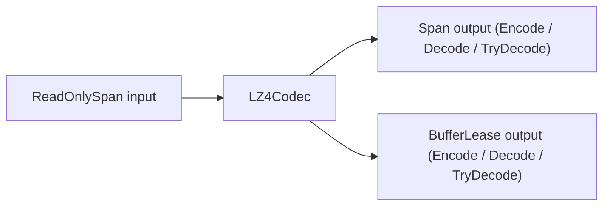

**Namespace:** `Nalix.Codec.LZ4` (`CompressionOptions` in `Nalix.Codec.Options`)  
**Assembly:** `Nalix.Codec`

This page covers the public LZ4 block compression surface in `Nalix.Codec.LZ4` and its runtime configuration in `CompressionOptions`.

## Source Mapping

- `src/Nalix.Codec/LZ4/LZ4Codec.cs`
- `src/Nalix.Codec/LZ4/LZ4BlockHeader.cs`
- `src/Nalix.Codec/LZ4/LZ4CompressionConstants.cs`
- `src/Nalix.Codec/LZ4/LZ4BlockEncoder.cs`
- `src/Nalix.Codec/Options/CompressionOptions.cs`

## Public Types at a Glance

| Type | Public Members |
|---|---|
| `LZ4Codec` | `Encode(ReadOnlySpan<byte>, Span<byte>)`, `Encode(ReadOnlySpan<byte>, out BufferLease, out int)`, `Decode(ReadOnlySpan<byte>, Span<byte>)`, `Decode(ReadOnlySpan<byte>, out BufferLease?, out int)`, `TryDecode(ReadOnlySpan<byte>, Span<byte>, out int)`, `TryDecode(ReadOnlySpan<byte>, out BufferLease?, out int)` |
| `LZ4BlockHeader` | `OriginalLength` (`int`), `CompressedLength` (`int`), `Size = 8` |
| `LZ4BlockEncoder` | `GetMaxLength(int input)`, `GetMinOutputBufferSize(int inputLength)`, `EncodeBlock(ReadOnlySpan<byte> input, Span<byte> output, int* hashTable, int hashBits)` |
| `LZ4CompressionConstants` | `MinMatchLength = 4`, `MaxOffset = 65535`, `MaxBlockSize = 0x40000` (`262_144` / 256 KB), `LastLiteralSize = 5`, `TokenMatchMask = 0x0F`, `TokenLiteralMask = 0x0F` |
| `CompressionOptions` | `Enabled = true`, `MinSizeToCompress = 512`, `MaxDecompressedSize = 33_554_432` (32 MB), `Validate()` |

## Runtime Shape



## Block Format (`LZ4BlockHeader`)

Every compressed block begins with an 8-byte little-endian `LZ4BlockHeader` (`LZ4BlockHeader.Size = 8`):

- `OriginalLength` (`int`, offset 0): Uncompressed byte count of the payload.
- `CompressedLength` (`int`, offset 4): Total encoded byte count (including the 8-byte header).

## Encode Overloads

- `int Encode(ReadOnlySpan<byte> input, Span<byte> output)` — Compresses `input` into caller-owned `output` and returns the number of bytes written (including the 8-byte `LZ4BlockHeader`). Throws `ArgumentOutOfRangeException` or `LZ4Exception` if `output` is too small.
- `void Encode(ReadOnlySpan<byte> input, out BufferLease lease, out int bytesWritten)` — Rents a `BufferLease` sized via `LZ4BlockEncoder.GetMaxLength(input.Length)`, encodes the block, commits `bytesWritten`, and returns ownership of `lease` to the caller.

## Decode and TryDecode Overloads

- `int Decode(ReadOnlySpan<byte> input, Span<byte> output)` — Decompresses `input` into `output` and returns the number of decompressed bytes written. Throws `LZ4Exception` on malformed input or insufficient output space.
- `bool TryDecode(ReadOnlySpan<byte> input, Span<byte> output, out int bytesWritten)` — Non-throwing span decompression used on untrusted network paths; returns `false` on malformed input or size mismatch.
- `void Decode(ReadOnlySpan<byte> input, out BufferLease? lease, out int bytesWritten)` — Rents a `BufferLease` matching the validated `OriginalLength` and decompresses into it. Throws `LZ4Exception` on failure.
- `bool TryDecode(ReadOnlySpan<byte> input, out BufferLease? lease, out int bytesWritten)` — Non-throwing pooled decompression; returns `false` and disposes any temporary buffer if decoding fails.

## `CompressionOptions` (`Nalix.Codec.Options`)

Loaded from the `[Compression]` section of `server.ini` via `ConfigurationManager.Instance.Get<CompressionOptions>()`:

| Property | Type | Default | Validation | Description |
| --- | --- | ---: | --- | --- |
| `Enabled` | `bool` | `true` | — | Enables or disables LZ4 frame compression. |
| `MinSizeToCompress` | `int` | `512` | `[ValueRange(1, int.MaxValue)]` | Minimum payload size in bytes before compression is attempted. |
| `MaxDecompressedSize` | `int` | `33_554_432` (32 MB) | `[ValueRange(1024, 268_435_456)]` | Maximum allowed `OriginalLength` to prevent zip-bomb allocation attacks (`MinSizeToCompress <= MaxDecompressedSize`). |

:::tip[12.5% Minimum Compression Gain in `FramePipeline`]
When `FramePipeline.ProcessOutbound` compresses a packet, it only transmits the compressed payload if it shrinks the payload by at least **12.5%** (`compressedLength <= originalLength - (originalLength >> 3)`). Incompressible payloads are automatically sent uncompressed without setting `PacketFlags.COMPRESSED`.
:::

## Example

```csharp
using System;
using Nalix.Codec.LZ4;
using Nalix.Environment.Memory;

ReadOnlySpan<byte> input = payload;

LZ4Codec.Encode(input, out BufferLease compressed, out int written);
using (compressed)
{
    if (LZ4Codec.TryDecode(compressed.Span, out BufferLease? restored, out int restoredBytes) && restored is not null)
    {
        using (restored)
        {
            Console.WriteLine($"Compressed {input.Length}B -> {written}B, restored {restoredBytes}B");
        }
    }
}
```

## Related APIs

- [Frame Pipeline](./frame-pipeline.md)
- [Buffer Management](../environment/memory/buffer-management.md)
- [Compression Options](../options/network/compression-options.md)
