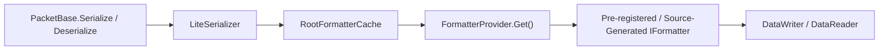

**Namespace:** `Nalix.Codec.Serialization`  
**Assembly:** `Nalix.Codec`

This page explains how `SerializeFormatterGenerator`, `LiteSerializer`, and `FormatterProvider` serialize and deserialize packet classes, structs, and nested collections.

## Source Mapping

- `analyzers/Nalix.Analyzers.Generators/SerializeFormatterGenerator.cs`
- `src/Nalix.Codec/Serialization/LiteSerializer.cs`
- `src/Nalix.Codec/Serialization/FormatterProvider.cs`
- `src/Nalix.Codec/DataFrames/PacketBase.cs`

## Supported Type Groups

- **Unmanaged primitives & structs**: `char`, `byte`, `sbyte`, `short`, `ushort`, `int`, `uint`, `long`, `ulong`, `float`, `double`, `decimal`, `bool`, `Guid`, `DateOnly`, `DateTime`, `TimeOnly`, `TimeSpan`, `DateTimeOffset`, `Bytes32`, `PacketHeader`, and custom unmanaged `struct` types.
- **Strings**: `string` and `string[]` (`StringFormatter`, `StringArrayFormatter`).
- **Nullable value types**: `T?` and `T?[]` (`NullableFormatter<T>`, `NullableArrayFormatter<T>`, `NullableValueListFormatter<T>`).
- **Enums**: Any `enum` backed by `byte`, `sbyte`, `short`, `ushort`, `int`, `uint`, `long`, or `ulong` (`EnumFormatter<T>`).
- **Collections**:
  - `T[]` (`ArrayFormatter<T>` for unmanaged `T`, `ReferenceArrayFormatter<T>` for reference types)
  - `List<T>` (`ListFormatter<T>` for unmanaged `T`, `ReferenceListFormatter<T>` for reference types)
  - `Dictionary<TKey, TValue>` (`DictionaryFormatter<TKey, TValue>`)
  - `Queue<T>`, `Stack<T>`, `HashSet<T>` (supported for unmanaged `T` and `string`)
  - `Memory<T>` and `ReadOnlyMemory<T>` (supported for unmanaged `T`)
- **Tuples**: `ValueTuple` of arity 2 through 5 (`ValueTupleFormatter<...>`).
- **Complex classes & structs**: Any class or struct annotated with `[GenerateFormatter]` (including all `PacketBase<TSelf>` subclasses).

## Compile-Time Member Model (`[GenerateFormatter]`)

Nalix does not use runtime reflection or `System.Reflection.Emit` to serialize objects. Instead, `SerializeFormatterGenerator` inspects types marked with `[GenerateFormatter]` at compile time:

1. **`SerializeLayout.Explicit` (Default for `[SerializePackable(SerializeLayout.Explicit)]`)**:
   - Only fields and properties annotated with `[SerializeOrder(n)]` (or `[SerializeHeader]`) are serialized, sorted in ascending order of `Order`.
   - `PacketBase<TSelf>` places `Header` (`PacketHeader`) at order `0` via `[SerializeHeader(0)]`. User fields on `PacketBase<TSelf>` subclasses also start their `[SerializeOrder]` at `0` (the generator always emits `Header` first before user members).
   - Public members without `[SerializeOrder]` or `[SerializeIgnore]` trigger analyzer warning **`NALIX013`**.
2. **`SerializeLayout.Sequential` (`[SerializePackable(SerializeLayout.Sequential)]`)**:
   - Serializes all accessible instance fields and auto-properties in declaration order across the inheritance hierarchy, skipping `[SerializeIgnore]` members.
3. **Reference Type Pooling (`Create()` and `IFillableFormatter<T>`)**:
   - Reference types marked with `[GenerateFormatter]` must expose a static `Create()` method (enforced by error **`NALIX059`**; provided automatically by `PacketBase<TSelf>.Create()`).
   - Generated class formatters implement both `IFormatter<T>` and `IFillableFormatter<T>`, allowing `PacketBase<TSelf>.Deserialize` and `LiteSerializer.Fill` to populate pooled packet instances in place without allocating.

## Resolution Flow



## Example: Packet with Nested Struct and Collection

```csharp
using System.Collections.Generic;
using Nalix.Abstractions.Networking.Packets;
using Nalix.Abstractions.Serialization;
using Nalix.Codec.DataFrames;

[GenerateFormatter]
[SerializePackable(SerializeLayout.Sequential)]
public partial struct InventoryItem
{
    public uint ItemId { get; set; }
    public ushort Quantity { get; set; }
}

[Packet]
[GenerateFormatter]
[SerializePackable(SerializeLayout.Explicit)]
public sealed partial class InventorySyncPacket : PacketBase<InventorySyncPacket>, IPacketStaticOpcode
{
    public static ushort StaticOpCode => 0x2010;

    [SerializeOrder(0)]
    public ulong AccountId { get; set; }

    [SerializeOrder(1)]
    public List<InventoryItem> Items { get; set; } = [];
}
```

## Related APIs

- [Serialization Basics](./serialization-basics.md)
- [Serialization Generator](../../analyzers/autogen/serialization-generator.md)
- [Packet Schema Generator](../../analyzers/autogen/packet-schema-generator.md)
- [Serialization Attributes](../../abstractions/serialization-attributes.md)
- [Frame Model](../packets/frame-model.md)
