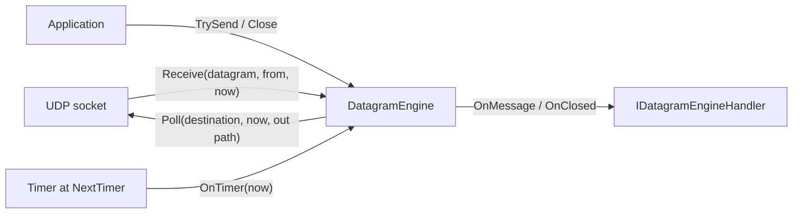

**Namespace:** `Nalix.Environment.Datagrams` (and `Nalix.Environment.Options` for `DatagramEngineOptions`)  
**Assembly:** `Nalix.Environment`

`DatagramEngine` is the protocol engine of one Nalix Datagram Protocol (NDP v1) session. It does no socket I/O ("sans-IO"): the owner feeds received UDP payloads to `Receive`, sends whatever `Poll` produces, and calls `OnTimer` at `NextTimer`. Times are microseconds from any monotonic clock, for example `DatagramEngine.NowMicros()`.

The engine implements packet numbers, AEAD protection through `IDatagramProtection`, ACK ranges, loss detection and NewReno congestion control with pacing, path MTU discovery, keepalive, idle timeout, close and draining, path validation, key update, and the `DeliveryMethod` modes on independent channels with fragmentation and advertised receive budgets. It is **not thread-safe**: the owner serializes all calls. The engine owns and disposes the protection.

## Source Mapping

- `src/Nalix.Environment/Datagrams/DatagramEngine.cs`
- `src/Nalix.Environment/Datagrams/DatagramEngine.Cleanup.cs`
- `src/Nalix.Environment/Datagrams/DatagramEngine.Report.cs`
- `src/Nalix.Environment/Datagrams/DatagramEngine.Types.cs`
- `src/Nalix.Environment/Datagrams/DatagramEngineState.cs`
- `src/Nalix.Environment/Datagrams/DatagramCloseCode.cs`
- `src/Nalix.Environment/Datagrams/DatagramPeerLimits.cs`
- `src/Nalix.Environment/Datagrams/IDatagramEngineHandler.cs`
- `src/Nalix.Environment/Options/DatagramEngineOptions.cs`

## Driving the engine



After every `Receive`, `TrySend`, `Close` and `OnTimer`, call `Poll` repeatedly until it returns `0`.

## `DatagramEngine`

`public sealed partial class DatagramEngine : IDisposable` (`DatagramEngine.cs` L34).

### Constructor

```csharp
public DatagramEngine(
    DatagramEngineOptions options, DatagramPeerLimits peerLimits, IDatagramProtection protection,
    ulong connectionId, bool isServer, IDatagramEngineHandler handler, long now);
```

(`DatagramEngine.cs` L108.) `options`, `protection` and `handler` throw `ArgumentNullException` when `null`; the constructor then calls `options.Validate()` (see [Validate() rules](#validate-rules)). Channel count and idle timeout must match the peer's. `peerLimits` are the receive budgets the peer advertised in the ticket. The client opens the session with a PING; the server only answers authenticated datagrams (`DatagramEngine.cs` L134-L135).

### Constants

| Member | Signature | Description |
| :--- | :--- | :--- |
| `MinimumDatagramSize` | `public const int MinimumDatagramSize` | Smallest valid datagram: 13-byte header, one frame byte, 16-byte tag (`DatagramEngine.cs` L37). |
| `MaxDatagramSize` | `public const int MaxDatagramSize = 1472` | Largest datagram `Poll` produces, the largest MTU probe (`DatagramEngine.cs` L228). |
| `MaxUnfragmentedMessageSize` | `public const int MaxUnfragmentedMessageSize` | Largest message sent in one MESSAGE frame: `DatagramEngineOptions.MinimumMtu` minus the datagram header (13), the tag bound (16) and the largest MESSAGE frame header (23), i.e. 1148 bytes (`DatagramEngine.Types.cs` L20-L21). |

### Lifecycle and routing

| Member | Signature | Description |
| :--- | :--- | :--- |
| `State` | `public DatagramEngineState State { get; }` | Current lifecycle state (L139). |
| `ConnectionId` | `public ulong ConnectionId { get; }` | The connection identifier given to the constructor (L142). |
| `TryReadConnectionId` | `public static bool TryReadConnectionId(ReadOnlySpan<byte> datagram, out ulong connectionId)` | Reads the connection id from the cleartext header without authenticating, to route a datagram to its session. Returns `false` for datagrams shorter than `MinimumDatagramSize` or with an unknown version or reserved bits set (L151). |
| `NowMicros` | `public static long NowMicros()` | Monotonic time in microseconds, for the `now` arguments (L166). |
| `Dispose` | `public void Dispose()` | Releases every buffer, fails pending ACK receipts and disposes the protection. Raises the close event with `NoError` if the session had not closed yet (`DatagramEngine.Cleanup.cs` L23). |

### Sending

| Member | Signature | Description |
| :--- | :--- | :--- |
| `TrySend` | `public bool TrySend(ReadOnlySpan<byte> message, DeliveryMethod method, byte channel, byte priority, long now)` | Queues a message (copied). Messages larger than `MaxUnfragmentedMessageSize` are fragmented and need a reliable ordered or unordered method. Returns `false` when the session is closing, the message is too large for its method, or the channel's send queue is full. Higher `priority` is sent first; levels above 7 are treated as 7. Throws `ArgumentOutOfRangeException` for an invalid `method` or a `channel` at or above `ChannelCount` (L183, L740-L747). |
| `TrySendWithReceipt` | `public Task<bool>? TrySendWithReceipt(ReadOnlySpan<byte> message, DeliveryMethod method, byte channel, byte priority, long now)` | Queues a reliable message and returns a task that completes with `true` when every fragment was acknowledged, or `false` when the session closed first or a newer `ReliableSequenced` message replaced it. Returns `null` when not queued. Throws `ArgumentException` when `method` is not reliable (L196). |
| `RaiseReceiveLimits` | `public void RaiseReceiveLimits(DatagramPeerLimits limits)` | Raises this side's advertised receive budgets; a LIMITS frame tells the peer. Budgets never shrink: each value is the maximum of the current and the given one (L213). |

### Polling, receiving and timers

| Member | Signature | Description |
| :--- | :--- | :--- |
| `Poll` | `public int Poll(Span<byte> destination, long now, out SocketAddress? path)` | Produces the next datagram, or returns `0` when nothing is due. `destination` must be at least `MaxDatagramSize` bytes (`ArgumentOutOfRangeException` otherwise). `path` is non-`null` only for a path challenge sent to an address that is not the active path (L241). |
| `Receive` | `public bool Receive(ReadOnlySpan<byte> datagram, SocketAddress? from, long now)` | Processes one received datagram; `true` when it authenticated and was processed. `from` is the sender address on the server (copied when kept) and `null` on the client. Datagrams that are malformed, too long, for another connection id, duplicate or not authentic increment `DatagramsDropped` and return `false` (L423-L433). |
| `OnTimer` | `public void OnTimer(long now)` | Runs the timers that are due: idle timeout, draining, loss detection, probe timeout, keepalive, path validation retries, key discard and fragment expiry (`DatagramEngine.Cleanup.cs` L182). |
| `NextTimer` | `public long NextTimer { get; }` | Time of the next `OnTimer` call, or `long.MaxValue` when none is needed (`DatagramEngine.Report.cs` L48). |
| `Close` | `public void Close(DatagramCloseCode code, string? reason, long now, ulong applicationCode = 0)` | Queues a CLOSE frame for the next `Poll`, then drains for three probe timeouts. `IdleTimeout` throws `ArgumentException` (local only). At most 256 UTF-8 bytes of `reason` are sent. `applicationCode` is used with `ApplicationError` (`DatagramEngine.Cleanup.cs` L65). |

### Diagnostics

All in `DatagramEngine.Report.cs`.

| Member | Signature | Description |
| :--- | :--- | :--- |
| `Mtu` | `public int Mtu { get; }` | Current path MTU (UDP payload bytes) (L13). |
| `SmoothedRtt` | `public long SmoothedRtt { get; }` | Smoothed round-trip time in microseconds (L16). |
| `CongestionWindow` | `public long CongestionWindow { get; }` | Congestion window in bytes (L19). |
| `BytesInFlight` | `public long BytesInFlight { get; }` | Bytes in flight (L22). |
| `DatagramsSent` | `public long DatagramsSent { get; private set; }` | Datagrams sent (L25). |
| `DatagramsReceived` | `public long DatagramsReceived { get; private set; }` | Authenticated datagrams received (L28). |
| `DatagramsDropped` | `public long DatagramsDropped { get; private set; }` | Received datagrams dropped (malformed, duplicate, or not authentic) (L31). |
| `DatagramsLost` | `public long DatagramsLost { get; private set; }` | Sent datagrams declared lost (L34). |
| `ActivePath` | `public SocketAddress? ActivePath { get; }` | Validated peer address on the server; `null` before the first authenticated datagram and on the client (L43). |
| `GenerateReport` | `public string GenerateReport()` | One-line summary (`state`, `mtu`, `srtt`, `cwnd`, `inflight`, `sent`, `received`, `lost`, `dropped`) for diagnostics (L87). |

## `DatagramEngineState`

`public enum DatagramEngineState : byte` (`DatagramEngineState.cs` L9). Lifecycle of a `DatagramEngine`.

| Value | Meaning |
| :--- | :--- |
| `Pending = 0` | Created; no datagram has authenticated yet. |
| `Established = 1` | A datagram from the peer authenticated; data flows (set in `Receive`, `DatagramEngine.cs` L468). |
| `Draining = 2` | A CLOSE frame is queued or was sent or received; the session ignores further datagrams. |
| `Closed = 3` | Closed; nothing is sent or received. |

## `DatagramCloseCode`

`public enum DatagramCloseCode : byte` (`DatagramCloseCode.cs` L9). Why a datagram session closed. Carried in the CLOSE frame, except `IdleTimeout`, which is local only.

| Value | Meaning |
| :--- | :--- |
| `NoError = 0` | Normal close. |
| `InternalError = 1` | The peer hit an internal error. |
| `ProtocolViolation = 2` | The peer violated the protocol. |
| `FrameEncodingError = 3` | A frame could not be decoded, or its type is unknown. |
| `FlowControlError = 4` | The peer exceeded an advertised receive budget. |
| `IdleTimeout = 5` | Nothing was received within the idle timeout. Never sent on the wire. |
| `AeadLimitReached = 6` | Too many datagrams failed to decrypt. |
| `ApplicationError = 7` | The application closed the session with its own code. |

## `DatagramPeerLimits`

`public readonly record struct DatagramPeerLimits(long ReceiveBufferBytes, long ChannelReceiveBufferBytes)` (`DatagramPeerLimits.cs` L14). The receive budgets the peer advertised, first in the ticket and later in LIMITS frames. A sender keeps its unreleased reliable bytes within them.

| Member | Signature | Description |
| :--- | :--- | :--- |
| `ReceiveBufferBytes` | `long` (positional) | Total bytes the peer buffers for ordering and reassembly. |
| `ChannelReceiveBufferBytes` | `long` (positional) | Bytes the peer buffers per channel. |
| `Default` | `public static DatagramPeerLimits Default { get; }` | Limits of a peer that uses a default `DatagramEngineOptions` (L19). |
| `From` | `public static DatagramPeerLimits From(DatagramEngineOptions options)` | Limits a side with `options` advertises; throws `ArgumentNullException` for `null` (L24-L28). |

## `IDatagramEngineHandler`

`public interface IDatagramEngineHandler` (`IDatagramEngineHandler.cs` L13). Receives the output of a `DatagramEngine`. It is called synchronously from the engine call that produced the event, under the owner's lock, so implementations hand work off instead of blocking.

| Member | Signature | Description |
| :--- | :--- | :--- |
| `OnMessage` | `void OnMessage(BufferLease message, DeliveryMethod method, byte channel)` | A complete message was delivered. Ownership of `message` passes to the handler, which disposes it (L21). |
| `OnClosed` | `void OnClosed(DatagramCloseCode code, ulong applicationCode, string reason, bool remote)` | The session closed, by either side or by idle timeout. Raised once. `applicationCode` is meaningful when `code` is `ApplicationError`; `reason` may be empty; `remote` is `true` when the peer closed the session (L30). |

`BufferLease` is from `Nalix.Environment.Memory`; `DeliveryMethod` is from `Nalix.Abstractions.Networking.Datagrams`.

## `DatagramEngineOptions`

`public sealed partial class DatagramEngineOptions : ConfigurationLoader, IValidatableConfiguration` (namespace `Nalix.Environment.Options`, `DatagramEngineOptions.cs` L16). Settings of one side of a datagram session. The server advertises channel count, idle timeout, message size and receive budgets in the ticket, and the client uses the same values. It is an `.ini`-bound options class (see [Configuration](./configuration.md)); the section name is `[DatagramEngine]`.

### Constants

| Member | Value | Description |
| :--- | :--- | :--- |
| `MinimumMtu` | `1200` | Smallest MTU, safe on IPv4 and IPv6 paths; every frame is sized to fit in it (L19). |
| `MaxChannels` | `64` | Largest number of channels (L22). |

### Properties

| Property | Type | Default | Range | Description |
| :--- | :--- | :--- | :--- | :--- |
| `ChannelCount` | `int` | `8` | 1..64 | Number of channels in use (L27). |
| `IdleTimeoutMs` | `int` | `15_000` | 100..3,600,000 | Idle timeout in milliseconds (L32). |
| `MaxAckDelayMs` | `int` | `25` | 1..1,000 | Longest an acknowledgement is delayed, in milliseconds (L37). |
| `UnreliableExpiryMs` | `int` | `100` | 1..60,000 | How long a queued unreliable message may wait before it is dropped (L42). |
| `MaxMessageSize` | `int` | `1048576` (1 MiB) | 1..67,108,864 (64 MiB) | Largest message accepted by a send or reassembled from fragments (L47). |
| `ReceiveBufferBytes` | `long` | `4194304` (4 MiB) | 1..`long.MaxValue` | Total bytes this side buffers for ordering and reassembly; advertised to the peer (L52). |
| `ChannelReceiveBufferBytes` | `long` | `2097152` (2 MiB) | 1..`long.MaxValue` | Bytes this side buffers per channel; advertised to the peer (L57). |
| `SendQueueBytesPerChannel` | `long` | `4194304` (4 MiB) | 1..`long.MaxValue` | Bytes that may wait in the send queue of one channel (L62). |
| `MaxOpenFragmentStreams` | `int` | `64` | 1..65,535 | Largest number of fragmented messages reassembled at once (L67). |
| `FragmentTimeoutMs` | `int` | `10_000` | 100..3,600,000 | How long an incomplete fragmented message is kept (L72). |
| `EnableMtuProbing` | `bool` | `true` | n/a | Probe the path MTU above `MinimumMtu` (L76). |
| `KeyUpdatePacketInterval` | `long` | `8388608` (2^23) | 16..2^40 | Packets sent with one key before a key update (L81). |
| `KeyUpdateIntervalMs` | `long` | `3_600_000` (1 hour) | 1,000..604,800,000 (7 days) | Time one key is used before a key update (L86). |

### Validate() rules

`public void Validate()` (L92) throws `ValidationException` (`Nalix.Abstractions.Exceptions`) when:

1. Any property is outside its `[ValueRange]` above (`ValidateDataAnnotations()`, L94).
2. `ChannelReceiveBufferBytes < MaxMessageSize + 65536`: a fragmented message is released by the peer only once complete, so one must fit in a channel budget with its fragment headers and per-message overhead (L98-L103).
3. `ReceiveBufferBytes < ChannelReceiveBufferBytes` (L105-L109).
4. `SendQueueBytesPerChannel < MaxMessageSize` (L111-L115).

The defaults satisfy all three cross-checks. If you raise `MaxMessageSize`, raise `ChannelReceiveBufferBytes`, `ReceiveBufferBytes` and `SendQueueBytesPerChannel` with it. `DatagramEngine`'s constructor calls `Validate()` for you.

## Usage example

A minimal server-side owner loop. The protection, handler and socket plumbing are application code; `connectionId` and `protection` come from your ticket and key exchange.

```csharp
using System.Net;
using Nalix.Abstractions.Networking.Datagrams;
using Nalix.Environment.Datagrams;
using Nalix.Environment.Memory;
using Nalix.Environment.Options;

sealed class SessionHandler : IDatagramEngineHandler
{
    public void OnMessage(BufferLease message, DeliveryMethod method, byte channel)
    {
        // Hand off quickly; the handler owns the lease.
        using (message)
        {
            // process the Nalix frame on a worker
        }
    }

    public void OnClosed(DatagramCloseCode code, ulong applicationCode, string reason, bool remote)
        => Console.WriteLine($"closed: {code} remote={remote} reason={reason}");
}

DatagramEngineOptions options = new() { ChannelCount = 4, IdleTimeoutMs = 10_000 };
DatagramPeerLimits peer = DatagramPeerLimits.Default;

using DatagramEngine engine = new(
    options, peer, protection, connectionId, isServer: true, new SessionHandler(), DatagramEngine.NowMicros());

// Inbound datagram from the socket:
engine.Receive(datagram, remoteEndPoint.Serialize(), DatagramEngine.NowMicros());

// Application send on channel 0, reliable and ordered:
engine.TrySend(payload, DeliveryMethod.ReliableOrdered, channel: 0, priority: 0, DatagramEngine.NowMicros());

// Drain output:
Span<byte> buffer = stackalloc byte[DatagramEngine.MaxDatagramSize];
int length;
while ((length = engine.Poll(buffer, DatagramEngine.NowMicros(), out SocketAddress? path)) > 0)
{
    // send buffer[..length] to `path` when non-null, otherwise to the active peer
}

// When the timer set for engine.NextTimer fires:
engine.OnTimer(DatagramEngine.NowMicros());

// Graceful shutdown (then keep calling Poll so the CLOSE frame is sent):
engine.Close(DatagramCloseCode.NoError, "bye", DatagramEngine.NowMicros());
```

:::note[Owner responsibilities]
The engine never touches a socket or a timer. The owner must serialize all calls, call `Poll` until it returns `0` after each `Receive`, `TrySend`, `Close` and `OnTimer`, and schedule `OnTimer` for `NextTimer`.
:::

## Related APIs

- [Configuration](./configuration.md)
- [Clock](./clock.md)
- [Buffer Lease](./memory/buffer-lease.md)
