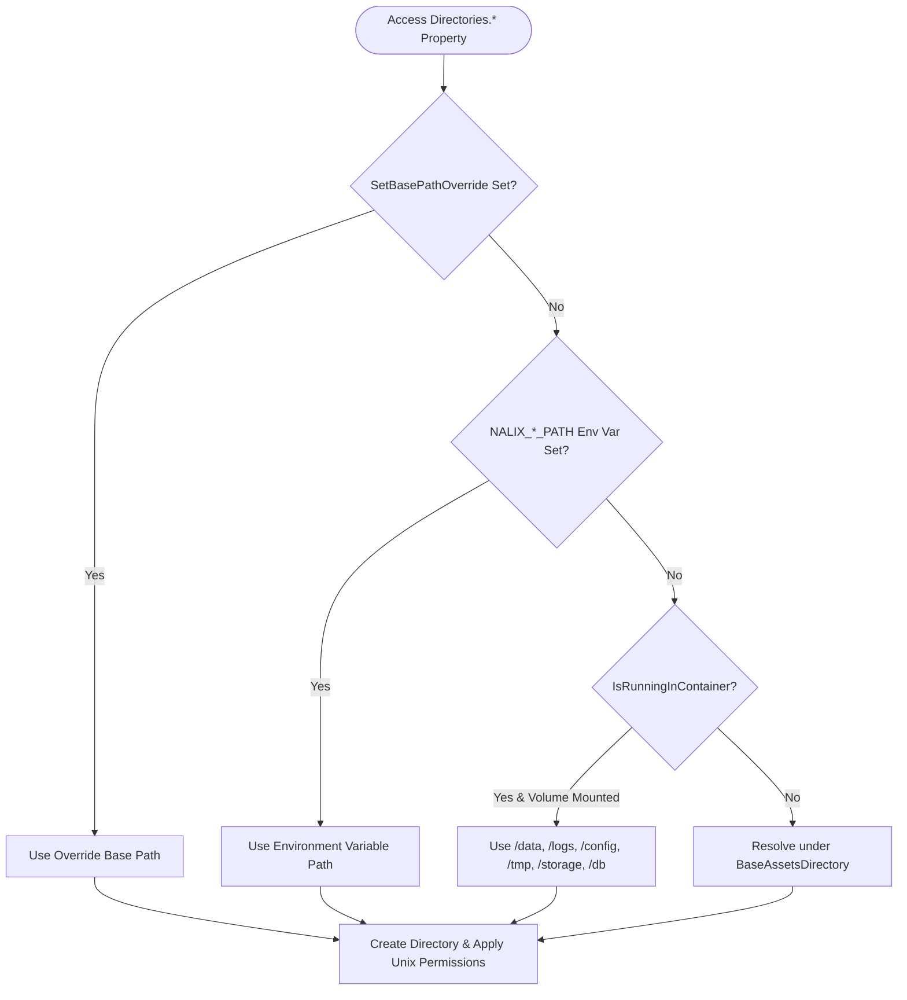

**Namespace:** `Nalix.Environment.IO`  
**Assembly:** `Nalix.Environment`

`Directories` is a thread-safe static utility that resolves, creates, and hardens application directories across Windows, Linux, macOS, and container (Docker/Kubernetes) environments.

## Source Mapping

- `src/Nalix.Environment/IO/Directories.Lazy.cs`
- `src/Nalix.Environment/IO/Directories.Properties.cs`
- `src/Nalix.Environment/IO/Directories.PublicMethods.cs`
- `src/Nalix.Environment/IO/Directories.UnixDirPerms.cs`

## Path Resolution Priority



## Public Properties

| Property | Env Variable Override | Container Volume | Default Path (`BaseAssetsDirectory` Relative) | Unix Mode |
| :--- | :--- | :--- | :--- | :---: |
| `IsRunningInContainer` | `DOTNET_RUNNING_IN_CONTAINER` / `KUBERNETES_SERVICE_HOST` | — | Detects `/.dockerenv` and `/proc/1/cgroup` markers | — |
| `BaseAssetsDirectory` | `NALIX_BASE_PATH` | `/data` | Windows: `%ProgramData%\Nalix`<br/>Unix: `$XDG_DATA_HOME/Nalix` or `~/.local/share/Nalix` | `0750` |
| `LogsDirectory` | `NALIX_LOGS_PATH` | `/logs` | `<BaseAssetsDirectory>/logs` | `0755` |
| `DataDirectory` | `NALIX_DATA_PATH` | `/data` | `<BaseAssetsDirectory>/data` | `0755` |
| `ConfigurationDirectory` | `NALIX_CONFIG_PATH` | `/config` | `<BaseAssetsDirectory>/config` | `0700` |
| `StorageDirectory` | `NALIX_STORAGE_PATH` | `/storage` | `<BaseAssetsDirectory>/storage` | `0750` |
| `DatabaseDirectory` | `NALIX_DB_PATH` | `/db` | `<BaseAssetsDirectory>/db` | `0700` |
| `TemporaryDirectory` | `NALIX_TEMP_PATH` | `/tmp` | `<BaseAssetsDirectory>/data/tmp` (auto-purges files older than `NALIX_TEMP_RETENTION_DAYS`, default `7` days) | `0700` |
| `CacheDirectory` | — | — | `<DataDirectory>/caches` | `0755` |
| `UploadsDirectory` | — | — | `<DataDirectory>/uploads` | `0750` |
| `BackupsDirectory` | — | — | `<DataDirectory>/backups` | `0700` |

## Public Methods

| Method | Signature | Description |
| :--- | :--- | :--- |
| `GetFilePath` | `public static string GetFilePath(string directoryPath, string fileName)` | Combines `directoryPath` and `fileName` while enforcing path-traversal guards (throws `UnauthorizedAccessException` if `fileName` escapes `directoryPath`). |
| `TryWriteNewFile` | `public static bool TryWriteNewFile(string path, string content, bool isPrivate = true)` | Atomically creates and writes `content` to a new file (applying `0600` on Unix when `isPrivate = true`); returns `false` if the file already exists. |
| `DeleteOldFiles` | `public static int DeleteOldFiles(string directoryPath, TimeSpan maxAge, string searchPattern = "*")` | Deletes files older than `maxAge` matching `searchPattern` and returns the number of deleted files. |
| `CanAccessAllDirectories` | `public static bool CanAccessAllDirectories()` | Verifies write permissions across all managed directories using OS ACL inspection on Windows (`GetAccessRules`) and `access(path, W_OK)` on Unix without writing temporary files. |
| `SetBasePathOverride` | `public static void SetBasePathOverride(string path)` | Overrides `BaseAssetsDirectory` for isolated unit/integration tests and resets all lazy directory caches. |

## Usage Example

```csharp
using System;
using Nalix.Environment.IO;

// Resolve a safe file path inside ConfigurationDirectory
string configPath = Directories.GetFilePath(Directories.ConfigurationDirectory, "server.ini");

// Clean up log files older than 30 days
int removed = Directories.DeleteOldFiles(Directories.LogsDirectory, TimeSpan.FromDays(30), "*.log");
```

## Related APIs

- [Configuration (ConfigurationManager)](./configuration.md)
- [Installation](../../installation.md)
