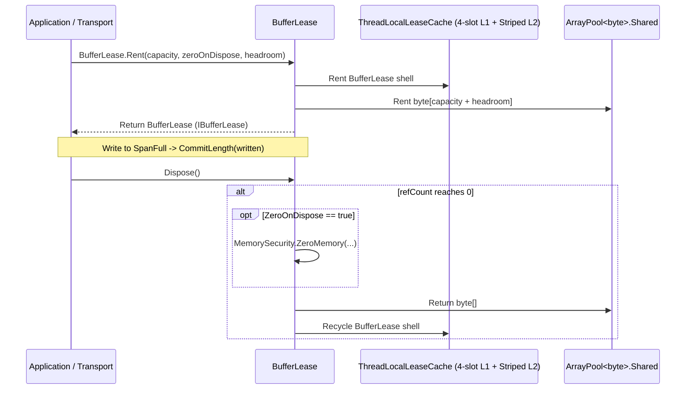

`Nalix.Environment.Memory.BufferLease` and `Nalix.Framework.Memory.Buffers.BufferPoolManager` provide Nalix's zero-allocation byte buffer lifecycle, backed by `ArrayPool<byte>.Shared` with thread-local shell caching and optional GC sentinel leak detection.

## Source Mapping

- `src/Nalix.Abstractions/IBufferLease.cs`
- `src/Nalix.Environment/Memory/BufferLease.cs`
- `src/Nalix.Environment/Options/MemoryOptions.cs`
- `src/Nalix.Framework/Memory/Buffers/BufferPoolManager.cs`
- `src/Nalix.Framework/Options/BufferOptions.cs`

## Architecture Overview



## `BufferPoolManager` (`Nalix.Framework.Memory.Buffers`)

`BufferPoolManager` (`[Injectable(typeof(IBufferPoolManager))]`) implements `IBufferPoolManager` and `IDisposable`. It wraps `ArrayPool<byte>.Shared`, tracks atomic rent/return telemetry (`_rentCount`, `_returnCount`, `_totalBytesRented`), and attaches `BufferSentinel` finalizer trackers when `BufferOptions.EnableBufferLeakDetection` is enabled.

### Constructors, Properties & Methods

| Member | Signature | Description |
| --- | --- | --- |
| `BufferPoolManager` | `public BufferPoolManager(BufferOptions? bufferConfig = null)` | Loads `BufferOptions` (from `ConfigurationManager` when `null`) and validates it. |
| `MaxBufferSize` | `public int MaxBufferSize => 0;` | Returns `0` (sizing is dynamically managed by `ArrayPool<byte>.Shared`). |
| `MinBufferSize` | `public int MinBufferSize => 0;` | Returns `0` (sizing is dynamically managed by `ArrayPool<byte>.Shared`). |
| `Rent` | `public byte[] Rent(int minimumLength = 256)` | Rents a `byte[]` of at least `minimumLength` bytes and records telemetry/leak sentinels. |
| `Return` | `public void Return(byte[]? array, bool arrayClear = false)` | Optionally clears `array` and returns it to `ArrayPool<byte>.Shared`, marking any active leak sentinel as returned. |
| `GenerateReport` | `public string GenerateReport()` | Returns a formatted diagnostic summary of rent/return counts,outstanding buffers, and detected leaks. |
| `WriteReportData` | `public void WriteReportData(Utf8JsonWriter writer)` | Writes structured JSON metrics for observability endpoints. |

## `MemoryOptions` (`Nalix.Environment.Options`)

Configured via `[Memory]` in `default.ini` or `builder.Configure<MemoryOptions>(...)` (`src/Nalix.Environment/Options/MemoryOptions.cs`):

| Property | Type | Default | Validation | Description |
| --- | --- | :---: | --- | --- |
| `MaxWriterCapacity` | `int` | `134_217_728` (`128 MiB`) | `[ValueRange(1024, 1073741824)]` | Maximum growable capacity for `DataWriter` in rented mode. |
| `BufferLeaseThreadLocalCacheMaxSlots` | `int` | `8` | `[ValueRange(1, 1024)]` | Number of L1 `[ThreadStatic]` cache slots per thread for `BufferLease` shells. |
| `BufferLeaseSharedPoolSize` | `int` | `64` | `[ValueRange(16, 65536)]` | Number of L2 striped shared pool slots for `BufferLease` shells. |
| `DataWriterStackAllocThreshold` | `int` | `512` | `[ValueRange(64, 8192)]` | Cutoff in bytes between stack allocation and `BufferLease` renting (`BufferLease.StackAllocThreshold`). |

## `BufferOptions` (`Nalix.Framework.Options`)

Configured via `[Buffer]` in `default.ini` or `builder.Configure<BufferOptions>(...)`:

| Property | Type | Default | Validation | Description |
| --- | --- | :---: | --- | --- |
| `EnableBufferLeakDetection` | `bool` | `false` | — | Attaches a GC finalizer sentinel (`BufferSentinel`) to every rented `byte[]` to detect unreturned buffers. |
| `EnableBufferLeakStackTrace` | `bool` | `false` | — | Captures allocation stack traces when `EnableBufferLeakDetection` is enabled (disable in production benchmarks). |
| `SuspiciousThresholdSeconds` | `int` | `30` | `[ValueRange(0, 3600)]` | Threshold in seconds after which an unreturned buffer is flagged as suspicious in diagnostic reports. |

## Registering `BufferPoolManager` in `Nalix.Hosting`

```csharp
using Nalix.Framework.Memory.Buffers;
using Nalix.Framework.Options;
using Nalix.Hosting;

NetworkApplication app = NetworkApplication.CreateBuilder()
    .Configure<BufferOptions>(opts =>
    {
        opts.EnableBufferLeakDetection = false;
        opts.SuspiciousThresholdSeconds = 30;
    })
    .UseBufferPoolManager(new BufferPoolManager())
    .Build();
```

## Related APIs

- [BufferLease](./buffer-lease.md)
- [Object Pooling (ObjectPoolManager)](../../framework/memory/object-pooling.md)
- [Zero-Allocation Path](../../../concepts/internals/zero-allocation.md)
