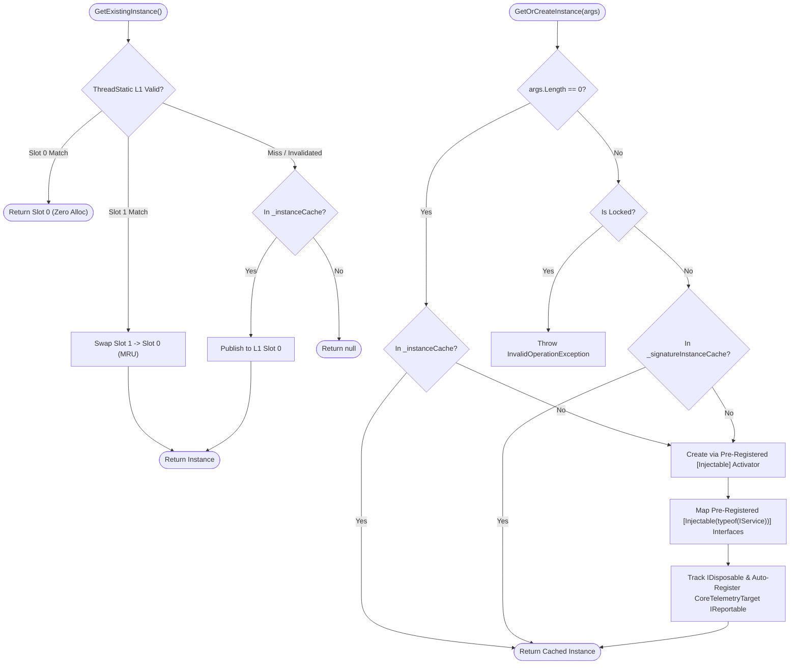

**Namespace:** `Nalix.Framework.Injection`  
**Assembly:** `Nalix.Framework`

`InstanceManager` (`public sealed partial class InstanceManager : SingletonBase<InstanceManager>, IReportable`) is Nalix's high-performance, Native AOT-safe dependency injection registry. It combines a 2-slot MRU `[ThreadStatic]` L1 cache with `RuntimeTypeHandle`-keyed concurrent storage and compile-time activators generated by `InstanceGenerator`.

## Resolution & Registration Flow



## Source Mapping

- `src/Nalix.Framework/Injection/InstanceManager.cs`
- `src/Nalix.Framework/Injection/InstanceManager.Activators.cs`
- `src/Nalix.Framework/Injection/InstanceManager.Types.cs`
- `src/Nalix.Framework/Injection/InstanceManager.Report.cs`
- `analyzers/Nalix.Analyzers.Generators/InstanceGenerator.cs`

## Key Architectural Guarantees

1. **2-Slot MRU `[ThreadStatic]` L1 Cache**: `GetExistingInstance<T>()` checks two thread-local MRU slots (`s_tsKey0`/`s_tsKey1`) guarded by a monotonic invalidation counter (`s_slotsInvalidated`). After warm-up, resolving a service on the packet hot path requires zero allocations and zero locks.
2. **Compile-Time Interface Mapping (`[Injectable]`)**: Interface registrations are explicit and AOT-safe. Annotating a class with `[Injectable(typeof(IMyService))]` causes `InstanceGenerator` to call `InstanceManager.RegisterServiceMapping(typeof(MyService), typeof(IMyService))` in the assembly's `[ModuleInitializer]`. When `Register(new MyService())` or `GetOrCreateInstance<MyService>()` is called, all mapped service interfaces are populated automatically.
3. **100% Native AOT Activators**: Dynamic creation (`GetOrCreateInstance`, `CreateInstance`, `CreateInstanceWithInjection`) uses factory delegates pre-registered via `InstanceManager.RegisterActivator` by `InstanceGenerator`. Attempting to dynamically instantiate a type not decorated with `[Injectable]` throws `InvalidOperationException`.
4. **Hard Cache Caps & `Lockdown()`**: Both `_instanceCache` and `_signatureInstanceCache` enforce a cap of `4096` entries (`MaxCachedInstances = 4096`, `MaxSignatureInstances = 4096`). Calling `Lockdown()` after startup freezes the registry so subsequent `Register<T>`, `RegisterForClassOnly<T>`, `RemoveInstance`, `Clear`, `GetOrCreateInstance(Type, args)`, or `GetOrCreateInstance<T>(args)` (when `args.Length > 0`) calls throw `InvalidOperationException`.
5. **Safe Disposable & Reportable Lifecycle**: Replaced or removed `IDisposable` instances are disposed once (only if no other type handle still references the same instance), and built-in `CoreTelemetryTarget` `IReportable` services (`ITaskManager`, `IConnectionHub`, `IBufferPoolManager`, `IObjectPoolManager`, `ISessionService`, etc.) are automatically registered with `ReportRegistry.Instance` (custom `IReportable` services can register explicitly via `ReportRegistry.Instance.Register(key, instance)`).

## Public API Reference

### Registration & Security

| Method | Signature | Description |
| :--- | :--- | :--- |
| `Register<T>` | `public void Register<T>(T instance) where T : class` | Registers or atomically replaces `instance` under `typeof(T)` and any interfaces mapped via `[Injectable(typeof(IService))]`. Tracks `IDisposable` and built-in `CoreTelemetryTarget` `IReportable` instances. |
| `RegisterForClassOnly<T>` | `public void RegisterForClassOnly<T>(T instance) where T : class` | Alias for `Register<T>(instance)`. |
| `RegisterActivator` | `public static void RegisterActivator(Type type, Func<object?[], object> factory)` | Registers a compile-time factory delegate (invoked automatically by `InstanceGenerator`). |
| `RegisterServiceMapping` | `public static void RegisterServiceMapping(Type concreteType, Type serviceType)` | Maps `concreteType` to `serviceType` (invoked automatically by `InstanceGenerator`). |
| `Lockdown` | `public void Lockdown()` | Freezes the manager state. Subsequent `Register<T>`, `RegisterForClassOnly<T>`, `RemoveInstance`, `Clear()`, `GetOrCreateInstance(Type, args)`, or `GetOrCreateInstance<T>(args)` (when `args.Length > 0`) calls throw `InvalidOperationException`. |

### Resolution & Creation

| Method | Signature | Description |
| :--- | :--- | :--- |
| `GetExistingInstance<T>` | `public T? GetExistingInstance<T>() where T : class` | Lock-free hot-path lookup via the 2-slot MRU `[ThreadStatic]` L1 cache and `_instanceCache`. Returns `null` if not registered. |
| `GetOrCreateInstance<T>` | `public T GetOrCreateInstance<T>(params object?[] args) where T : class` | Returns the cached `T` instance or creates and caches a new one using its `[Injectable]` activator (when `args.Length > 0`, delegates to `GetOrCreateInstance(typeof(T), args)` and enforces `Lockdown()`). |
| `GetOrCreateInstance` | `public object GetOrCreateInstance(Type type, params object?[] args)` | Non-generic resolution/creation by `Type` (uses `ActivatorKey` signature caching when `args` are provided; throws `InvalidOperationException` if `Lockdown()` is active). |
| `CreateInstance` | `public object CreateInstance(Type type, params object?[] args)` | Creates a new instance via its `[Injectable]` activator without caching it. |
| `CreateInstanceWithInjection<T>` | `public T CreateInstanceWithInjection<T>() where T : class` | Creates a new uncached instance of `T` by selecting the greediest public constructor whose parameters can all be resolved from `_instanceCache`. |
| `CreateInstanceWithInjection` | `public object CreateInstanceWithInjection(Type type)` | Non-generic greedy constructor injection overload. |
| `HasInstance<T>` | `public bool HasInstance<T>()` | Returns `true` if `typeof(T)` is currently in `_instanceCache`. |

### Removal, Cleanup & Diagnostics

| Member | Signature | Description |
| :--- | :--- | :--- |
| `CachedInstanceCount` | `public int CachedInstanceCount { get; }` | Total number of cached instances across `_instanceCache` and `_signatureInstanceCache`. |
| `RemoveInstance` | `public bool RemoveInstance(Type type)` | Removes `type` (and its mapped interfaces and signature instances) and disposes the instance if no longer referenced. |
| `Clear` | `public void Clear(bool dispose = true)` | Clears all caches and invalidates L1 slots; disposes tracked `IDisposable` instances when `dispose = true`. |
| `GenerateReport` | `public string GenerateReport()` | Returns a formatted diagnostic table of cached instances, activators, and hit/creation counters. |
| `WriteReportData` | `public void WriteReportData(Utf8JsonWriter writer)` | Writes structured JSON diagnostic metrics. |

## Usage Example

```csharp
using Nalix.Abstractions.Injection;
using Nalix.Framework.Injection;

public interface IPlayerRepository
{
    bool Exists(ulong playerId);
}

[Injectable(typeof(IPlayerRepository))]
public sealed class InMemoryPlayerRepository : IPlayerRepository
{
    public bool Exists(ulong playerId) => playerId != 0;
}

// 1. Register at startup (populates both InMemoryPlayerRepository and IPlayerRepository)
InstanceManager.Instance.Register(new InMemoryPlayerRepository());

// 2. Freeze registrations after startup
InstanceManager.Instance.Lockdown();

// 3. Zero-allocation hot-path resolution
IPlayerRepository? repo = InstanceManager.Instance.GetExistingInstance<IPlayerRepository>();
```

## Related APIs

- [Injection Attributes (`[Injectable]`, `[Inject]`, `[FromScope]`)](../abstractions/injection.md)
- [Instance Generator](../analyzers/autogen/instance-generator.md)
- [SingletonBase\<T\>](./singleton-base.md)
- [Task Manager](./task-manager.md)
