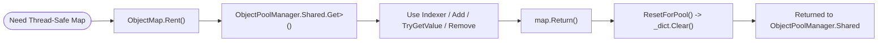

**Namespace:** `Nalix.Framework.Memory.Objects`  
**Assembly:** `Nalix.Framework`

`ObjectMap<TKey, TValue>` (`public sealed class ObjectMap<TKey, TValue> : IObjectMap<TKey, TValue> where TKey : notnull`) is a pooled, thread-safe key-value map backed by `ConcurrentDictionary<TKey, TValue>` and recycled via `ObjectPoolManager.Shared`. It is used for per-connection `IConnection.Attributes` (`IObjectMap<AttributeKey, object>`) and temporary concurrent lookup tables.

## Rent & Return Lifecycle



## Source Mapping

- `src/Nalix.Abstractions/IObjectMap.cs`
- `src/Nalix.Framework/Memory/Objects/ObjectMap.cs`

## Public Static & Instance Members

| Member | Signature | Description |
| :--- | :--- | :--- |
| `Rent()` | `public static ObjectMap<TKey, TValue> Rent()` | Retrieves a cleared `ObjectMap<TKey, TValue>` instance from `ObjectPoolManager.Shared` (requires `ObjectPoolManager.Shared` to be configured). |
| `Return()` | `public void Return()` | Clears the map (`ResetForPool()`) and returns it to `ObjectPoolManager.Shared`. |
| `ResetForPool()` | `public void ResetForPool()` | Clears all entries from the underlying `ConcurrentDictionary<TKey, TValue>` while preserving internal bucket capacity. |
| `this[TKey key]` | `public TValue this[TKey key] { get; set; }` | Gets or sets the value for `key` (setting inserts or overwrites; getting throws `KeyNotFoundException` if missing). |
| `Add(TKey, TValue)` | `public void Add(TKey key, TValue value)` | Adds `(key, value)` to the map; throws `ArgumentException` if `key` already exists. |
| `Add(KeyValuePair)` | `public void Add(KeyValuePair<TKey, TValue> item)` | Adds `item` to the map; throws `ArgumentException` if `item.Key` already exists. |
| `TryGetValue` | `public bool TryGetValue(TKey key, [MaybeNullWhen(false)] out TValue value)` | Attempts to retrieve the value associated with `key`. |
| `ContainsKey` | `public bool ContainsKey(TKey key)` | Returns `true` if `key` exists in the map. |
| `Contains(KeyValuePair)` | `public bool Contains(KeyValuePair<TKey, TValue> item)` | Returns `true` if `item.Key` exists and its value equals `item.Value`. |
| `Remove(TKey)` | `public bool Remove(TKey key)` | Removes `key` from the map; returns `true` if removed. |
| `Remove(KeyValuePair)` | `public bool Remove(KeyValuePair<TKey, TValue> item)` | Removes `item` only if both key and value match. |
| `CopyTo` | `public void CopyTo(KeyValuePair<TKey, TValue>[] array, int arrayIndex)` | Copies the map's key-value pairs to `array` starting at `arrayIndex`. |
| `GetEnumerator()` | `public IEnumerator<KeyValuePair<TKey, TValue>> GetEnumerator()` | Returns a thread-safe enumerator over the map's key-value pairs. |
| `Clear()` | `public void Clear()` | Removes all entries from the map. |
| `Count` | `public int Count { get; }` | Number of elements currently in the map. |
| `Keys` / `Values` | `ICollection<TKey>` / `ICollection<TValue>` | Snapshot collections of keys and values. |
| `IsReadOnly` | `public bool IsReadOnly => false;` | Always returns `false`. |

## Usage Example

```csharp
using Nalix.Framework.Memory.Objects;

ObjectMap<string, ulong> activeRooms = ObjectMap<string, ulong>.Rent();
try
{
    // Use indexer to insert or overwrite safely
    activeRooms["lobby"] = 1001UL;

    // Or Add (throws ArgumentException on duplicate key)
    activeRooms.Add("match-1", 2002UL);

    if (activeRooms.TryGetValue("lobby", out ulong roomId))
    {
        // Use roomId
    }
}
finally
{
    activeRooms.Return();
}
```

:::caution[Do Not Access After `Return()`]
Never read or mutate an `ObjectMap<TKey, TValue>` after calling `Return()`. The instance is immediately cleared and can be rented by another thread.
:::

## Related APIs

- [Object Pooling (ObjectPoolManager)](./object-pooling.md)
- [Typed Object Pools](./typed-object-pools.md)
- [Connection Contracts (IConnection.Attributes)](../../abstractions/connection-contracts.md)
