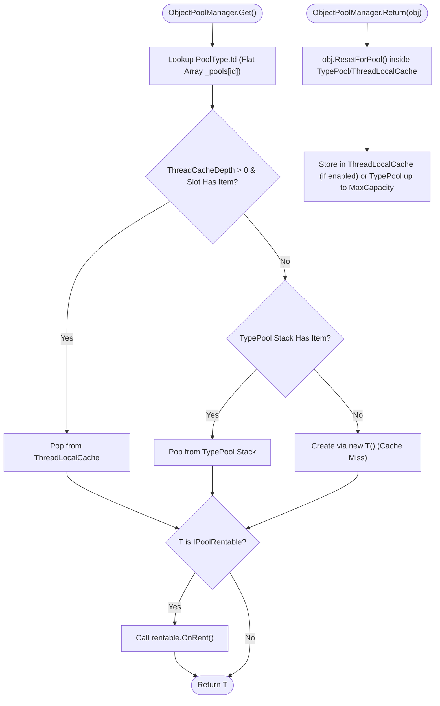

**Namespace:** `Nalix.Framework.Memory.Objects` (and `Nalix.Framework.Options`)  
**Assembly:** `Nalix.Framework`

`ObjectPoolManager` (`[Injectable(typeof(IObjectPoolManager))] public sealed partial class ObjectPoolManager : IObjectPoolManager, IDisposable`) manages reusable class instances implementing `IPoolable` across the Nalix stack (packets, `PacketContext<T>`, `PacketSender`, `ObjectMap<K,V>`, `BufferLease` shells, and socket event args).

## Object Pool Architecture



## Source Mapping

- `src/Nalix.Abstractions/IPoolable.cs`
- `src/Nalix.Abstractions/IObjectPoolManager.cs`
- `src/Nalix.Framework/Memory/Objects/ObjectPoolManager.cs`
- `src/Nalix.Framework/Memory/Objects/ObjectPoolManager.Cleanup.cs`
- `src/Nalix.Framework/Memory/Objects/ObjectPoolManager.Report.cs`
- `src/Nalix.Framework/Memory/Objects/TypedObjectPool.cs`
- `src/Nalix.Framework/Options/ObjectPoolOptions.cs`

## Core Contracts (`IPoolable` & `IPoolRentable`)

```csharp
namespace Nalix.Abstractions;

public interface IPoolable
{
    void ResetForPool();
}

public interface IPoolRentable
{
    void OnRent();
}
```

- **`IPoolable.ResetForPool()`**: Invoked automatically when an object is returned to the pool (`Return<T>(obj)`). Implementations must clear references and reset mutable fields.
- **`IPoolRentable.OnRent()`**: Optional hook invoked by `ObjectPoolManager.Get<T>()` right before returning the rented instance to the caller.
- **Double-Return Protection (`IPoolStateTracked`)**: Objects implementing `IPoolStateTracked` (`MarkRented()` / `TryMarkReturned()`) are checked on `Return<T>(obj)` so duplicate returns are safely rejected (`TotalRejectedReturnCount`).

## `ObjectPoolManager` API Reference

### Static Configuration

| Member | Signature | Description |
| :--- | :--- | :--- |
| `Shared` | `public static ObjectPoolManager Shared { get; }` | Returns the globally configured `ObjectPoolManager` (throws `InvalidOperationException` if accessed before `Configure` is called). |
| `Configure` | `public static void Configure(ObjectPoolManager manager)` | Sets the process-wide `ObjectPoolManager.Shared` instance (wired automatically by `NetworkApplicationBuilder`). |

### Constructors, Properties & Methods

| Member | Signature | Description |
| :--- | :--- | :--- |
| `ObjectPoolManager()` | `public ObjectPoolManager()` | Loads `ObjectPoolOptions` from `ConfigurationManager.Instance` and schedules the recurring `obj.trim` job if `EnableObjectTrimming` is `true`. |
| `ObjectPoolManager(ObjectPoolOptions)` | `public ObjectPoolManager(ObjectPoolOptions config)` | Initializes the pool manager with explicit `ObjectPoolOptions`. |
| `PoolCount` / `PeakPoolCount` | `int` | Current and peak number of distinct type pools managed. |
| `TotalGetOperations` / `TotalReturnOperations` | `long` | Lifetime `Get<T>()` and `Return<T>(obj)` operation counters. |
| `TotalCacheHits` / `TotalCacheMisses` | `long` | Total pool hits versus new allocations (`new T()`). |
| `CacheHitRate` | `double` | Overall cache hit rate percentage (`0.0..100.0`). |
| `Uptime` | `TimeSpan` | Elapsed time since the manager was created or `ResetStatistics()` was called. |
| `UnhealthyPoolCount` | `int` | Number of pools flagged as unhealthy during the most recent `PerformHealthCheck()`. |
| `Get<T>()` | `public T Get<T>() where T : IPoolable, new()` | Rents or creates an instance of `T` via `PoolType<T>.Id` flat-array lookup (preallocates `DefaultPreallocate` items on first access to a new type). |
| `Return<T>(T)` | `public void Return<T>(T obj) where T : IPoolable` | Resets `obj` (`ResetForPool()`) and returns it to the pool (throws `ArgumentNullException` if `obj` is `null`). |
| `GetTypedPool<T>()` | `public TypedObjectPool<T> GetTypedPool<T>() where T : IPoolable, new()` | Returns a `TypedObjectPool<T>` adapter bound to this manager. |
| `Prealloc<T>(int)` | `public int Prealloc<T>(int count) where T : IPoolable, new()` | Preallocates `count` instances into `T`'s pool (`count > 0`) and returns the number of instances added. |
| `SetMaxCapacity<T>(int)` | `public bool SetMaxCapacity<T>(int maxCapacity) where T : IPoolable` | Sets the maximum retained capacity for `T`'s pool (`maxCapacity >= 0`). |
| `GetTypeInfo<T>()` | `public Dictionary<string, object> GetTypeInfo<T>() where T : IPoolable` | Returns a dictionary of metrics (`AvailableCount`, `MaxCapacity`, `TotalGets`, `TotalReturns`, `CacheHitRate`, `Outstanding`, `PeakOutstanding`, `Status`, and lifetime percentiles when `EnableDiagnostics = true`). |
| `ClearPool<T>()` / `ClearAllPools()` | `public int ClearPool<T>()` / `public int ClearAllPools()` | Purges pooled instances and returns the number of removed objects. |
| `PerformHealthCheck()` | `public int PerformHealthCheck()` | Evaluates window miss rates across active pools and returns the number of unhealthy pools. |
| `ResetMetrics()` / `ResetStatistics()` | `public void ResetMetrics()` / `public void ResetStatistics()` | Resets global and per-pool counters. |
| `GenerateReport()` / `WriteReportData` | `public string GenerateReport()` / `public void WriteReportData(Utf8JsonWriter writer)` | Produces human-readable text or structured JSON reports. |

## `ObjectPoolOptions` (`Nalix.Framework.Options`)

Configured via `[ObjectPool]` in `default.ini` or `builder.Configure<ObjectPoolOptions>(...)`:

| Property | Type | Default | Validation | Description |
| :--- | :--- | :---: | :--- | :--- |
| `EnableDiagnostics` | `bool` | `false` | — | Enables `PoolSentinel` tracking for object lifetimes (`Avg`/`p95`/`Max`) and suspicious long-lived rentals. |
| `EnableMetrics` | `bool` | `true` | — | Enables lightweight atomic hit/miss and `Outstanding` counters (safe for production). |
| `CaptureStackTraces` | `bool` | `false` | — | Captures allocation stack traces on `Get<T>()` when `EnableDiagnostics = true` (expensive; use only when debugging leaks). |
| `SuspiciousThresholdSeconds` | `int` | `30` | `[ValueRange(0, 3600)]` | Threshold in seconds after which an unreturned object is flagged as suspicious. |
| `EnableLeakDetection` | `bool` | `false` | — | Uses `PoolSentinel` finalizers to detect rented objects garbage-collected without `Return<T>()` (requires `EnableDiagnostics = true` so `PoolSentinel` instances are attached on `Get<T>()`). |
| `LifetimeReservoirSize` | `int` | `64` | `[ValueRange(16, 1024)]` | Number of recent rental duration samples kept per pool for `p95LifetimeMs` calculation. |
| `EnableObjectTrimming` | `bool` | `true` | — | Schedules a recurring `TaskManager` job (`obj.trim`) to release idle pooled objects. |
| `TrimIntervalMinutes` | `int` | `5` | `[ValueRange(1, 60)]` | Interval in minutes between normal pool trim cycles. |
| `DeepTrimIntervalMinutes` | `int` | `30` | `[ValueRange(5, 120)]` | Interval in minutes between deep/aggressive pool trim cycles. |
| `BaseKeepPercentage` | `int` | `75` | `[ValueRange(50, 90)]` | Percentage of capacity retained during normal trim cycles. |
| `DeepTrimPercentage` | `int` | `25` | `[ValueRange(10, 45)]` | Percentage of capacity retained during deep trim cycles. |
| `TrimDecayFactor` | `double` | `0.5` | `[ValueRange(0.1, 1.0)]` | Fraction of excess objects removed per trim cycle (exponential decay). |
| `HotHitRateThreshold` | `double` | `85.0` | `[ValueRange(75.0, 98.0)]` | Hit-rate percentage above which a pool is treated as "hot" and trimmed lightly. |
| `MinimumKeepObjects` | `int` | `8` | `[ValueRange(4, 64)]` | Minimum floor of objects always kept in each pool during trimming. |
| `DefaultMaxPoolSize` | `int` | `2048` | `[ValueRange(1024, 1_000_000)]` | Default maximum capacity for newly created type pools. |
| `DefaultPreallocate` | `int` | `8` | `[ValueRange(0, 1_000_000)]` | Number of instances preallocated when a type pool is first created. |
| `ThreadCacheDepth` | `int` | `0` | `[ValueRange(0, 4)]` | Per-thread `ThreadLocalCache<T>` depth (`0` = disabled by default so `async`/`await` continuations across ThreadPool threads do not strand pooled objects). |

## `ListPool<T>` (`Nalix.Framework.Memory.Pools`)

`ListPool<T>` (`src/Nalix.Framework/Memory/Pools/ListPool.cs`) is a sealed, thread-safe pool of reusable `List<T>` instances. `ListPool<T>.Instance` is the shared singleton (default max pool size `1024`, initial capacity `16`); a public constructor `ListPool(int maxPoolSize, int initialCapacity)` creates a custom pool.

- `Rent(int minimumCapacity = 0)` / `Return(List<T> list, bool clearItems = true)` — rent and give back a list.
- `Prealloc(int count, int capacity = 0)`, `Trim(int maximumSize = 0)`, `Clear()` — pool maintenance.
- `AvailableCount`, `CreatedCount`, `RentedCount`, `TotalRentOperations`, `TotalReturnOperations`, `TrimmedCount`, `UptimeMs`, `GetStatistics()`, `ResetStatistics()` — statistics.

## Related APIs

- [Typed Object Pools (TypedObjectPool<T>)](./typed-object-pools.md)
- [Object Map (ObjectMap<TKey, TValue>)](./object-map.md)
- [Buffer Management](../../environment/memory/buffer-management.md)
- [Zero-Allocation Path](../../../concepts/internals/zero-allocation.md)
