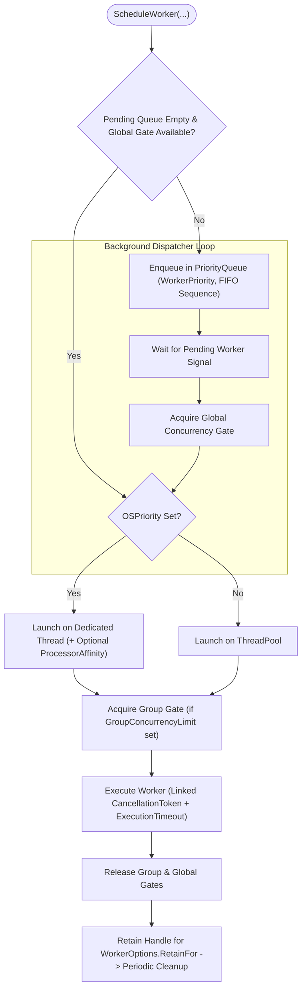

**Namespace:** `Nalix.Framework.Tasks` (and `Nalix.Framework.Options`)  
**Assembly:** `Nalix.Framework`

`TaskManager` (`[Injectable(typeof(ITaskManager))] public sealed partial class TaskManager : ITaskManager, IDisposable`) coordinates one-off/long-running background workers and recurring jobs with global and per-group concurrency gating, priority queuing, CPU-load dynamic concurrency adjustment, and `IReportable` telemetry.

## Source Mapping

- `src/Nalix.Abstractions/Concurrency/ITaskManager.cs`
- `src/Nalix.Framework/Tasks/TaskManager.cs`
- `src/Nalix.Framework/Tasks/TaskManager.PrivateMethods.cs`
- `src/Nalix.Framework/Tasks/TaskManager.Affinity.cs`
- `src/Nalix.Framework/Tasks/TaskManager.Cleanup.cs`
- `src/Nalix.Framework/Tasks/TaskManager.Report.cs`
- `src/Nalix.Framework/Options/TaskManagerOptions.cs`

## Scheduling & Concurrency Architecture

## Public Constructors & Properties

| Member | Type / Signature | Description |
| :--- | :--- | :--- |
| `TaskManager()` | `public TaskManager()` | Initializes `TaskManager` using `ConfigurationManager.Instance.Get<TaskManagerOptions>()`. |
| `TaskManager(TaskManagerOptions?)` | `public TaskManager(TaskManagerOptions? options = null)` | Initializes `TaskManager` with explicit `TaskManagerOptions` and validates it. |
| `Title` | `string` | Compact status summary (`"Workers: X running / Y total \| Recurring: Z"`). |
| `ConcurrencyLimitRatio` | `double` | Ratio (`0.0..1.0`) of the current dynamic concurrency limit relative to `TaskManagerOptions.MaxWorkers`. |
| `AverageWorkerUptime` | `double` | Average execution duration of completed workers in milliseconds. |
| `AverageRecurringExecutionTime` | `double` | Average execution duration of recurring job runs in milliseconds. |
| `AverageWorkerWaitTime` | `double` | Average queue wait time before workers start executing, in milliseconds. |
| `P95WorkerUptime` | `double` | Approximate 95th percentile worker execution time in milliseconds. |
| `P99WorkerUptime` | `double` | Approximate 99th percentile worker execution time in milliseconds. |
| `PeakRunningWorkerCount` | `int` | High-water mark of concurrently running workers. |
| `WorkerErrorCount` | `int` | Total number of unhandled worker exceptions observed. |
| `RecurringErrorCount` | `int` | Total number of unhandled recurring task exceptions observed. |

## Public Methods

### Scheduling & Execution

| Method | Signature | Description |
| :--- | :--- | :--- |
| `ScheduleWorker` (async delegate) | `public IWorkerHandle ScheduleWorker(string name, string group, Func<IWorkerContext, CancellationToken, ValueTask> work, IWorkerOptions? options = null)` | Schedules a managed worker with global/group gating, priority queueing, and progress tracking. |
| `ScheduleWorker` (`IWorker`) | `public IWorkerHandle ScheduleWorker(IWorker worker)` | Schedules an `IWorker` instance, reading `[Worker(name, group, ...)]` metadata if present (returns `NoOpWorkerHandle.Instance` when `Enabled = false`). |
| `ScheduleWorker<TState>` (fire-and-forget) | `public void ScheduleWorker<TState>(string name, Action<TState> work, TState state)` | Queues a lightweight state callback directly onto `ThreadPool.UnsafeQueueUserWorkItem` while tracking completion/error telemetry. |
| `ScheduleRecurring` | `public IRecurringHandle ScheduleRecurring(string name, TimeSpan interval, Func<CancellationToken, ValueTask> work, IRecurringOptions? options = null)` | Starts a named recurring background loop (`interval > TimeSpan.Zero`; throws `InternalErrorException` on duplicate `name`). |
| `RunOnceAsync` | `public ValueTask RunOnceAsync(string name, Func<CancellationToken, ValueTask> work, CancellationToken ct = default)` | Executes `work` inline once with diagnostic failure logging. |

### Runtime Control, Cancellation & Queries

| Method | Signature | Description |
| :--- | :--- | :--- |
| `SetGroupConcurrencyLimit` | `public void SetGroupConcurrencyLimit(string group, int limit)` | Dynamically updates the maximum concurrent workers allowed for `group` at runtime. |
| `PauseRecurring` | `public void PauseRecurring(string name)` | Pauses scheduled executions of the recurring job `name` until `ResumeRecurring` is called. |
| `ResumeRecurring` | `public void ResumeRecurring(string name)` | Resumes a previously paused recurring job. |
| `CancelWorker` | `public void CancelWorker(ISnowflake id)` | Cancels a specific worker by its `ISnowflake` identifier. |
| `CancelGroup` | `public int CancelGroup(string group)` | Cancels all workers in `group` and returns the number of workers cancelled. |
| `CancelAllWorkers` | `public int CancelAllWorkers()` | Cancels all active workers and returns the number of workers cancelled. |
| `CancelRecurring` | `public void CancelRecurring(string? name)` | Cancels and removes a recurring job by `name`. |
| `GetWorkers` | `public IReadOnlyCollection<IWorkerHandle> GetWorkers(bool runningOnly = true, string? group = null)` | Returns a snapshot of workers, optionally filtered by `runningOnly` and exact `group` match. |
| `TryGetWorker` | `public bool TryGetWorker(ISnowflake id, [NotNullWhen(true)] out IWorkerHandle? handle)` | Looks up a worker handle by its `ISnowflake` ID. |
| `GetRecurring` | `public IReadOnlyCollection<IRecurringHandle> GetRecurring()` | Returns a snapshot of all registered recurring jobs. |
| `TryGetRecurring` | `public bool TryGetRecurring(string name, [NotNullWhen(true)] out IRecurringHandle? handle)` | Looks up a recurring job handle by `name`. |
| `WaitGroupAsync` | `public Task WaitGroupAsync(string group, CancellationToken ct = default)` | Waits for all current workers in `group` to finish (supports prefix wildcard matching when `group` ends with `*`, e.g. `"net.*"`). |
| `GenerateReport` / `WriteReportData` | `public string GenerateReport()` / `public void WriteReportData(Utf8JsonWriter writer)` | Emits human-readable text or structured JSON diagnostics. |

## `TaskManagerOptions` (`Nalix.Framework.Options`)

Configured via `[TaskManager]` in `default.ini` or `builder.Configure<TaskManagerOptions>(...)`:

| Property | Type | Default | Validation | Description |
| :--- | :--- | :---: | :--- | :--- |
| `IsEnableLatency` | `bool` | `true` | — | Enables execution latency and wait-time histogram tracking. |
| `DynamicAdjustmentEnabled` | `bool` | `true` | — | Starts the internal `task.monitor` worker to scale global concurrency based on CPU load. |
| `MaxWorkers` | `int` | `100` | `> 0` | Global maximum number of concurrent workers. |
| `ThresholdHighCpu` | `double` | `80.0` | `[ValueRange(0.0, 100.0)]` | CPU utilization percentage above which global concurrency is reduced (`>= ThresholdLowCpu`). |
| `ThresholdLowCpu` | `double` | `40.0` | `[ValueRange(0.0, 100.0)]` | CPU utilization percentage below which global concurrency is increased back toward `MaxWorkers`. |
| `ObservingInterval` | `TimeSpan` | `00:00:05` (`5s`) | `> TimeSpan.Zero` | Interval between CPU load observations. |
| `CpuWarmupDuration` | `TimeSpan` | `00:01:00` (`60s`) | `>= TimeSpan.Zero` | Startup warm-up period before dynamic CPU concurrency adjustments begin. |
| `AdjustmentStreakRequired` | `int` | `3` | `[ValueRange(1, 64)]` | Consecutive high/low CPU samples required before adjusting concurrency (hysteresis). |
| `BusyWaitThreshold` | `TimeSpan` | `200 µs` (`2000` ticks) | `>= TimeSpan.Zero` | Maximum high-precision spin-wait threshold for recurring timers. |
| `BackoffMaxPower` | `int` | `5` (`32x`) | `[ValueRange(0, 16)]` | Maximum exponent ($2^n$) for recurring task failure backoff. |
| `BackoffBaseInterval` | `TimeSpan` | `00:00:01` (`1s`) | `>= 10 ms` | Base interval multiplied by $2^{\text{failures}}$ during recurring task backoff. |
| `CleanupInterval` | `TimeSpan` | `00:00:30` (`30s`) | `>= 1 s` | Interval at which completed workers past their `RetainFor` window are purged. |

## Related APIs

- [WorkerOptions](./options/worker-options.md)
- [RecurringOptions](./options/recurring-options.md)
- [Concurrency Contracts (ITaskManager, IWorker)](../abstractions/concurrency-contracts.md)
