**Namespaces:** `Nalix.Hosting`, `Nalix.Hosting.Protocols`  
**Assembly:** `Nalix.Hosting`

`Nalix.Hosting` provides a Microsoft-style fluent builder (`INetworkApplicationBuilder` / `NetworkApplicationBuilder`) and server host (`NetworkApplication`) that orchestrate configuration loading, dependency registration, compile-time packet handler wiring, and multi-transport listener lifecycles (TCP, UDP, and WebSocket).

## Source Mapping

- `src/Nalix.Hosting/NetworkApplication.cs`
- `src/Nalix.Hosting/INetworkApplicationBuilder.cs`
- `src/Nalix.Hosting/NetworkApplicationBuilder.cs`
- `src/Nalix.Hosting/NetworkApplicationBuilder.Extensions.cs`
- `src/Nalix.Hosting/IProtocolBindingBuilder.cs`
- `src/Nalix.Hosting/IWebSocketBindingBuilder.cs`
- `src/Nalix.Hosting/Protocols/DefaultProtocol.cs`
- `src/Nalix.Hosting/Protocols/DefaultFrameProcessor.cs`
- `src/Nalix.Hosting/Protocols/DefaultOpCodeExtractor.cs`

## Startup & Lifecycle Flow

```mermaid
flowchart LR
    subgraph Phase1["1. Fluent Configuration"]
        CB["NetworkApplication.CreateBuilder()"] --> Opts["Configure<TOptions>() / UseLogger()"]
        Opts --> Feat["UseSecureConnections() / UseSessions() / UseGroups()"]
        Feat --> Map["MapHandlers<THandler>() / RegisterScoped<T>()"]
        Map --> Bind["MapTcp<T>() / MapUdp<T>() / MapWebSocket<T>().Bind()"]
    end

    subgraph Phase2["2. Build()"]
        Bind --> Bld["Build()"]
        Bld --> RegPkt["RegisterPacketRegistry() + ApplyOptions()"]
        RegPkt --> Factories["Capture Dispatch & Listener Factories"]
    end

    subgraph Phase3["3. ActivateAsync() / RunAsync()"]
        Factories --> Prep["Register Logger, Hub, Guard, BufferPool, ObjectPool"]
        Prep --> Disp["Create & Activate IPacketDispatch"]
        Disp --> Listen["Construct & Activate TCP / UDP / WebSocket Listeners"]
    end
```



## `NetworkApplication` Reference

```csharp
public sealed class NetworkApplication : IActivatableAsync, IAsyncDisposable
{
    public static NetworkApplicationBuilder CreateBuilder();
    public static NetworkApplication CreateMinimal(ushort? port = null);

    public Task RunAsync(CancellationToken cancellationToken = default);
    public Task ActivateAsync(CancellationToken cancellationToken = default);
    public Task DeactivateAsync(CancellationToken cancellationToken = default);
    public ValueTask DisposeAsync();
    public void Dispose();
}
```

### Method Details

| Method | Description |
| :--- | :--- |
| `CreateBuilder()` | Creates a new `NetworkApplicationBuilder` initialized with an empty `HostingBuilderContext`. |
| `CreateMinimal(ushort? port = null)` | Creates a ready-to-run `NetworkApplication` bound to `MapTcp<DefaultProtocol>()` on `port` (or `NetworkSocketOptions.Port` when `null`). Note: runtime assembly scanning is omitted for Native AOT safety; handlers are resolved via the compile-time `PacketHandlerRegistry` or `MapHandlers<T>()`. |
| `ActivateAsync(CancellationToken)` | Acquires the lifecycle gate, invokes `PrepareCallbacks` (registering `ILogger`, `IConnectionHub`, `IConnectionGuard`, `IBufferPoolManager`, and `IObjectPoolManager`), creates and activates `IPacketDispatch`, constructs each bound listener (`TcpServerListener`, `UdpServerListener`, `UdpPassthroughListener`, `WebSocketServerListener`), registers them in `ReportRegistry`, and activates them. Rolls back partial activation on failure. |
| `RunAsync(CancellationToken)` | Calls `ActivateAsync(cancellationToken)`, awaits `Task.Delay(Timeout.InfiniteTimeSpan, cancellationToken)`, and guarantees `DeactivateAsync(CancellationToken.None)` in a `finally` block. |
| `DeactivateAsync(CancellationToken)` | Deactivates and disposes all listeners in reverse registration order, disposes all protocols in reverse order, deactivates `IPacketDispatch`, and awaits `TaskManager.WaitGroupAsync("net/*", ct)` and `WaitGroupAsync("time/*", ct)` so no background workers leak across restarts. |
| `DisposeAsync()` / `Dispose()` | Idempotently invokes `DeactivateAsync(CancellationToken.None)` and disposes the internal `SemaphoreSlim` gate. |

---

## `INetworkApplicationBuilder` Reference

### Core Builder Methods

| Method | Description |
| :--- | :--- |
| `Configure<TOptions>(Action<TOptions>)` | Queues a configuration mutator for `TOptions : ConfigurationLoader, new()`. During `Build()`, resolves `ConfigurationManager.Instance.Get<TOptions>()`, runs the delegate, calls `Validate()` if `TOptions` implements `IValidatableConfiguration`, and marks the option type as manually configured. |
| `ConfigureDispatchOptions(Action<PacketDispatchOptions<IPacket>>)` | Registers a callback to configure middleware, rate limiters, handler result stages, or custom error handling on [PacketDispatchOptions&lt;IPacket&gt;](../options/runtime/packet-dispatch-options.md). |
| `ConfigureDispatch(Func<Action<PacketDispatchOptions<IPacket>>, IPacketDispatch>)` | Replaces the default `PacketDispatchChannel` with a custom `IPacketDispatch` implementation (e.g., synchronous `PacketRouter`). |
| `UseLogger(ILogger)` | Registers `logger` into `InstanceManager` immediately and attaches the internal `DiagnosticChannel` event listener. |
| `UseConnectionHub(IConnectionHub)` | Registers a custom `IConnectionHub` (and `IConnectionBroadcaster` if implemented). When omitted, a default `ConnectionHub` is created during `ActivateAsync`. |
| `UseConnectionGuard(IConnectionGuard)` | Registers a custom `IConnectionGuard` (and `IProofOfWorkPolicy` if implemented). When omitted, a default `ConnectionGuard` is created during `ActivateAsync`. |
| `UseBufferPoolManager(IBufferPoolManager)` | Registers a custom `IBufferPoolManager` and binds `BufferLease.ByteArrayPool`. |
| `UseObjectPoolManager(IObjectPoolManager)` | Registers a custom `IObjectPoolManager` and configures `BufferLease`, `PacketRegistry`, and `ObjectPoolManager`. |
| `RegisterScoped<TService>(Func<IPacketScope, TService>)` | Registers a per-packet scoped service factory (`where TService : class`) in `ScopedServiceRegistry.Instance` for `[FromScope]` handler parameters. |
| `MapHandlers<THandler>()` | Validates and registers a `[PacketController]` class constructed via `InstanceManager.Instance.CreateInstanceWithInjection(typeof(THandler))`. |
| `MapHandlers<THandler>(Func<THandler>)` | Validates and registers a `[PacketController]` class constructed via an explicit factory delegate. |
| `MapHandlers(Type)` | Validates and registers a `[PacketController]` type directly (supports static handler classes). |
| `MapTcp<TProtocol>()` | Begins a fluent TCP listener binding (`IProtocolBindingBuilder`) for `TProtocol : class, IProtocol`. |
| `MapUdp<TProtocol>()` | Begins a fluent UDP listener binding (`IProtocolBindingBuilder`) for `TProtocol : class, IProtocol`. |
| `MapWebSocket<TProtocol>()` | Begins a fluent WebSocket listener binding ([IWebSocketBindingBuilder](./websocket-binding.md)) for `TProtocol : class, IProtocol`. |
| `Build()` | Applies options, registers the compile-time packet registry, and returns a configured `NetworkApplication`. |

:::warning[Obsolete Binding Methods]
`ListenTcp<TProtocol>()`, `ListenUdp<TProtocol>()`, and `ListenWebSocket<TProtocol>()` are marked `[Obsolete]` in `INetworkApplicationBuilder`. Always use `MapTcp<TProtocol>()`, `MapUdp<TProtocol>()`, and `MapWebSocket<TProtocol>()` in new code.
:::

---

## Feature Extension Methods (`NetworkApplicationBuilderExtensions`)

`Nalix.Hosting` provides opt-in extension methods on `INetworkApplicationBuilder` for built-in runtime subsystems:

| Extension Method | Registered Handlers & Services |
| :--- | :--- |
| `UseTimeSync()` | Maps `SystemTimeSyncHandlers` (`ControlType.TIMESYNCREQUEST`). |
| `UseSystemControl()` | Idempotently maps `SystemControlHandlers` (`PING`, `DISCONNECT`, `CIPHER_UPDATE`, `PUBLIC_KEY_REQUEST`, etc.). |
| `UseSecureConnections(string? certificatePath = null)` | Registers `FileCertificateStore` as `ICertificateStore` (if none exists), idempotently maps `HandshakeHandlers`, `ProofOfWorkHandlers`, and `SystemControlHandlers`, and initializes the static X25519 server certificate (`HandshakeHandlers.SetCertificatePath(certificatePath)` or `HandshakeHandlers.Initialize()`). |
| `UseSessions()` | Maps `SessionHandlers` and calls `ServiceRegistrar.RegisterSessions()` to register `ISessionService` (`SessionService`) and `SessionPersistenceObserver`. |
| `UseGroups()` | Calls `ServiceRegistrar.RegisterGroups()` to register `IConnectionGroupRegistry` (`InMemoryGroupStore`) and `GroupMembershipObserver`. |
| `UseSessionService(SessionService)` | Registers a custom `SessionService` instance as `ISessionService`. |
| `UseSessionStore(ISessionStore)` | Registers a custom `ISessionStore` backing store (e.g., Redis) for `SessionService`. |
| `UseSessionFactory(ISessionFactory)` | Registers a custom `ISessionFactory` for `SessionService`. |

---

## `IProtocolBindingBuilder` Reference (TCP & UDP)

`MapTcp<TProtocol>()` and `MapUdp<TProtocol>()` return an `IProtocolBindingBuilder`:

```csharp
public interface IProtocolBindingBuilder
{
    IProtocolBindingBuilder OnPort(ushort port);
    IProtocolBindingBuilder WithMode(OperatingMode mode);
    IProtocolBindingBuilder WithFactory(Func<IPacketDispatch, IProtocol> factory);
    IProtocolBindingBuilder WithAuthentication(Func<IConnection, EndPoint, ReadOnlySpan<byte>, bool> authen);
    INetworkApplicationBuilder Bind();
}
```

| Method | Applies To | Description |
| :--- | :--- | :--- |
| `OnPort(ushort port)` | TCP & UDP | Overrides `NetworkSocketOptions.Port` (`57206`) for this specific listener binding. |
| `WithFactory(Func<IPacketDispatch, IProtocol>)` | TCP & UDP | Supplies a custom factory to instantiate `TProtocol`. When omitted, `NetworkApplicationBuilder` automatically resolves constructors matching `(ILogger, IPacketDispatch)`, `(IPacketDispatch, ILogger)`, `(IPacketDispatch)`, or `()`. |
| `WithMode(OperatingMode mode)` | UDP only | Selects `OperatingMode.Server` (`0`, default authenticated `UdpListenerBase`) or `OperatingMode.Passthrough` (`1`, raw `UdpPassthroughListener` without Nalix session/MAC framing). |
| `WithAuthentication(Func<IConnection, EndPoint, ReadOnlySpan<byte>, bool>)` | UDP (`Server` mode) | Supplies a custom datagram authentication predicate for `UdpServerListener`. Throws `InvalidOperationException` if combined with `OperatingMode.Passthrough`. |
| `Bind()` | TCP & UDP | Finalizes the binding and returns the parent `INetworkApplicationBuilder`. |

---

## `DefaultProtocol` Reference

For applications that route all frames directly into `IPacketDispatch` without custom protocol-level state machines, `Nalix.Hosting.Protocols.DefaultProtocol` eliminates the need to write a custom `Protocol` subclass:

```csharp
[Injectable]
public sealed class DefaultProtocol : Protocol
{
    public DefaultProtocol(ILogger logger, IPacketDispatch dispatch);
    public override IFrameProcessor FrameProcessor { get; }
    public override IOpCodeExtractor OpCodeExtractor { get; }
    public override void ProcessMessage(object? sender, IConnectionEventArgs args);
}
```

- Sets `IsAccepting = true` and `KeepConnectionOpen = true` on construction.
- Uses `DefaultFrameProcessor` and `DefaultOpCodeExtractor` (reading `payload.AsHeaderRef().OpCode` from `PacketHeader`).
- Forwards `args.Lease` and `args.Connection` directly to `_dispatch.HandlePacket(args.Lease, args.Connection)`.

---

## Production Usage Example

```csharp
using System.Threading;
using System.Threading.Tasks;
using Microsoft.Extensions.Logging;
using Nalix.Hosting;
using Nalix.Hosting.Protocols;
using Nalix.Network.Options;
using Nalix.Runtime.Middleware;

public static class Program
{
    public static async Task Main(string[] args)
    {
        using ILoggerFactory loggerFactory = LoggerFactory.Create(b => b.AddConsole());
        ILogger logger = loggerFactory.CreateLogger("GameServer");

        await using NetworkApplication app = NetworkApplication.CreateBuilder()
            .UseLogger(logger)
            .Configure<NetworkSocketOptions>(opt =>
            {
                opt.Port = 57206;
                opt.EnableDualStack = true;
            })
            .UseSecureConnections()
            .UseSessions()
            .UseGroups()
            .UseTimeSync()
            .ConfigureDispatchOptions(dispatch =>
            {
                dispatch.WithMiddleware(new TokenBucketMiddleware());
            })
            .MapHandlers<PlayerController>()
            .MapTcp<DefaultProtocol>().OnPort(57206).Bind()
            .MapUdp<DefaultProtocol>().OnPort(57206).Bind()
            .Build();

        using CancellationTokenSource cts = new();
        Console.CancelKeyPress += (_, e) =>
        {
            e.Cancel = true;
            cts.Cancel();
        };

        await app.RunAsync(cts.Token);
    }
}
```

## Related APIs

- [WebSocket Hosting Binding](./websocket-binding.md)
- [Hosting Options](../options/hosting/hosting-options.md)
- [Protocol](../network/protocol.md)
- [TCP Listener](../network/tcp-listener.md)
- [UDP Listener](../network/udp-listener.md)
- [Packet Dispatch Channel & Router](../runtime/routing/dispatch-channel-and-router.md)
- [Packet Dispatch Options](../options/runtime/packet-dispatch-options.md)
