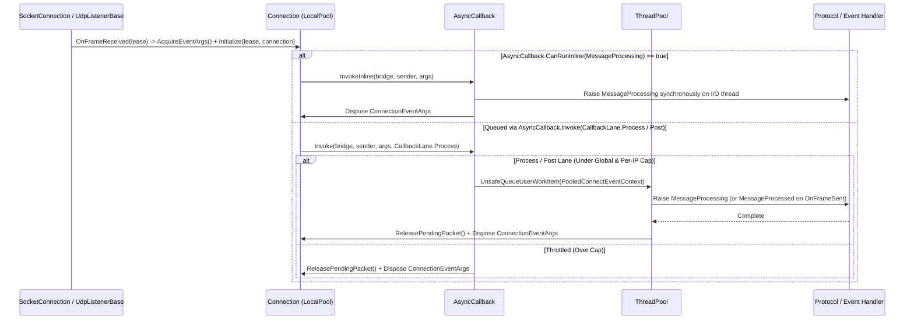

**Namespace:** `Nalix.Network.Connections`  
**Assembly:** `Nalix.Network`

Network events on `IConnection` (`MessageProcessing`, `MessageProcessed`, and `ConnectionClosed`) are carried by pooled `ConnectionEventArgs` instances and scheduled through the internal `AsyncCallback` multi-lane dispatcher (`CallbackLane.Process`, `CallbackLane.Post`, and `InvokeHighPriority`).

## Source Mapping

- `src/Nalix.Abstractions/Networking/IConnectionEventArgs.cs`
- `src/Nalix.Network/Connections/Connection.EventArgs.cs`
- `src/Nalix.Network/Connections/Connection.cs`
- `src/Nalix.Network/Internal/Transport/AsyncCallback.cs`
- `src/Nalix.Network/Options/NetworkCallbackOptions.cs`

## Event Execution Pipeline



## `ConnectionEventArgs` (`public sealed class`)

```csharp
namespace Nalix.Network.Connections;

public sealed class ConnectionEventArgs : EventArgs, IConnectionEventArgs, IPoolable, IPoolRentable
{
    public IBufferLease? Lease { get; }
    public IConnection Connection { get; }
    public INetworkEndpoint NetworkEndpoint { get; }

    public IBufferLease? ExchangeLease([Borrowed] IBufferLease? newLease);
    public void OnRent();
    public void ResetForPool();
    public void Dispose();
}
```

- **`ExchangeLease(newLease)`**: Atomically swaps the underlying `IBufferLease?` (used by `TcpListenerBase` / `WebSocketListenerBase` after `FramePipeline.ProcessInbound` decrypts or decompresses an inbound frame in place) and returns the previous lease so the caller can dispose it.
- **Two-Tier Pooling**: `Connection` and `WebSocketConnection` maintain an 8-slot lock-free `LocalPool` for `ConnectionEventArgs` and `PooledConnectEventContext`, falling back to `ObjectPoolManager.Shared` when the per-connection local pool is full.

:::warning[Never Retain `ConnectionEventArgs`]
`ConnectionEventArgs` and its `Lease` are automatically returned to the pool as soon as the event bridge completes (unless ownership of `Lease` was transferred via `Retain()` or `ExchangeLease(null)`). Never store `args` after the handler returns.
:::

## Three Dispatch Lanes in `AsyncCallback`

| Event | `AsyncCallback` Lane | Global Cap | Per-IP Cap | Behavior |
| :--- | :--- | ---: | ---: | :--- |
| `MessageProcessing` | `CallbackLane.Process` (or `InvokeInline`) | `MaxPendingNormalCallbacks` (`10,000`) | `MaxPendingPerIp` (`64`) | Decrypts/decompresses frame (`FramePipeline.ProcessInbound`), verifies sequence, and invokes `IProtocol.ProcessMessage`. Executes inline via `AsyncCallback.CanRunInline` / `InvokeInline` when bound to a single `IFrameProcessor { SupportsInlineProcessing: true }` subscriber. |
| `MessageProcessed` | `CallbackLane.Post` | `MaxPendingPostCallbacks` (`5,000`) | `MaxPendingPostPerIp` (`32`) | Triggered by `Connection.OnFrameSent` when an outbound frame send completes; invokes `IProtocol.PostProcessMessage` (metrics & `KeepConnectionOpen` teardown). |
| `ConnectionClosed` | `InvokeHighPriority` | Unbounded | Unbounded | Bypasses all normal/post backpressure gates so disconnect cleanup and unregistration never stall under flood conditions. |

### Per-IP Fairness Accounting (`FairnessMapSize = 16384`)

`AsyncCallback` hashes `IConnectionEventArgs.NetworkEndpoint` into fixed-size `long[FairnessMapSize]` arrays (`s_perIpProcessMap` and `s_perIpPostMap`, default `16,384` slots), packing `((long)(uint)hash << 32) | count` into each 64-bit slot to track pending callbacks per remote IP without heap allocations. Slow callbacks exceeding `MaxCallbackExecutionMs` (`50` ms) are counted in `AsyncCallbackMetrics.SlowCallbacks` and logged via throttled diagnostics.

## Related APIs

- [Connection](./connection.md)
- [Socket Connection](../socket-connection.md)
- [Network Callback Options](../../options/network/network-callback-options.md)
