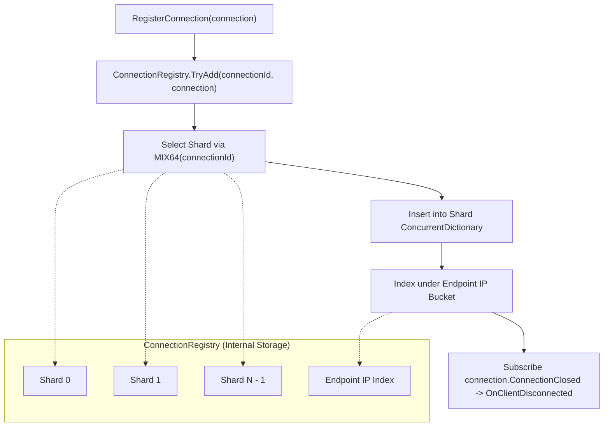

**Namespace:** `Nalix.Network.Connections`  
**Assembly:** `Nalix.Network`

`ConnectionHub` (`public sealed partial class ConnectionHub : IConnectionHub, IConnectionBroadcaster`) is the central thread-safe registry for all active client connections. It delegates storage to a sharded `ConnectionRegistry`, tracks 1-second rolling ingress/egress throughput (`"hub.throughput"`), and provides zero-allocation snapshot broadcasting.

## Source Mapping

- `src/Nalix.Abstractions/Networking/IConnectionHub.cs`
- `src/Nalix.Abstractions/Networking/IConnectionBroadcaster.cs`
- `src/Nalix.Abstractions/Networking/IConnectionSender.cs`
- `src/Nalix.Abstractions/Networking/IConnectionGroupRegistry.cs`
- `src/Nalix.Network/Connections/ConnectionHub.cs`
- `src/Nalix.Network/Connections/ConnectionHub.Broadcast.cs`
- `src/Nalix.Network/Internal/Connections/ConnectionRegistry.cs`
- `src/Nalix.Runtime/Extensions/ConnectionExtensions.Broadcast.cs`

## Architecture



## Public Properties, Events & Methods (`IConnectionHub`)

| Member | Signature | Description |
| :--- | :--- | :--- |
| `RecurringName` | `public static readonly string RecurringName = "hub.throughput";` | Name prefix for the 1-second recurring throughput calculation task. |
| `Count` | `public int Count { get; }` | Total number of active connections across all shards. |
| `ConnectionUnregistered` | `public event Action<IConnection>? ConnectionUnregistered;` | Raised after a connection is removed from `ConnectionRegistry` (observed by `SessionPersistenceObserver`). |
| `RegisterConnection` | `public void RegisterConnection(IConnection connection)` | Registers `connection`, sets `ConnectionAttributes.OwnerHub`, and subscribes to `connection.ConnectionClosed`. Throws `ObjectDisposedException` if the hub is disposed or `InternalErrorException` on duplicate `ConnectionId`. |
| `UnregisterConnection` | `public void UnregisterConnection(IConnection connection)` | Removes `connection` from its shard and endpoint index, detaches `ConnectionClosed`, and fires `ConnectionUnregistered`. |
| `GetConnection(ulong)` | `public IConnection? GetConnection(ulong id)` | $O(1)$ shard lookup by 64-bit `ConnectionId`. |
| `GetConnection(ReadOnlySpan<byte>)` | `public IConnection? GetConnection(ReadOnlySpan<byte> id)` | Reads an 8-byte little-endian `ulong` (`BinaryPrimitives.ReadUInt64LittleEndian(id)`) and looks up the connection (used on the UDP datagram hot path). |
| `ListConnections()` | `public IReadOnlyCollection<IConnection> ListConnections()` | Returns a point-in-time snapshot of all active connections. |
| `ListConnections(INetworkEndpoint)` | `public IReadOnlyCollection<IConnection> ListConnections(INetworkEndpoint networkEndpoint)` | Returns active connections matching `networkEndpoint` via the secondary IP index. |
| `GenerateReport` / `WriteReportData` | `public string GenerateReport()` / `public void WriteReportData(Utf8JsonWriter writer)` | Emits connection counts, shard count, ingress/egress B/s, cipher/permission breakdowns, `AsyncCallback` queue stats, and `TimingWheel` stats. |
| `Dispose` | `public void Dispose()` | Stops the throughput task and disposes all registered connections in parallel (`ConnectionHubOptions.ParallelDisconnectDegree`). |

## Broadcasting & Group Multicast (`IConnectionBroadcaster`)

### 1. Packet-Based Broadcast & Multicast (Recommended)

Use the `ConnectionExtensions` methods in `Nalix.Runtime.Extensions`, which serialize and LZ4-compress the packet **once** and apply AEAD encryption per connection:

```csharp
using Nalix.Abstractions.Networking;
using Nalix.Runtime.Extensions;

IConnectionHub hub = /* resolved from InstanceManager */;
IConnectionGroupRegistry groups = /* resolved when .UseGroups() is enabled */;

// 1. Broadcast to all active connections
await hub.BroadcastAsync(serverNoticePacket, NetworkTransport.TCP, enableEncrypt: true, ct);

// 2. Multicast to a named group
await hub.MulticastAsync(groups, "lobby:eu-1", roomStatePacket, NetworkTransport.TCP, enableEncrypt: true, ct);

// 3. Multicast to a group excluding the sender
await hub.MulticastExceptAsync(groups, "lobby:eu-1", senderConnection, chatPacket, NetworkTransport.TCP, enableEncrypt: true, ct);
```

### 2. Zero-Allocation Struct Sender (`IConnectionSender<TState>`)

`ConnectionHub` exposes generic struct-based fan-out methods that avoid delegate/closure allocations and use `RentedConnectionSnapshot` (`ArrayPool<IConnection>.Shared`):

```csharp
public Task BroadcastAsync<TState, TSender>(
    TState state,
    TSender sender,
    CancellationToken cancellationToken = default)
    where TSender : struct, IConnectionSender<TState>;

public Task MulticastAsync<TState, TSender>(
    IConnectionGroupRegistry groupProvider,
    string groupName,
    TState state,
    TSender sender,
    CancellationToken cancellationToken = default)
    where TSender : struct, IConnectionSender<TState>;

public Task MulticastExceptAsync<TState, TSender>(
    IConnectionGroupRegistry groupProvider,
    string groupName,
    IConnection excludedConnection,
    TState state,
    TSender sender,
    CancellationToken cancellationToken = default)
    where TSender : struct, IConnectionSender<TState>;
```

### 3. Legacy Raw-Buffer Overloads (`[Obsolete]` — `NALIX_NET001`)

`BroadcastAsync(ReadOnlyMemory<byte>, ...)`, `BroadcastWhereAsync(ReadOnlyMemory<byte>, ...)`, `MulticastAsync(..., ReadOnlyMemory<byte>, ...)`, and `MulticastExceptAsync(..., ReadOnlyMemory<byte>, ...)` are marked `[Obsolete(..., DiagnosticId = "NALIX_NET001")]` because sending pre-serialized buffers bypasses per-connection encryption and sequence numbering.

## Related APIs

- [Connection](./connection.md)
- [Connection Extensions](./connection-extensions.md)
- [Connection Hub Options](../../options/network/connection-hub-options.md)
- [Session Store & Service](../session-store.md)
