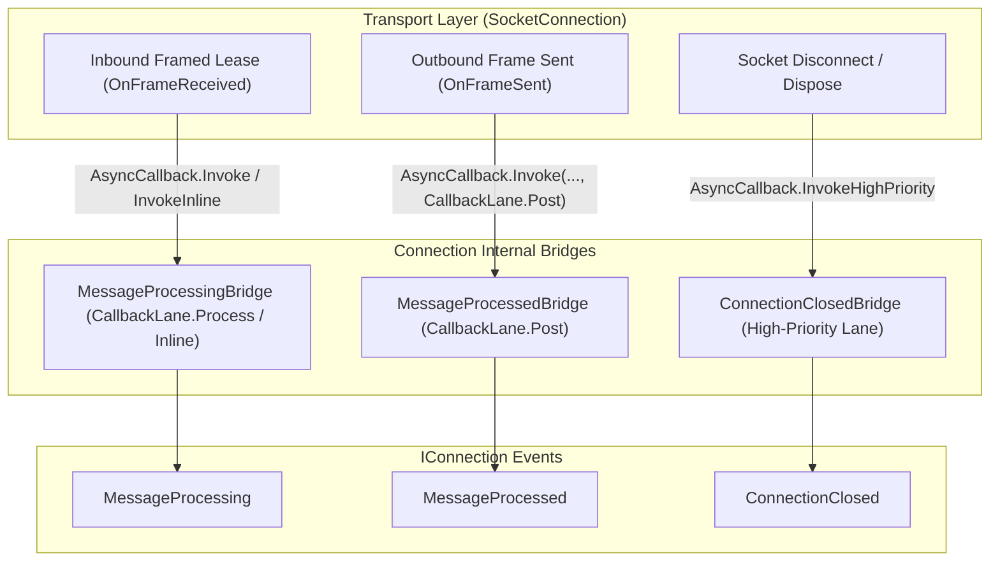

**Namespace:** `Nalix.Network.Connections`  
**Assembly:** `Nalix.Network`

`Connection` (`public sealed partial class Connection : IConnection, IConnectionErrorTracked, IConnectionTrafficMetrics, IPooledConnectContextPool, TimingWheel.ITimeoutTrackedConnection`) is the server-side representation of a connected client session. It owns the underlying `SocketConnection`, TCP and optional UDP transports, cryptographic state (`Secret`, `Algorithm`, `Level`), pooled `Attributes`, and dual-lane `AsyncCallback` event bridges.

## Source Mapping

- `src/Nalix.Abstractions/Networking/IConnection.cs`
- `src/Nalix.Abstractions/Networking/IConnection.Transmission.cs`
- `src/Nalix.Abstractions/Networking/IConnection.ErrorTracked.cs`
- `src/Nalix.Abstractions/Networking/IConnection.TrafficMetrics.cs`
- `src/Nalix.Network/Connections/Connection.cs`
- `src/Nalix.Network/Internal/Connections/ConnectionBacking.cs`

## Architectural Pipeline

## Public Constructors

| Constructor | Signature | Description |
| :--- | :--- | :--- |
| Standard | `public Connection(Socket socket, IOpCodeExtractor packetClassifier)` | Creates a connection using `socket.RemoteEndPoint` as `NetworkEndpoint` and assigns a new `SnowflakeType.Session` `ConnectionId`. |
| Proxy Protocol | `public Connection(Socket socket, IOpCodeExtractor packetClassifier, EndPoint realEndPoint)` | Creates a connection overriding `NetworkEndpoint` with `realEndPoint` extracted from a PROXY v1/v2 header. |

## Public Properties & Events

| Member | Type | Description |
| :--- | :--- | :--- |
| `ConnectionId` | `ulong` | Unique 64-bit session identifier (`Snowflake.NewId(SnowflakeType.Session).ToUInt64()`). |
| `UserId` | `string?` | Optional application user identifier (populated by `ConnectionUserExtensions.MapToUserAsync`). |
| `NetworkEndpoint` | `INetworkEndpoint` | Remote client endpoint (`SocketEndpoint` snapshot; preserves real client IP when behind PROXY Protocol). |
| `PacketClassifier` | `IOpCodeExtractor` | Opcode extractor bound by the listener's `IProtocol`. |
| `TCP` | `IConnection.ITransport` | Primary reliable transport (`SocketTcpTransport`). Throws `ObjectDisposedException` if disposed. |
| `UDP` | `IConnection.ITransport?` | Companion UDP transport (`SocketUdpTransport`), or `null` when UDP has not been established for this connection. |
| `IsUdpCreated` | `bool` | `true` when `UDP` is non-null. |
| `Attributes` | `IObjectMap<AttributeKey, object>` | Lazily rented, pooled attribute map (`ObjectMap<AttributeKey, object>`) for per-connection state. |
| `RateLimitCache` | `ConcurrentDictionary<ushort, object>` | Per-connection `ScopedEndpoint` cache used by `PolicyRateLimiter`. |
| `Level` | `PermissionLevel` | Current authorization level (defaults to `PermissionLevel.NONE`). |
| `Algorithm` | `CipherSuiteType` | Negotiated symmetric cipher suite (defaults to `CipherSuiteType.Chacha20Poly1305`). |
| `Secret` | `Bytes32` | 32-byte session key derived during the X25519 handshake (zeroed on disposal). |
| `UpTime` | `long` | Elapsed connection lifetime in milliseconds. |
| `LastPingTime` | `long` | Monotonic Unix timestamp (ms) of the last received frame/ping. |
| `IdleTimeoutMs` | `int` | Per-connection idle timeout threshold in milliseconds (defaults to `TimingWheelOptions.IdleTimeoutMs`). |
| `ExcludeFromIdleTimeout` | `bool` | When `true`, exempts this connection from `TimingWheel` idle reaping. |
| `PendingPackets` | `int` | Number of packets currently pending in `CallbackLane.Process`. |
| `ErrorCount` | `int` | Cumulative protocol/transport errors recorded via `IncrementErrorCount()`. |
| `BytesSent` / `BytesReceived` | `long` | Combined wire bytes transmitted across TCP and UDP. |
| `PacketsDropped` | `long` | Total packets dropped for this connection due to backpressure or validation failures. |
| `IsDisposed` | `bool` | `true` once the connection backing has been disposed and returned to the pool. |
| `MessageProcessing` | `event EventHandler<IConnectionEventArgs>` | Raised via `OnFrameReceived` (`CallbackLane.Process` or `InvokeInline`) when an inbound frame arrives. |
| `MessageProcessed` | `event EventHandler<IConnectionEventArgs>` | Raised via `OnFrameSent` on `CallbackLane.Post` when `SocketConnection` finishes sending an outbound frame. |
| `ConnectionClosed` | `event EventHandler<IConnectionEventArgs>` | Raised once during connection teardown before `Attributes` are returned to the pool. |

## Public Methods

| Method | Signature | Behavior |
| :--- | :--- | :--- |
| `Disconnect` | `public void Disconnect(string? reason = null)` | Logs the optional disconnect reason and initiates idempotent connection disposal (`Dispose()`). |
| `UpdateIdleTimeout` | `public void UpdateIdleTimeout(int newTimeoutMs)` | Updates `IdleTimeoutMs` (`> 0`, otherwise throws `ArgumentOutOfRangeException`) and re-registers the connection in `TimingWheel`. |
| `IncrementErrorCount` | `public void IncrementErrorCount()` | Atomically increments `ErrorCount`; automatically calls `Disconnect("Exceeded maximum error threshold.")` when `ErrorCount >= ConnectionGuardOptions.MaxErrorThreshold` (`50`). |
| `IncrementBytesSent` / `IncrementBytesReceived` | `public void IncrementBytesSent(int bytes)` / `IncrementBytesReceived(int bytes)` | Atomically adds to connection traffic counters. |
| `IncrementPacketsDropped` | `public void IncrementPacketsDropped()` | Atomically increments `PacketsDropped`. |
| `Dispose` | `public void Dispose()` | Fires `ConnectionClosed` while `Attributes` are still readable, zeroes `Secret`, returns `backing.Attributes?.Return()` to its pool, breaks the `TimingWheel.TimeoutTask` reference for instant GC, disposes sockets, and returns `ConnectionBacking` to `ObjectPoolManager.Shared`. |

## Related APIs

- [Socket Connection](../socket-connection.md)
- [Connection Hub](./connection-hub.md)
- [Connection Events](./connection-events.md)
- [Connection Extensions](./connection-extensions.md)
