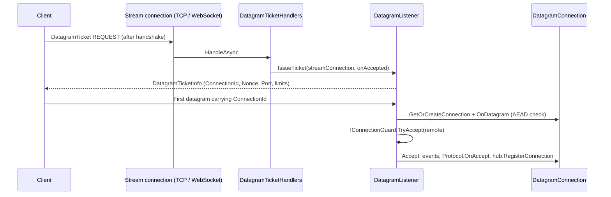

**Namespace:** `Nalix.Network.Listeners.Datagram`  
**Assembly:** `Nalix.Network`

`DatagramListener` (`public sealed partial class DatagramListener : IListener, IDatagramTicketIssuer`) is the UDP listener of the Nalix Datagram Protocol (NDP). It replaces the former `UdpListenerBase` / `UdpPassthroughListener` pair: there is no token-plus-MAC companion mode and no raw passthrough mode any more.

A client first completes the handshake on a stream connection (TCP or WebSocket), then asks for a datagram **ticket**. The listener answers with the connection identifier, a nonce and the session limits, and turns the ticket into a `DatagramConnection` when the first datagram of that identifier authenticates.

:::note[Page location]
`UdpListenerBase`, `UdpPassthroughListener`, `PassthroughConnection`, `DatagramGuard` and `DatagramGuardOptions` no longer exist in the source.
:::

## Source Mapping

- `src/Nalix.Network/Listeners/Datagram/DatagramListener.Core.cs`
- `src/Nalix.Network/Listeners/Datagram/DatagramListener.PublicMethods.cs`
- `src/Nalix.Network/Listeners/Datagram/DatagramListener.Receive.cs`
- `src/Nalix.Network/Listeners/Datagram/DatagramListener.SocketConfig.cs`
- `src/Nalix.Network/Listeners/Datagram/DatagramListener.Metrics.cs`
- `src/Nalix.Network/Listeners/Datagram/DatagramListener.Types.cs`
- `src/Nalix.Network/Connections/DatagramConnection.cs`
- `src/Nalix.Network/Connections/DatagramConnection.Transport.cs`
- `src/Nalix.Network/Options/DatagramOptions.cs`
- `src/Nalix.Abstractions/Networking/Datagrams/IDatagramTicketIssuer.cs`

## Ticket and Session Flow



`DatagramTicketHandlers` (`src/Nalix.Runtime/Handlers/DatagramTicketHandlers.cs`) refuses the request with `ProtocolReason.UNAUTHENTICATED` when the stream connection has no completed handshake or no secret, `STATE_VIOLATION` when the connection is itself a datagram transport, and `SERVICE_UNAVAILABLE` when no `IDatagramTicketIssuer` is registered or `IssueTicket` throws `InvalidOperationException`.

## Datagram Routing (`DatagramListener.Receive.cs`)

1. Each receive worker reads into a pinned buffer of `DatagramEngine.MaxDatagramSize + 1` bytes (`MaxDatagramSize = 1472`), so an oversized datagram is detected rather than truncated.
2. `Route` drops the datagram (`DroppedMalformed`) when it is longer than `MaxDatagramSize` or has no NDP header from which `DatagramEngine.TryReadConnectionId` can read the connection identifier.
3. A known identifier in the session table is handed to `DatagramConnection.OnDatagram`; an identifier with a pending ticket goes through `TryPromote`; anything else is dropped (`DroppedUnknown`). Unauthenticated datagrams are never answered.
4. A datagram of a known session that fails authentication, or is a replay, counts as `DroppedUnauthenticated`.
5. On promotion the listener calls `IConnectionGuard.TryAccept(remote)` (when a guard was supplied). A refusal disposes the session and counts in `TotalGuardRejections`; otherwise the session owns the guard slot until it closes. The session then raises `MessageProcessing` to `Protocol.FrameProcessor.ProcessFrame`, `MessageProcessed` to `Protocol.PostProcessMessage`, calls `Protocol.OnAccept`, and registers in the `IConnectionHub`.

Socket errors `ConnectionReset` and `MessageSize` count as malformed drops; other `SocketException`s count in `TotalErrors` and back off up to one second.

## Tickets

- `IssueTicket` throws `InvalidOperationException` when the listener is not active, when the caller is itself a `DatagramConnection`, when the stream connection has no secret, or when `SessionCount + PendingTicketCount` has reached `DatagramOptions.MaxSessions`.
- The connection identifier comes from the CSPRNG (not a Snowflake) so it cannot be predicted.
- At most one ticket is outstanding per stream connection: a new request replaces the previous one.
- A ticket not authenticated within `DatagramOptions.TicketLifetimeSeconds` is discarded by a one-second sweep and counted in `TicketsExpired`.
- The stream connection's user, permission level, cipher suite and secret are copied into the session when the ticket is issued. Disconnecting the stream connection does **not** close the datagram session; disconnect the `DatagramConnection` whose `StreamConnectionId` matches.

## Public API

```csharp
namespace Nalix.Network.Listeners.Datagram;

public sealed partial class DatagramListener : IListener, IDatagramTicketIssuer
{
    public DatagramListener(
        ushort port, IProtocol protocol, IConnectionHub hub, IDatagramProtectionFactory protectionFactory,
        IConnectionGuard? guard = null, DatagramOptions? options = null, DatagramEngineOptions? engineOptions = null);

    public DMetrics Metrics { get; }
    public ushort Port { get; }
    public bool IsListening { get; }
    public int SessionCount { get; }
    public int PendingTicketCount { get; }

    public void Activate(CancellationToken cancellationToken = default);
    public void Deactivate(CancellationToken cancellationToken = default);
    public DatagramTicketInfo IssueTicket(IConnection streamConnection, Action<IConnection>? onAccepted = null);

    public string GenerateReport();
    public void WriteReportData(Utf8JsonWriter writer);
    public void Dispose();

    public sealed class DMetrics { /* counters, see below */ }
}
```

- `port` of `0` picks a free port; `Port` returns the bound port after activation.
- `options` and `engineOptions` default to `ConfigurationManager.Instance.Get<DatagramOptions>()` and `Get<DatagramEngineOptions>()`; both are validated in the constructor.
- `Activate` binds the socket, starts `DatagramOptions.ReceiveWorkers` receive workers, the datagram timing wheel and the ticket sweep, and throws `ObjectDisposedException` or `SocketException`. A second `Activate` while not stopped is ignored.
- `Deactivate` disconnects every session with `"Server is shutting down."`, discards pending tickets and closes the socket.
- `guard` of `null` accepts every authenticated session.
- `IsAuthenticated`-style hooks and `TryResolveConnection` no longer exist; authentication is the AEAD check of `IDatagramProtectionFactory`. The hosting package uses `ChaCha20Poly1305DatagramProtectionFactory.Instance`.

### `DMetrics` (`DatagramListener.DMetrics`)

| Property | Meaning |
| :--- | :--- |
| `DatagramsReceived`, `BytesReceived` | Datagrams and bytes read from the socket. |
| `DroppedMalformed` | Too large or no NDP header. |
| `DroppedUnknown` | Unknown connection identifier. |
| `DroppedUnauthenticated` | Known session, but not authenticated (or a replay). |
| `TotalDropped` | Sum of the three drop counters. |
| `TicketsIssued`, `TicketsExpired` | Tickets issued, and expired before their first authenticated datagram. |
| `TotalAccepted` | Sessions accepted. |
| `TotalGuardRejections` | Authenticated sessions refused by `IConnectionGuard`. |
| `TotalErrors` | Receive, processing and accept errors. |

## Socket Setup (`DatagramListener.SocketConfig.cs`)

- Dual-stack IPv6 socket when `NetworkSocketOptions.EnableDualStack` is set and the host supports IPv6 (`DualMode = NetworkSocketOptions.DualMode`); falls back to IPv4 when the address family is unsupported.
- `SO_REUSEADDR` is never set (whatever `NetworkSocketOptions.ReuseAddress` says); on Windows `ExclusiveAddressUse = true`.
- `ReceiveBufferSize` / `SendBufferSize` come from `DatagramOptions.SocketReceiveBufferSize` / `SocketSendBufferSize`, not from `NetworkSocketOptions.BufferSize`.
- `DontFragment = true` is attempted so path-MTU probing sees oversized datagrams dropped; failure is ignored.

## `DatagramConnection`

`public sealed partial class DatagramConnection : IConnection, IConnectionErrorTracked, IConnectionTrafficMetrics, IPooledConnectContextPool, IDatagramTransport` is created by the listener (its constructor is internal).

- `ConnectionId` is a new Snowflake (`SnowflakeType.Session`); `DatagramConnectionId` is the wire identifier from the ticket; `StreamConnectionId` is the `ConnectionId` of the stream connection that requested the ticket.
- `Transport` returns the connection itself. Plain `Send` / `SendAsync` use `DeliveryMethod.ReliableOrdered` on channel 0.
- `SendAsync(ReadOnlyMemory<byte> message, DeliveryMethod method, byte channel, CancellationToken)` and `WithDelivery(DeliveryMethod method, byte channel)` choose the delivery method (`Unreliable`, `UnreliableSequenced`, `ReliableUnordered`, `ReliableOrdered`, `ReliableSequenced`) and channel; `WithDelivery` throws `ArgumentOutOfRangeException` for an unknown method or a channel not below the session's channel count.
- `EngineReport` returns the protocol engine's report.
- `ExcludeFromIdleTimeout` is `true`; the idle timeout is enforced by the protocol engine (`DatagramEngineOptions.IdleTimeoutMs`), not by the `TimingWheel`. `UpdateIdleTimeout` only validates its argument.

## Related APIs

- [TCP Listener](./tcp-listener.md)
- [Connection](./connection/connection.md)
- [Datagram Options](../options/network/datagram-options.md)
- [Network Socket Options](../options/network/network-socket-options.md)
- [Connection Limiter](./connection/connection-limiter.md)
- [Network Application](../hosting/network-application.md)
