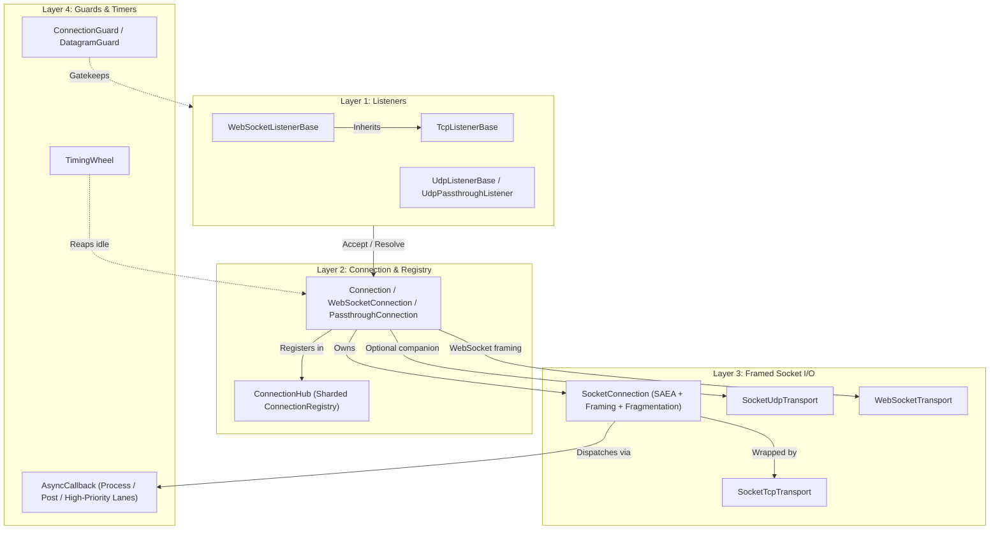

**Namespaces:** `Nalix.Network.Connections`, `Nalix.Network.Listeners.Tcp`, `Nalix.Network.Listeners.Udp`, `Nalix.Network.Listeners.Web`, `Nalix.Network.Protocols`, `Nalix.Network.RateLimiting`, `Nalix.Network.Options`  
**Assembly:** `Nalix.Network`

`Nalix.Network` is the server-side transport engine. It manages raw TCP, UDP, and WebSocket sockets, enforces multi-layer admission and callback backpressure, maintains the sharded connection registry, and delivers framed payloads into `IProtocol`.

## Master Transport Landscape

## Progressive Reading Order

1. [Socket Connection](./socket-connection.md) — Internal SAEA receive/send engine, length/VarInt framing, fragmentation, and Layer 1 pending-packet throttling.
2. [TCP Listener](./tcp-listener.md) and [UDP Listener](./udp-listener.md) — Socket activation, `ConnectionGuard` / `DatagramGuard` admission, PROXY protocol parsing, and 8-byte token + 4-byte MAC UDP authentication.
3. [Connection](./connection/connection.md) — High-level `IConnection` implementation owning identity (`ConnectionId`), cryptographic context (`Secret`, `Algorithm`), `Attributes`, and event bridges.
4. [Connection Hub](./connection/connection-hub.md) — Sharded `ConnectionRegistry` (`MIX64` hash sharding), zero-allocation snapshot broadcasting, and `IReportable` telemetry.
5. [Timing Wheel](./time/timing-wheel.md) — Hashed wheel timer for low-overhead idle connection reaping.

## Core Areas

### Connection Subsystem

- [Connection](./connection/connection.md)
- [Connection Hub](./connection/connection-hub.md)
- [Connection Events](./connection/connection-events.md)
- [Connection Extensions](./connection/connection-extensions.md)
- [Connection Guard](./connection/connection-guard.md)
- [Connection Limiter](./connection/connection-limiter.md)

### Protocols & Transport

- [Protocol](./protocol.md)
- [Socket Connection](./socket-connection.md)
- [TCP Listener](./tcp-listener.md)
- [UDP Listener](./udp-listener.md)
- [Session Store & Service](./session-store.md)
- [Timing Wheel](./time/timing-wheel.md)

### Network Options

- [Options Overview](../options/network/options.md)
- [Network Socket Options](../options/network/network-socket-options.md)
- [Connection Quota Options](../options/network/connection-quota-options.md)
- [Connection Guard Options](../options/network/connection-guard-options.md)
- [Trusted Proxy Options](../options/network/trusted-proxy-options.md)
- [Connection Ban Store Options](../options/network/connection-ban-store-options.md)
- [Connection Blacklist Store Options](../options/network/connection-blacklist-store-options.md)
- [Connection Hub Options](../options/network/connection-hub-options.md)
- [Timing Wheel Options](../options/network/timing-wheel-options.md)
- [Pooling Options](../options/network/pooling-options.md)
- [Network Callback Options](../options/network/network-callback-options.md)
- [Session Store Options](../options/network/session-store-options.md)
- [Compression Options](../options/network/compression-options.md)

## Related APIs

- [Runtime Overview](../runtime/index.md)
- [Network Application (Hosting)](../hosting/network-application.md)
- [SDK Overview](../sdk/index.md)
