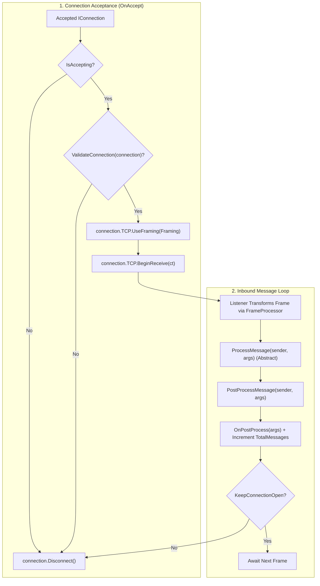

**Namespace:** `Nalix.Network.Protocols`  
**Assembly:** `Nalix.Network`

`Protocol` (`public abstract partial class Protocol : IProtocol`) is the abstract base class consumed by `TcpListenerBase`, `UdpListenerBase`, and `WebSocketListenerBase`. It defines the connection acceptance workflow (`OnAccept`, `ValidateConnection`), wire framing selection (`Framing`), inbound transform/opcode hooks (`FrameProcessor`, `OpCodeExtractor`), message processing (`ProcessMessage`, `PostProcessMessage`), and protocol-level error/message metrics.

## Source Mapping

- `src/Nalix.Abstractions/Networking/Protocols/IProtocol.cs`
- `src/Nalix.Network/Protocols/Protocol.Core.cs`
- `src/Nalix.Network/Protocols/Protocol.PublicMethods.cs`
- `src/Nalix.Network/Protocols/Protocol.Lifecycle.cs`
- `src/Nalix.Network/Protocols/Protocol.Metrics.cs`

## Lifecycle & Message Pipeline



## Public & Protected Members

```csharp
namespace Nalix.Network.Protocols;

public abstract partial class Protocol : IProtocol
{
    // Abstract contracts required from derived protocols
    public abstract IFrameProcessor FrameProcessor { get; }
    public abstract IOpCodeExtractor OpCodeExtractor { get; }
    public abstract void ProcessMessage(object? sender, IConnectionEventArgs args);

    // Configurable properties
    public virtual TransportFraming Framing { get; set; } = TransportFraming.UInt16LengthPrefixed;
    public virtual bool KeepConnectionOpen { get; protected set; }
    public bool IsAccepting { get; protected set; }

    // Metrics
    public ulong TotalMessages { get; }
    public ulong TotalErrors { get; }

    // Lifecycle & execution methods
    public virtual void OnAccept(IConnection connection, CancellationToken cancellationToken = default);
    public void PostProcessMessage(object? sender, IConnectionEventArgs args);
    public void SetConnectionAcceptance(bool isEnabled);

    // Protected extensibility hooks
    protected virtual bool ValidateConnection(IConnection connection) => true;
    protected virtual void OnPostProcess(IConnectionEventArgs args);
    protected virtual void OnConnectionError(IConnection connection, Exception exception);
    protected virtual void Dispose(bool disposing);

    // Diagnostics & disposal
    public virtual string GenerateReport();
    public virtual void WriteReportData(Utf8JsonWriter writer);
    public void Dispose();
}
```

## Implementing a Custom `Protocol`

When using `Nalix.Hosting` (`builder.MapTcp<MyProtocol>(port)`), you only need to implement `ProcessMessage` if you inherit from the hosting protocol base or supply `FrameProcessor` (`FramePipeline.Instance`) and `OpCodeExtractor` (`NativeOpCodeExtractor.Instance`):

```csharp
using Nalix.Abstractions.Networking;
using Nalix.Abstractions.Networking.Packets;
using Nalix.Abstractions.Networking.Protocols;
using Nalix.Codec.Classifiers;
using Nalix.Codec.Transforms;
using Nalix.Network.Protocols;
using Nalix.Runtime.Dispatching;

public sealed class GameProtocol(IPacketDispatch dispatcher) : Protocol
{
    public override IFrameProcessor FrameProcessor => FramePipeline.Instance;
    public override IOpCodeExtractor OpCodeExtractor => NativeOpCodeExtractor.Instance;

    public GameProtocol(IPacketDispatch dispatcher, bool keepOpen = true) : this(dispatcher)
    {
        this.KeepConnectionOpen = keepOpen;
        this.IsAccepting = true;
    }

    public override void ProcessMessage(object? sender, IConnectionEventArgs args)
    {
        if (args.Lease is not null)
        {
            dispatcher.HandlePacket(args.Lease, args.Connection);
        }
    }
}
```

## Related APIs

- [TCP Listener](./tcp-listener.md)
- [UDP Listener](./udp-listener.md)
- [Connection](./connection/connection.md)
- [Packet Dispatch Channel & Router](../runtime/routing/dispatch-channel-and-router.md)
