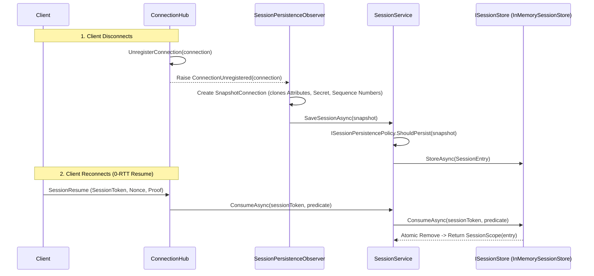

**Namespaces:** `Nalix.Abstractions.Networking.Sessions`, `Nalix.Runtime.Sessions`  
**Assembly:** `Nalix.Runtime`

`SessionService`, `InMemorySessionStore`, `SessionFactory`, `DefaultSessionPersistencePolicy`, and `SessionPersistenceObserver` manage resumable session snapshots (`SessionEntry` / `SessionScope`) when clients disconnect and later reconnect via the 0-RTT `SessionResume` protocol (`SessionResumeStage.REQUEST`).

## Source Mapping

- `src/Nalix.Abstractions/Networking/Sessions/ISessionService.cs`
- `src/Nalix.Abstractions/Networking/Sessions/ISessionStore.cs`
- `src/Nalix.Abstractions/Networking/Sessions/ISessionFactory.cs`
- `src/Nalix.Abstractions/Networking/Sessions/ISessionPersistencePolicy.cs`
- `src/Nalix.Abstractions/Networking/Sessions/SessionEntry.cs`
- `src/Nalix.Abstractions/Networking/Sessions/SessionScope.cs`
- `src/Nalix.Runtime/Sessions/SessionService.cs`
- `src/Nalix.Runtime/Sessions/InMemorySessionStore.cs`
- `src/Nalix.Runtime/Sessions/SessionFactory.cs`
- `src/Nalix.Runtime/Sessions/DefaultSessionPersistencePolicy.cs`
- `src/Nalix.Runtime/Sessions/SessionPersistenceObserver.cs`
- `src/Nalix.Runtime/Options/SessionStoreOptions.cs`

## Session Persistence & Resume Lifecycle



## Public Contracts & Implementations

### 1. `ISessionService` & `SessionService`

```csharp
namespace Nalix.Runtime.Sessions;

public sealed class SessionService : ISessionService, IDisposable, IReportable
{
    public SessionService(
        ISessionFactory? factory = null,
        ISessionStore? store = null,
        ISessionPersistencePolicy? policy = null);

    public ValueTask SaveSessionAsync(
        IConnection connection,
        CancellationToken cancellationToken = default);

    public ValueTask<SessionScope> ConsumeAsync(
        ulong sessionToken,
        Func<SessionEntry, bool>? predicate = null,
        CancellationToken cancellationToken = default);

    public string GenerateReport();
    public void WriteReportData(Utf8JsonWriter writer);
    public void Dispose();
}
```

- **Scavenger Scheduling**: When `_store` implements `IWorker` (as `InMemorySessionStore` does), `SessionService` automatically schedules it on `TaskManager.ScheduleWorker(hostedWorker)` and disposes the `IWorkerHandle` when `SessionService.Dispose()` is called.
- **Pooled Safety**: If `_store.StoreAsync(entry, ct)` throws a non-fatal exception, `SessionService` immediately calls `entry.Return()` so the pooled `SessionEntry` and its rented `ObjectMap<AttributeKey, object>` are never leaked.

### 2. `InMemorySessionStore` (`ISessionStore`, `IWorker`, `IReportable`)

```csharp
namespace Nalix.Runtime.Sessions;

public sealed class InMemorySessionStore : ISessionStore, IWorker, IReportable
{
    public const int DefaultMaxSessions = 65_536;
    public int MaxSessions { get; set; }

    public ValueTask StoreAsync(
        SessionEntry entry,
        CancellationToken cancellationToken = default);

    public ValueTask<SessionScope> ConsumeAsync(
        ulong sessionToken,
        Func<SessionEntry, bool>? predicate = null,
        CancellationToken cancellationToken = default);

    public ValueTask ExecuteAsync(IWorkerContext context, CancellationToken cancellationToken);
}
```

- **Atomic One-Shot Consumption (`SEC-33`)**: `ConsumeAsync` verifies that `entry.Snapshot.ExpiresAtUnixMilliseconds > Clock.UnixMillisecondsNow()`, evaluates the optional `predicate(entry)` BEFORE removing the entry if `predicate` returns `false`, and uses atomic key-value removal (`ICollection<KeyValuePair<ulong, SessionEntry>>.Remove`) so only one concurrent caller can consume a valid token. Returns a `SessionScope` (`scope.IsValid == true` when consumed; disposing `SessionScope` returns the `SessionEntry` to its pool).
- **Minute-Bucketed Expiration Index (`_expiryBuckets`)**: Groups session tokens into 60-second buckets (`ExpiresAtUnixMilliseconds / 60_000`) so the background `ExecuteAsync` scavenger only visits buckets that are due.
- **Capacity Eviction (`DefaultMaxSessions = 65,536`)**: When `_store.Count >= MaxSessions`, evicts expired entries first, then oldest entries, calling `entry.Return()`.

### 3. `DefaultSessionPersistencePolicy` & `SessionPersistenceObserver`

- `SessionPersistenceObserver` subscribes to `IConnectionHub.ConnectionUnregistered`, captures a `SnapshotConnection` (cloning `Attributes`, `Secret`, `Level`, `Algorithm`, and TCP/UDP sequence counters before `Connection.Dispose()` zeroes them), and invokes `SaveSessionAsync` in the background.
- `DefaultSessionPersistencePolicy.ShouldPersist(IConnection)` evaluates three rules in order:
  1. **Policy 1 (Handshake Gate)**: If `!connection.GetRuntimeState().HandshakeEstablished`, returns `false`.
  2. **Policy 2 (Active Cryptographic Session)**: If `!connection.Secret.IsZero` (active 32-byte encryption key established), returns `true` immediately.
  3. **Policy 3 (Attribute Count Fallback)**: Otherwise returns `connection.Attributes.Count > _options.MinAttributesForPersistence` (default `10`).

## Related APIs

- [Session Store Options](../options/network/session-store-options.md)
- [Session Resume](../security/session-resume.md)
- [Connection Hub](./connection/connection-hub.md)
- [Connection](./connection/connection.md)
