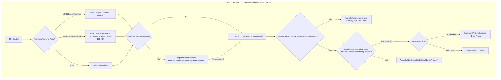

**Namespace:** `Nalix.Network.Internal.Transport`  
**Assembly:** `Nalix.Network`

`SocketConnection` (`internal sealed partial class SocketConnection : IDisposable, IPoolable`) is the internal framed TCP transport engine backing `Connection.TCP` (`SocketTcpTransport`). It uses pooled `PooledSocketReceiveContext` (`SocketAsyncEventArgs`) instances, `BufferLease` byte-array pools, and multi-mode framing to sustain 10,000+ concurrent connections with zero per-packet heap allocations.

:::warning[Internal Implementation Type]
`SocketConnection` is `internal sealed` and is not directly referenced by application code. Application code interacts with TCP sockets through `IConnection` and `connection.TCP` (`IConnection.ITransport`).
:::

## Source Mapping

- `src/Nalix.Network/Internal/Transport/SocketConnection.cs`
- `src/Nalix.Network/Internal/Transport/SocketConnection.Framing.cs`
- `src/Nalix.Network/Internal/Transport/SocketConnection.Receive.VarInt.cs`
- `src/Nalix.Network/Internal/Transport/SocketConnection.Send.cs`
- `src/Nalix.Network/Internal/Transport/SocketConnection.Send.VarInt.cs`
- `src/Nalix.Network/Internal/Transport/SocketTcpTransport.cs`
- `src/Nalix.Network/Options/NetworkCallbackOptions.cs`
- `src/Nalix.Network/Options/VarIntFramingOptions.cs`

## Architectural Receive & Send Pipeline

## Key Technical Responsibilities

### 1. Multi-Mode Transport Framing (`TransportFraming`)

Configured via `connection.TCP.UseFraming(this.Framing)` during `Protocol.OnAccept` (locked once `BeginReceive` starts):

| Mode | Wire Prefix | Max Frame Size | Source File |
| :--- | :--- | :--- | :--- |
| `TransportFraming.UInt16LengthPrefixed` (default) | 2-byte little-endian `ushort` total frame length | `65,535` bytes (larger payloads use `FragmentStream`) | `SocketConnection.Framing.cs` |
| `TransportFraming.VarIntLengthPrefixed` | 1-to-5-byte LEB128 VarInt payload length | `VarIntFramingOptions.MaxPayloadSize` (`131,072` bytes / 128 KB) | `SocketConnection.Receive.VarInt.cs`, `SocketConnection.Send.VarInt.cs` |
| `TransportFraming.None` | Unframed stream chunks | Bounded by receive buffer | `SocketConnection.cs` |

### 2. Layer 1 Per-Connection Throttle & `OverflowPolicy` (`Connection.OnFrameReceived`)

When `SocketConnection.PROCESS_FRAME_FROM_BUFFER` completes a frame (or reassembles all chunks via `FragmentAssembler`), it calls `_connectionOwner?.OnFrameReceived(lease)` on the owning `Connection`:

- **Inline Fast Path (`AsyncCallback.CanRunInline`)**: If `MessageProcessing` has a single subscriber bound to an `IFrameProcessor` with `SupportsInlineProcessing == true`, `Connection.OnFrameReceived` executes `AsyncCallback.InvokeInline(...)` synchronously on the receive completion thread without queuing.
- **Per-Connection Throttle**: Otherwise, `Connection.OnFrameReceived` increments `backing.PendingProcessCallbacks` and checks `NetworkCallbackOptions.MaxPerConnectionPendingPackets` (default `16`):
  - When `OverflowPolicy == NetworkOverflowPolicy.DropPacket` (default): increments `PacketsDropped`, rolls back `PendingProcessCallbacks`, disposes the lease, and discards the frame before it touches the `ThreadPool`.
  - When `OverflowPolicy == NetworkOverflowPolicy.Disconnect`: rolls back the counter, disposes the lease, and immediately calls `Disconnect()` on the flooding peer.
  - When within budget: acquires a pooled `ConnectionEventArgs` and dispatches via `AsyncCallback.Invoke(..., CallbackLane.Process, releasePendingPacketOnCompletion: true)`.

### 3. Automatic Fragmentation & Reassembly (`FragmentAssembler`)

- **Outbound**: Payloads exceeding `FragmentOptions.MaxChunkSize` are split across multiple frames prefixed with a `FragmentHeader`.
- **Inbound**: `SocketConnection` reassembles fragmented streams via `FragmentAssembler`, enforcing `NetworkCallbackOptions.MaxPerConnectionOpenFragmentStreams` (default `4`) and evicting expired partial streams on each receive cycle.

### 4. Pre-Read Buffer Injection (`InjectPreReadBytes`)

When `TcpListenerBase` or `WebSocketListenerBase` reads initial bytes during PROXY Protocol v1/v2 or HTTP Upgrade parsing, any trailing payload bytes already read from the socket are injected into `SocketConnection` via `InjectPreReadBytes(ReadOnlySpan<byte>)` so they are processed before the next OS socket read.

## Related APIs

- [Connection](./connection/connection.md)
- [Connection Events](./connection/connection-events.md)
- [Protocol](./protocol.md)
- [Network Callback Options](../options/network/network-callback-options.md)
