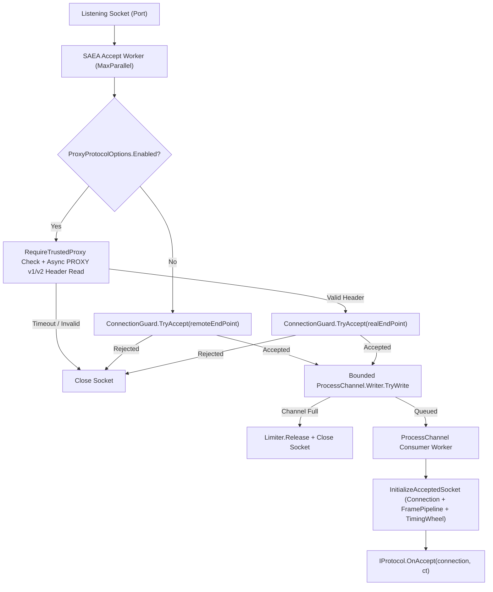

**Namespace:** `Nalix.Network.Listeners.Tcp`  
**Assembly:** `Nalix.Network`

`TcpListenerBase` (`public abstract partial class TcpListenerBase : IListener`) is the base TCP server listener in `Nalix.Network` (and the base class of `WebSocketListenerBase`). It manages socket binding, multi-worker `SocketAsyncEventArgs` accept loops, optional PROXY Protocol v1/v2 real-IP extraction, `ConnectionGuard` admission control, a bounded accept-processing channel, and `TimingWheel` registration.

## Source Mapping

- `src/Nalix.Abstractions/Networking/IListener.cs`
- `src/Nalix.Network/Listeners/TcpListener/TcpListener.Core.cs`
- `src/Nalix.Network/Listeners/TcpListener/TcpListener.PublicMethods.cs`
- `src/Nalix.Network/Listeners/TcpListener/TcpListener.Handle.cs`
- `src/Nalix.Network/Listeners/TcpListener/TcpListener.ProcessChannel.cs`
- `src/Nalix.Network/Listeners/TcpListener/TcpListener.ProxyProtocol.cs`
- `src/Nalix.Network/Listeners/TcpListener/TcpListener.SocketConfig.cs`
- `src/Nalix.Network/Listeners/TcpListener/TcpListener.Synchronization.cs`
- `src/Nalix.Network/Listeners/TcpListener/TcpListener.Metrics.cs`
- `src/Nalix.Network/Options/NetworkSocketOptions.cs`
- `src/Nalix.Network/Options/ProxyProtocolOptions.cs`

## Accept & Initialization Pipeline



## Constructors & Public API

```csharp
namespace Nalix.Network.Listeners.Tcp;

public abstract partial class TcpListenerBase : IListener
{
    protected TcpListenerBase(ushort port, IProtocol protocol, IConnectionHub hub, IConnectionGuard guard);
    protected TcpListenerBase(IProtocol protocol, IConnectionHub hub, IConnectionGuard guard);

    public int ProcessChannelCount { get; }
    public Metrics Metrics { get; }
    protected internal IConnectionGuard Limiter { get; }

    public virtual void Activate(CancellationToken cancellationToken = default);
    public virtual void Deactivate(CancellationToken cancellationToken = default);

    public virtual string GenerateReport();
    public virtual void WriteReportData(Utf8JsonWriter writer);
    public void Dispose();
    protected virtual void Dispose(bool disposing);
}
```

## Key Subsystems

### 1. Socket Binding & Tuning (`TcpListener.SocketConfig.cs`)

- **Dual-Stack IPv6 / IPv4 Fallback**: When `NetworkSocketOptions.EnableDualStack` is `true` (default), `TcpListenerBase` binds an `InterNetworkV6` socket with `DualMode = _config.DualMode` (`true`), falling back to `InterNetwork` (IPv4) if the OS does not support IPv6 dual-stack.
- **Socket Options**: Configures `ReuseAddress`, `ReusePort`, `TcpFastOpen`, `Backlog` (`512`), `NoDelay` (`true`), `SendBufferSize`/`ReceiveBufferSize` (`BufferSize = 65536`), and cross-platform TCP Keep-Alive probes (`3s` time, `1s` interval, `3` retries).

### 2. PROXY Protocol v1/v2 (`TcpListener.ProxyProtocol.cs`)

When `ProxyProtocolOptions.Enabled` is `true`:

- If `ProxyProtocolOptions.RequireTrustedProxy` is `true`, only physical peers matching `TrustedProxyOptions` are permitted to send a PROXY header.
- Bounds concurrent in-flight PROXY header reads to `ProxyProtocolOptions.MaxPendingProxyConnections` (`1024`) with a timeout of `HeaderTimeoutMs` (`2000` ms).
- Parses PROXY v1 or v2 headers via `ProxyProtocolParser`, extracts the real client `EndPoint`, passes it to `ConnectionGuard.TryAccept`, and injects any leftover bytes into the `Connection` via `InjectPreReadBytes`.

### 3. Bounded Accept Process Channel (`TcpListener.ProcessChannel.cs`)

- Accepted connections are written into a `Channel.CreateBounded<AcceptConnectionResult>` sized to `NetworkSocketOptions.ProcessChannelCapacity` (`256`).
- If the consumer thread is saturated and `TryWrite` returns `false`, the listener calls `_limiter.Release(remoteEndPoint)` and closes the socket immediately.
- During `Deactivate`, the listener waits up to `NetworkSocketOptions.ProcessChannelDrainTimeout` (`5000` ms) for queued accepts to drain gracefully.
- Optional CPU pinning for the dispatch consumer thread is supported via `NetworkSocketOptions.DispatchProcessorAffinity` (default `-1`).

## Related APIs

- [UDP Listener](./udp-listener.md)
- [WebSocket Binding](../hosting/websocket-binding.md)
- [Protocol](./protocol.md)
- [Network Socket Options](../options/network/network-socket-options.md)
- [Connection Guard](./connection/connection-guard.md)
