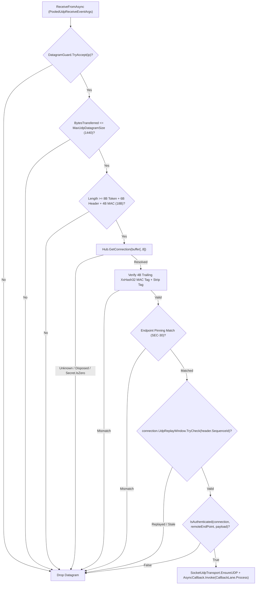

**Namespace:** `Nalix.Network.Listeners.Udp`  
**Assembly:** `Nalix.Network`

`Nalix.Network.Listeners.Udp` provides two UDP listener implementations:

1. **`UdpListenerBase`** (`public abstract partial class UdpListenerBase : IListener`): Authenticated companion UDP listener that resolves each datagram to an existing TCP-authenticated `Connection` in `IConnectionHub` using an 8-byte `SessionToken` prefix and a 4-byte trailing `XxHash32` MAC tag.
2. **`UdpPassthroughListener`** (`public sealed class UdpPassthroughListener : UdpListenerBase`): Raw connectionless UDP listener that bypasses token/MAC checks and forwards raw datagrams to `IProtocol` using lightweight `PassthroughConnection` instances tracked in `TimingWheel`.

## Source Mapping

- `src/Nalix.Network/Listeners/UdpListener/UdpListener.Core.cs`
- `src/Nalix.Network/Listeners/UdpListener/UdpListener.PublicMethods.cs`
- `src/Nalix.Network/Listeners/UdpListener/UdpListener.Receive.cs`
- `src/Nalix.Network/Listeners/UdpListener/UdpListener.SocketConfig.cs`
- `src/Nalix.Network/Listeners/UdpListener/UdpListener.Metrics.cs`
- `src/Nalix.Network/Listeners/UdpListener/UdpPassthroughListener.cs`
- `src/Nalix.Network/Connections/PassthroughConnection.cs`
- `src/Nalix.Network/RateLimiting/Datagram.Guard.cs`
- `src/Nalix.Network/Options/DatagramGuardOptions.cs`

## 1. Authenticated Datagram Wire Layout (`UdpListenerBase`)

Every authenticated inbound UDP datagram has a **12-byte authentication envelope** (`8-byte SessionToken prefix` + `4-byte XxHash32 MAC suffix`) wrapping the Nalix packet:

```text
+-----------------------------------+-----------------------------------+-----------------------------------+
|  SessionToken (8B, LE UInt64)     |  Packet Payload (>= 6B Header)    |  UdpMacTag (4B, LE UInt32)        |
|  = ConnectionId (ISnowflake)      |  [OpCode(2)..SequenceId(2)..Body] |  XxHash32(Secret, seed: Hash(0..N))|
+-----------------------------------+-----------------------------------+-----------------------------------+
  Bytes 0..7                          Bytes 8..(Length - 5)               Bytes (Length - 4)..(Length - 1)
```

### Multi-Gate Validation Pipeline (`UdpListener.Receive.cs`)



1. **Per-IP Rate & Size Gate**: Checks `_rateLimiter.TryAccept(ip)` (`DatagramGuard`) and rejects datagrams larger than `NetworkSocketOptions.MaxUdpDatagramSize` (`1440` bytes).
2. **Session Resolution**: Reads the 8-byte `SessionToken` (`buffer[..8]`) and resolves the active `Connection` from `IConnectionHub`. Rejects if the connection does not exist or `connection.Secret.IsZero` (handshake not completed).
3. **Keyed `XxHash32` MAC Verification (`UdpMacTagSize = 4`)**:
   - Let `dataLen = lease.Length - 4`.
   - Computes `uint payloadHash = XxHash32.Compute(lease.Span[..dataLen])`.
   - Computes `uint computedTag = XxHash32.Compute(connection.Secret.AsSpan(), seed: payloadHash)`.
   - Compares `computedTag` against the trailing 4-byte little-endian tag (`lease.Span.Slice(dataLen, 4)`) and strips the 4-byte tag (`lease.CommitLength(dataLen)`).
4. **Endpoint Pinning (`SEC-30`)**: Verifies that the UDP source IP (and port, when pinned) matches `connection.NetworkEndpoint`.
5. **Sliding Replay Window (`SEC-27`)**: Validates the 16-bit `header.SequenceId` (`ushort`) against `connection.UdpReplayWindow` (`DatagramGuardOptions.UdpReplayWindowSize = 512` bits).
6. **Custom Hook & Frame Processing**: Calls `IsAuthenticated(connection, remoteEndPoint, payload)`, binds `SocketUdpTransport.EnsureUDP`, strips the 8-byte `SessionToken` prefix, and dispatches the packet through `AsyncCallback` (`FramePipeline.ProcessInbound` $\rightarrow$ `IProtocol.ProcessMessage`).

## 2. Raw Passthrough Mode (`UdpPassthroughListener`)

Registered via `builder.MapUdp<TProtocol>(port, passthrough: true)` when implementing custom third-party UDP protocols (such as RakNet or custom binary UDP):

- Bypasses the 8-byte `SessionToken`, 4-byte `XxHash32` MAC tag, `UdpReplayWindow`, and `FramePipeline`.
- Tracks each remote `IPEndPoint` as a `PassthroughConnection` (`public sealed class PassthroughConnection : IConnection, IConnectionTrafficMetrics, TimingWheel.ITimeoutTrackedConnection`) admission-checked by `IConnectionGuard`, throttled to `MaxPendingPackets = 64` concurrent pending packets per endpoint, and registered in `TimingWheel` for automatic idle eviction.
- `PassthroughConnection` exposes `UDP` (`IConnection.ITransport`) bound to the shared listener socket for sending replies, while accessing `PassthroughConnection.TCP` throws `NotSupportedException`.

## Public & Protected API (`UdpListenerBase`)

```csharp
namespace Nalix.Network.Listeners.Udp;

public abstract partial class UdpListenerBase : IListener
{
    protected UdpListenerBase(ushort port, IProtocol protocol, IConnectionHub hub);
    protected UdpListenerBase(IProtocol protocol, IConnectionHub hub);

    public bool IsListening { get; }
    public UMetrics Metrics { get; }
    protected IProtocol Protocol { get; }
    protected Socket? ListenerSocket { get; }

    public void Activate(CancellationToken cancellationToken = default);
    public void Deactivate(CancellationToken cancellationToken = default);

    public virtual bool TryResolveConnection(
        IConnectionHub hub,
        ReadOnlySpan<byte> sessionToken,
        out Connection? connection);
    public abstract bool IsAuthenticated(
        IConnection connection,
        EndPoint remoteEndPoint,
        ReadOnlySpan<byte> payload);
    protected virtual void ProcessDatagram(BufferLease lease, EndPoint? remoteEndPoint);

    public string GenerateReport();
    public void WriteReportData(Utf8JsonWriter writer);
    public void Dispose();
    protected virtual void Dispose(bool disposing);
}
```

## Related APIs

- [TCP Listener](./tcp-listener.md)
- [Connection](./connection/connection.md)
- [Network Socket Options](../options/network/network-socket-options.md)
- [Connection Limiter (DatagramGuard)](./connection/connection-limiter.md)
