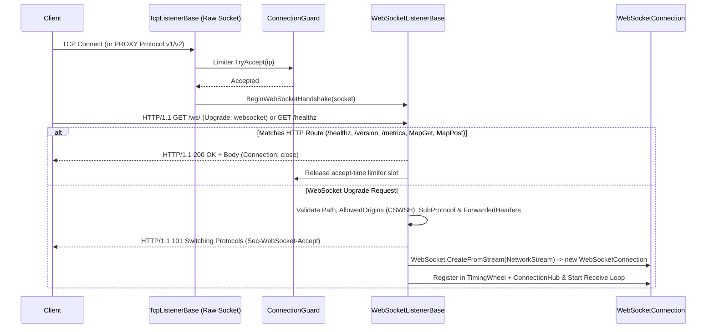

**Namespace:** `Nalix.Network.Listeners.Web`  
**Assembly:** `Nalix.Network`

`WebSocketListenerBase` (`public abstract partial class WebSocketListenerBase : TcpListenerBase`) provides a zero-allocation, raw-socket RFC 6455 WebSocket and HTTP/1.1 control-plane listener built directly on top of [TcpListenerBase](./tcp-listener.md) (it does **not** use `System.Net.HttpListener` and does **not** require Windows URL ACLs or administrator privileges).

## Source Mapping

- `src/Nalix.Network/Listeners/WebListener/WebSocketListener.Core.cs`
- `src/Nalix.Network/Listeners/WebListener/WebSocketListener.Handle.cs`
- `src/Nalix.Network/Listeners/WebListener/WebSocketListener.Headers.cs`
- `src/Nalix.Network/Listeners/WebListener/WebSocketListener.Http.cs`
- `src/Nalix.Network/Listeners/WebListener/WebSocketListener.HttpResponses.cs`
- `src/Nalix.Network/Listeners/WebListener/HttpRequestView.cs`
- `src/Nalix.Network/Options/NetworkWebSocketOptions.cs`
- `src/Nalix.Network/Options/ForwardedHeadersOptions.cs`

## 1. Upgrade & HTTP Request Pipeline



### Key Architectural Behaviors

1. **Handshake Timeout Sweeper**: When `Activate()` is called, `WebSocketListenerBase` schedules a 1-second recurring task (`TaskManager.ScheduleRecurring`) that sweeps stalled HTTP upgrade contexts exceeding `NetworkWebSocketOptions.HandshakeTimeoutMs` (`5000` ms default), closing their sockets outside the lock and releasing their `ConnectionGuard` slots.
2. **Built-In DevOps HTTP Endpoints**: When `NetworkWebSocketOptions.EnableDevOpsEndpoints = true` (default), the listener registers zero-allocation HTTP `GET` handlers on the same port:
   - `/healthz`, `/health`, `/livez`, `/readyz`, `/startupz`, `/ping` $\rightarrow$ `200 OK` (`OK`)
   - `/version` $\rightarrow$ `200 OK` JSON (`{"name":"Nalix","version":"1.0.0","status":"running"}`)
   - `/metrics` $\rightarrow$ `200 OK` Prometheus text format (`nalix_active_connections`)
3. **CSWSH Origin Enforcement**: Validates the `Origin` header via `NetworkWebSocketOptions.IsOriginAllowed(origin)` before sending `101 Switching Protocols`. Rejected requests receive `HTTP/1.1 403 Forbidden` and close immediately.
4. **L7 Forwarded Headers (`ForwardedHeadersOptions`)**: When `ForwardedHeadersOptions.Enabled = true`, extracts the real client IP from `CF-Connecting-IP` or `X-Forwarded-For` (enforcing `TrustedProxyOptions` when `RequireTrustedProxy = true`) and transfers the `ConnectionGuard` slot from the proxy IP to the real client IP.

---

## 2. `WebSocketListenerBase` API Reference

```csharp
namespace Nalix.Network.Listeners.Web;

public abstract partial class WebSocketListenerBase : TcpListenerBase
{
    protected WebSocketListenerBase(
        ushort port,
        string path,
        IProtocol protocol,
        IConnectionHub hub,
        IConnectionGuard guard);

    protected WebSocketListenerBase(
        IProtocol protocol,
        IConnectionHub hub,
        IConnectionGuard guard);

    protected WebSocketListenerBase(
        string path,
        IProtocol protocol,
        IConnectionHub hub,
        IConnectionGuard guard);

    // Minimal HTTP/1.1 control-plane routing on the WebSocket port
    public void MapGet(string path, HttpRouteHandler handler);
    public void MapPost(string path, HttpRouteHandler handler);

    public override void Activate(CancellationToken cancellationToken = default);
    public override void Deactivate(CancellationToken cancellationToken = default);
}
```

---

## 3. Minimal HTTP Routing Types (`HttpRequestView.cs`)

`Nalix.Network.Listeners.Web` exposes zero-allocation `ref struct` types for handling custom HTTP `GET` and `POST` routes registered via `WebSocketListenerBase.MapGet` / `MapPost` or `IWebSocketBindingBuilder.MapGet` / `MapPost`:

### `HttpMethodType` & `HttpRouteHandler`

```csharp
public enum HttpMethodType : byte
{
    Get = 1,
    Post = 2,
    Options = 3
}

public delegate void HttpRouteHandler(
    in HttpRequestView request,
    ref HttpResponseWriter response);
```

### `HttpRequestView` (`readonly ref struct`)

| Property | Type | Description |
| :--- | :--- | :--- |
| `Method` | `ReadOnlySpan<byte>` | Raw HTTP method bytes (e.g., `"GET"u8`, `"POST"u8`). |
| `Path` | `ReadOnlySpan<byte>` | Request path without the query string (e.g., `"/metrics"u8`). |
| `Query` | `ReadOnlySpan<byte>` | Raw query string without the leading `'?'`, or empty if absent. |
| `Body` | `ReadOnlySpan<byte>` | Request payload body bytes (for `POST` requests, up to `MaxUpgradeRequestSize`), or empty. |
| `ContentType` | `ReadOnlySpan<byte>` | `Content-Type` header value, or empty if absent. |
| `Origin` | `ReadOnlySpan<byte>` | `Origin` header value, or empty if absent. |
| `RemoteEndPoint` | `EndPoint?` | Resolved client endpoint (accounting for PROXY Protocol v1/v2 or trusted `ForwardedHeadersOptions`). |

### `HttpResponseWriter` (`ref struct`)

Rents buffers from `BufferLease.ByteArrayPool` (up to `1_048_576` bytes max body capacity) and returns them automatically after the response is sent.

| Member | Signature | Description |
| :--- | :--- | :--- |
| `StatusCode` | `public int StatusCode { get; set; }` | HTTP status code (default `200`). |
| `ContentType` | `public ReadOnlySpan<byte> ContentType { readonly get; set; }` | `Content-Type` header bytes (default `"text/plain; charset=utf-8"u8`). |
| `WrittenCount` | `public int WrittenCount { get; }` | Number of body bytes written so far. |
| `WrittenSpan` | `public readonly ReadOnlySpan<byte> WrittenSpan { get; }` | Written response body as a read-only byte span. |
| `GetSpan(int)` | `public Span<byte> GetSpan(int sizeHint = 0)` | Returns a writable `Span<byte>` of at least `sizeHint` bytes. |
| `Advance(int)` | `public void Advance(int count)` | Advances `WrittenCount` after writing into `GetSpan`. |
| `Write(ReadOnlySpan<byte>)` | `public void Write(ReadOnlySpan<byte> bytes)` | Appends raw UTF-8 or binary bytes to the response body. |
| `WriteUtf8(ReadOnlySpan<char>)` | `public void WriteUtf8(ReadOnlySpan<char> text)` | Encodes and appends a character span as UTF-8. |
| `WriteJson(ReadOnlySpan<char>)` | `public void WriteJson(ReadOnlySpan<char> json)` | Sets `ContentType` to `"application/json; charset=utf-8"u8` and writes the UTF-8 JSON payload. |
| `WriteInt32(int)` / `WriteInt64(long)` | `public void WriteInt32(int value)` / `WriteInt64(long value)` | Formats an integer as UTF-8 digits into the response body with zero allocations. |

## Usage Example

```csharp
using Nalix.Hosting;
using Nalix.Hosting.Protocols;
using Nalix.Network.Listeners.Web;

var app = NetworkApplication.CreateBuilder()
    .MapWebSocket<DefaultProtocol>()
        .OnPort(57207)
        .WithPath("/ws/")
        .MapGet("/status", (in HttpRequestView req, ref HttpResponseWriter res) =>
        {
            res.StatusCode = 200;
            res.WriteJson("{\"ready\":true}");
        })
        .Bind()
    .Build();
```

## Related APIs

- [WebSocket Binding (IWebSocketBindingBuilder)](../hosting/websocket-binding.md)
- [WebSocket Connection](./websocket-connection.md)
- [WebSocket Options (NetworkWebSocketOptions)](../options/network/websocket-options.md)
- [TCP Listener](./tcp-listener.md)
