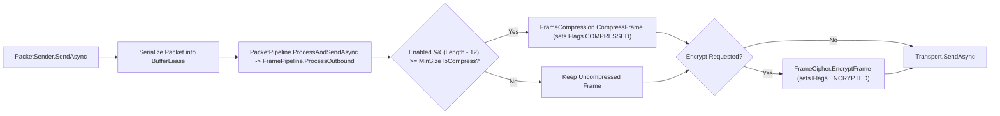

**Namespace:** `Nalix.Codec.Options`  
**Assembly:** `Nalix.Codec`

`CompressionOptions` controls whether outbound packet frames are compressed with LZ4 (`Enabled`), the minimum payload size before compression is attempted (`MinSizeToCompress`), and the maximum decompressed payload size allowed on inbound frames (`MaxDecompressedSize`).

## Source Mapping

- `src/Nalix.Codec/Options/CompressionOptions.cs`
- `src/Nalix.Codec/Transforms/FrameCompression.cs`
- `src/Nalix.Codec/Transforms/FramePipeline.cs`
- `src/Nalix.Runtime/Internal/Pipelines/PacketPipeline.cs`
- `src/Nalix.Runtime/Dispatching/PacketSender.cs`

## Defaults and Validation

| Property | Type | Default | Validation | Runtime Effect |
| :--- | :--- | ---: | :--- | :--- |
| `Enabled` | `bool` | `true` | None | Enables automatic outbound LZ4 frame compression when payload size meets `MinSizeToCompress`. |
| `MinSizeToCompress` | `int` | `512` | `[ValueRange(1, int.MaxValue)]` | Minimum payload size in bytes (excluding the 12-byte packet header) before outbound compression is attempted. |
| `MaxDecompressedSize` | `int` | `33_554_432` (`32 MB`) | `[ValueRange(1024, 268_435_456)]` (`1 KB..256 MB`) | Maximum allowed decompressed payload size in bytes for inbound `COMPRESSED` frames (protects against zip-bomb / allocation-DoS attacks). |

`Validate()` executes `this.ValidateDataAnnotations()` and enforces the cross-field rule `MinSizeToCompress <= MaxDecompressedSize` (throwing `ValidationException` on failure).

## Outbound & Inbound Pipeline Behavior (`FramePipeline` & `PacketPipeline`)

`PacketPipeline.ProcessAndSendAsync` (on outbound) and `TcpListenerBase`/`UdpListenerBase`/`WebSocketListenerBase` (on inbound) execute frame transforms through `FramePipeline`:



### Transform Ordering (`Compress-then-Encrypt`)

| Direction | Order | Details |
| :--- | :--- | :--- |
| **Outbound** (`FramePipeline.ProcessOutbound`) | **Compress $\rightarrow$ Encrypt** | Invoked by `PacketPipeline.ProcessAndSendAsync`; evaluates `(current.Length - PacketConstants.HeaderSize) >= minSizeToCompress`. High-entropy ciphertext cannot be compressed, so LZ4 compression always runs before AEAD encryption. |
| **Inbound** (`FramePipeline.ProcessInbound`) | **Decrypt $\rightarrow$ Decompress** | Decrypts `PacketFlags.ENCRYPTED` frames first, re-reads the restored `PacketFlags`, and if `PacketFlags.COMPRESSED` is set, validates the declared original length against `MaxDecompressedSize` before calling `FrameCompression.DecompressFrame(...)`. |

:::note[Inbound Decompression Independence]
`CompressionOptions.Enabled` only governs whether the local sender compresses outbound frames. Inbound frames carrying `PacketFlags.COMPRESSED` are always decompressed as long as their declared uncompressed size does not exceed `MaxDecompressedSize`.
:::

## Configuration Examples

### Programmatic Configuration

```csharp
using Nalix.Codec.Options;
using Nalix.Hosting;

INetworkApplicationBuilder builder = NetworkApplication.CreateBuilder();

builder.Configure<CompressionOptions>(options =>
{
    options.Enabled = true;
    options.MinSizeToCompress = 512;
    options.MaxDecompressedSize = 16 * 1024 * 1024; // 16 MB
});
```

### INI Configuration (`default.ini`)

```ini
[Compression]
Enabled = true
MinSizeToCompress = 512
MaxDecompressedSize = 33554432
```

## Related APIs

- [Packet Compression](../../codec/frame-pipeline.md)
- [Packet Sender](../../runtime/routing/packet-sender.md)
- [Network Options](./options.md)
