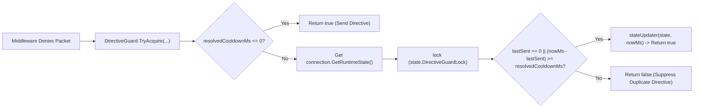

**Namespace:** `Nalix.Runtime.Options`  
**Assembly:** `Nalix.Runtime`

`DirectiveGuardOptions` (`public sealed partial class DirectiveGuardOptions : ConfigurationLoader, IValidatableConfiguration`) configures the per-connection cooldown enforced by `DirectiveGuard` before sending repeated inbound failure directives (`UNAUTHORIZED`, `RATE_LIMITED`, and `TIMEOUT`).

## Source Mapping

- `src/Nalix.Runtime/Options/DirectiveGuardOptions.cs`
- `src/Nalix.Runtime/Internal/RateLimiting/DirectiveGuard.cs`
- `src/Nalix.Runtime/Internal/RuntimeConnectionState.cs`
- `src/Nalix.Runtime/Extensions/ConnectionExtensions.cs`
- `src/Nalix.Runtime/Middleware/Standard/PermissionMiddleware.cs`
- `src/Nalix.Runtime/Middleware/Standard/RateLimitMiddleware.cs`
- `src/Nalix.Runtime/Middleware/Standard/TimeoutMiddleware.cs`

## Property Reference

Loaded from the `[DirectiveGuard]` section of `default.ini` via `ConfigurationManager.Instance.Get<DirectiveGuardOptions>()`:

| Property | Type | Default | Validation | Description |
| :--- | :--- | :---: | :--- | :--- |
| `DefaultCooldownMs` | `int` | `1_000` (`1000` ms) | `[ValueRange(0, 60000)]` | Minimum interval in milliseconds between repeated directives of the same category per connection (`0` disables suppression). |

## How `DirectiveGuard` Works

When an inbound middleware denies or times out a packet, it calls:

```csharp
DirectiveGuard.TryAcquire(
    IConnection connection,
    Func<RuntimeConnectionState, long> stateSelector,
    Action<RuntimeConnectionState, long> stateUpdater,
    int? cooldownMs = null)
```



### Per-Category Timestamps on `RuntimeConnectionState`

`DirectiveGuard` tracks three independent `Environment.TickCount64` timestamps on each connection's `RuntimeConnectionState` (guarded by `state.DirectiveGuardLock`):

| Middleware | Directive Reason | `RuntimeConnectionState` Property |
| :--- | :--- | :--- |
| `PermissionMiddleware` | `ProtocolReason.UNAUTHORIZED` | `InboundDirectiveUnauthorizedLastSentAtMs` |
| `RateLimitMiddleware` | `ProtocolReason.RATE_LIMITED` | `InboundDirectiveRateLimitedLastSentAtMs` |
| `TimeoutMiddleware` | `ProtocolReason.TIMEOUT` | `InboundDirectiveTimeoutLastSentAtMs` |

Suppressing a duplicate `Directive` only prevents outbound response amplification—the denied packet is still dropped and never reaches the handler.

## Related APIs

- [Permission Middleware](../../runtime/middleware/permission-middleware.md)
- [Policy Rate Limiter](../../runtime/middleware/policy-rate-limiter.md)
- [Timeout Middleware](../../runtime/middleware/timeout-middleware.md)
- [Token Bucket Options](./token-bucket-options.md)
