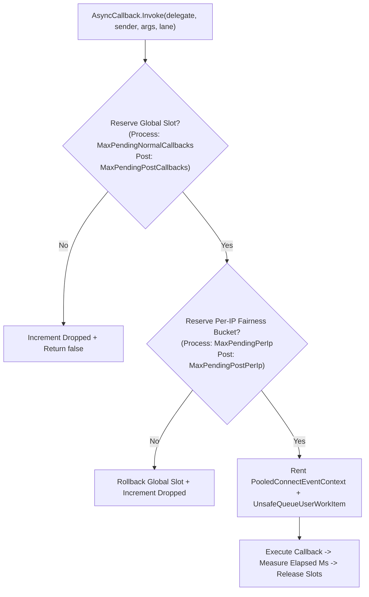

**Namespace:** `Nalix.Network.Options`  
**Assembly:** `Nalix.Network`

`NetworkCallbackOptions` configures two independent callback-pressure layers:
1. **Layer 1 (Per-Connection Throttles in `SocketConnection`)**: Caps pending receive packets (`MaxPerConnectionPendingPackets`) and open fragment reassembly streams (`MaxPerConnectionOpenFragmentStreams`) per connection, applying `OverflowPolicy` (`DropPacket` or `Disconnect`) when exceeded.
2. **Layer 2 (Global & Per-IP Fairness Lanes in `AsyncCallback`)**: Enforces separate budgets for inbound processing callbacks (`CallbackLane.Process`) and outbound post-processing callbacks (`CallbackLane.Post`) across global counters and a lock-free endpoint-hash fairness array (`FairnessMapSize`).

## Source Mapping

- `src/Nalix.Network/Options/NetworkCallbackOptions.cs`
- `src/Nalix.Abstractions/Networking/NetworkOverflowPolicy.cs`
- `src/Nalix.Network/Internal/Transport/SocketConnection.cs`
- `src/Nalix.Network/Internal/Transport/AsyncCallback.cs`
- `src/Nalix.Network/Connections/Connection.cs`
- `src/Nalix.Network/Internal/Pooling/PooledConnectEventContext.cs`

## Defaults and Validation

| Property | Type | Default | Valid Range | Runtime Effect |
| :--- | :--- | ---: | :--- | :--- |
| `MaxPerConnectionPendingPackets` | `int` | `16` | `1..1024` | Layer 1 cap for receive-path packets queued for one connection (`MessageProcessing`) but not yet completed. |
| `MaxPerConnectionOpenFragmentStreams` | `int` | `4` | `1..256` | Layer 1 cap for concurrently open fragmented packet streams on a single connection. |
| `OverflowPolicy` | `NetworkOverflowPolicy` | `DropPacket` (`0`) | `DropPacket` (`0`), `Disconnect` (`1`) | Action taken when a connection exceeds `MaxPerConnectionPendingPackets`: drop the incoming packet (`DropPacket`) or immediately close the connection (`Disconnect`). |
| `MaxPendingNormalCallbacks` | `int` | `10_000` | `100..1_000_000` | Layer 2 global cap for inbound processing callbacks (`CallbackLane.Process`) pending in `AsyncCallback`. |
| `CallbackWarningThreshold` | `int` | `5_000` | `0..1_000_000` | Emits backpressure warnings every `1,000` callbacks once pending normal callbacks reach this threshold (`0` disables warnings). |
| `MaxPendingPerIp` | `int` | `64` | `1..10_000` | Layer 2 per-endpoint fairness cap for `CallbackLane.Process` callbacks. |
| `MaxPendingPostCallbacks` | `int` | `5_000` | `100..1_000_000` | Layer 2 global cap for post-process (`MessageProcessed` / `CallbackLane.Post`) callbacks. |
| `MaxPendingPostPerIp` | `int` | `32` | `1..10_000` | Layer 2 per-endpoint fairness cap for `CallbackLane.Post` callbacks. |
| `MaxCallbackExecutionMs` | `int` | `50` | `1..60_000` | Execution time threshold (ms) for a single callback before a slow-callback warning is logged and `SlowCallbacks` is incremented. |
| `MaxPooledCallbackStates` | `int` | `1_000` | `64..100_000` | Configuration bound for reusable callback state wrappers. |
| `FairnessMapSize` | `int` | `16_384` | `1_024..65_536` | Size of the fixed `long[]` fairness buckets (`s_perIpProcessMap` and `s_perIpPostMap`) used for per-endpoint callback accounting. |

### Validation Rules

`Validate()` runs DataAnnotations validation followed by three cross-field checks:
- `CallbackWarningThreshold < MaxPendingNormalCallbacks` (when `CallbackWarningThreshold > 0`)
- `MaxPendingPerIp <= MaxPendingNormalCallbacks`
- `MaxPendingPostPerIp <= MaxPendingPostCallbacks`

## Layer 1: Per-Connection Receive Throttles (`Connection.OnFrameReceived` & `SocketConnection`)

When a complete frame is assembled in `SocketConnection.PROCESS_FRAME_FROM_BUFFER`, it calls `_connectionOwner?.OnFrameReceived(lease)` on the owning `Connection`. When `AsyncCallback.CanRunInline(backing.MessageProcessing)` is `false`, `Connection.OnFrameReceived` increments `backing.PendingProcessCallbacks` before queuing the frame:

- If the incremented counter exceeds `MaxPerConnectionPendingPackets`:
  - The counter is immediately decremented, `IncrementPacketsDropped()` is called, and the frame lease is disposed.
  - If `OverflowPolicy == NetworkOverflowPolicy.Disconnect`, the connection is closed immediately (`Disconnect()`) to protect the server from slow-consumer / flood abuse.
  - If `OverflowPolicy == NetworkOverflowPolicy.DropPacket` (default), the packet is dropped and the connection remains open.
- Otherwise, the frame is wrapped in `ConnectionEventArgs` and dispatched via:
  ```csharp
  AsyncCallback.Invoke(
      s_messageProcessingBridge,
      this,
      args,
      CallbackLane.Process,
      releasePendingPacketOnCompletion: true);
  ```
  When the callback finishes executing, `PooledConnectEventContext` notifies the connection (`ReleasePendingPacket()`) to decrement `backing.PendingProcessCallbacks`.

### Fragment Stream Cap

When a fragmented frame arrives and opens a new stream in `FragmentAssembler`, `SocketConnection` enforces `MaxPerConnectionOpenFragmentStreams`. If the count exceeds `MaxPerConnectionOpenFragmentStreams`, the stream is rejected and the frame is dropped. Expired fragment streams are periodically evicted via `FragmentAssembler.EvictExpired(...)`.

## Layer 2: `AsyncCallback` Dual-Lane Backpressure

`AsyncCallback` separates normal callbacks into two isolated lanes (`CallbackLane.Process` for `MessageProcessing` and `CallbackLane.Post` for `MessageProcessed`) plus a high-priority cleanup lane (`InvokeHighPriority` for `ConnectionClosed`):



### High-Priority Cleanup Lane

`AsyncCallback.InvokeHighPriority(...)` is used by `Connection` when raising `ConnectionClosed`. It bypasses `MaxPendingNormalCallbacks` and `MaxPendingPerIp` so disconnect cleanup and resource release always run even during severe callback saturation.

## Diagnostics (`AsyncCallbackMetrics`)

`AsyncCallback.GetStatistics()` returns an `internal readonly struct AsyncCallbackMetrics`:

| Property | Type | Description |
| :--- | :--- | :--- |
| `PendingProcess` | `int` | Live count of queued `CallbackLane.Process` callbacks. |
| `PendingPost` | `int` | Live count of queued `CallbackLane.Post` callbacks. |
| `Total` | `long` | Cumulative callbacks scheduled across all lanes. |
| `Dropped` | `long` | Cumulative callbacks rejected by global, per-IP, or ThreadPool backpressure. |
| `SlowCallbacks` | `long` | Cumulative callbacks whose execution time exceeded `MaxCallbackExecutionMs`. |
| `FairnessCollisions` | `long` | Cumulative hash-bucket collisions detected in the per-IP fairness maps. |
| `FairnessEvictions` | `long` | Cumulative fairness bucket evictions when idle slots are reclaimed. |

## INI Configuration Example

```ini
[NetworkCallback]
MaxPerConnectionPendingPackets = 16
MaxPerConnectionOpenFragmentStreams = 4
OverflowPolicy = DropPacket
MaxPendingNormalCallbacks = 10000
CallbackWarningThreshold = 5000
MaxPendingPerIp = 64
MaxPendingPostCallbacks = 5000
MaxPendingPostPerIp = 32
MaxCallbackExecutionMs = 50
MaxPooledCallbackStates = 1000
FairnessMapSize = 16384
```

## Related APIs

- [Connection Events](../../network/connection/connection-events.md)
- [Socket Connection](../../network/socket-connection.md)
- [Connection Guard Options](./connection-guard-options.md)
- [Pooling Options](./pooling-options.md)
- [Network Options](./options.md)
