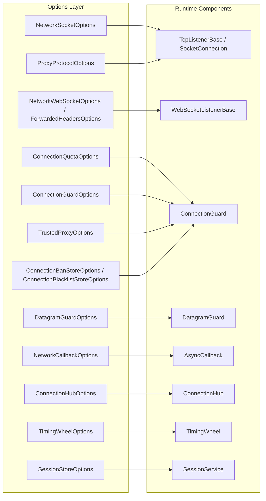

**Namespaces:** `Nalix.Network.Options`, `Nalix.Runtime.Options`, `Nalix.Codec.Options`  
**Assemblies:** `Nalix.Network`, `Nalix.Runtime`, `Nalix.Codec`

Network and runtime option classes inherit from `ConfigurationLoader` and map directly to INI sections in `default.ini` (via `ConfigurationManager.Instance.Get<TOptions>()` or `builder.Configure<TOptions>(...)`).

## Configuration Topology

## Option Ownership Matrix

| Option Type | Namespace / Package | INI Section | Primary Role |
| :--- | :--- | :--- | :--- |
| [NetworkSocketOptions](./network-socket-options.md) | `Nalix.Network.Options` | `[NetworkSocket]` | Port (`57206`), backlog (`512`), dual-stack IPv6 (`EnableDualStack = true`), buffers (`65536`), accept parallelism, and UDP datagram cap (`1440`). |
| `NetworkWebSocketOptions` | `Nalix.Network.Options` | `[NetworkWebSocket]` | WebSocket port (`57207`), path (`"/ws/"`), subprotocol (`"nalix.v1"`), DevOps endpoints (`/healthz`, `/version`, `/metrics`), and CSWSH `AllowedOrigins`. |
| `ProxyProtocolOptions` | `Nalix.Network.Options` | `[ProxyProtocol]` | HAProxy / AWS NLB PROXY Protocol v1/v2 real client IP extraction (`Enabled`, `RequireTrustedProxy`, `HeaderTimeoutMs = 2000`, `MaxPendingProxyConnections = 1024`). |
| `ForwardedHeadersOptions` | `Nalix.Network.Options` | `[ForwardedHeaders]` | L7 HTTP proxy header (`CF-Connecting-IP`, `X-Forwarded-For`) parsing for `WebSocketListenerBase`. |
| `VarIntFramingOptions` | `Nalix.Network.Options` | `[VarIntFraming]` | Maximum VarInt-framed payload size (`MaxPayloadSize = 131_072`). |
| [ConnectionQuotaOptions](./connection-quota-options.md) | `Nalix.Network.Options` | `[ConnectionQuota]` | Per-IP (`10`) and per-subnet (`50`) concurrency caps, rate windows (`5s`), burst detection, and adaptive Proof-of-Work (`AdaptivePowMinDifficulty = 12`). |
| [ConnectionGuardOptions](./connection-guard-options.md) | `Nalix.Network.Options` | `[ConnectionGuard]` | Global connection ceiling (`MaxConnections = 2000`), progressive banning (`EnableProgressiveBanning = true`), error threshold (`50`), and UDP packet rate (`128` pkt/s). |
| [TrustedProxyOptions](./trusted-proxy-options.md) | `Nalix.Network.Options` | `[TrustedProxy]` | Trusted reverse proxy / CDN allowlist (`"trusted_proxies.txt"`) and elevated connection ceilings (`5000`). |
| [ConnectionBanStoreOptions](./connection-ban-store-options.md) | `Nalix.Network.Options` | `[ConnectionBanStore]` | Disk persistence (`"banned_ips.bin"`) and 7-day decay window for dynamic IP bans. |
| [ConnectionBlacklistStoreOptions](./connection-blacklist-store-options.md) | `Nalix.Network.Options` | `[ConnectionBlacklistStore]` | Permanent IP/CIDR blocklist loaded from `"blacklist.txt"`. |
| `DatagramGuardOptions` | `Nalix.Network.Options` | `[DatagramGuard]` | Bounded IPv4 (`65,536`) / IPv6 (`16,384`) UDP source windows and replay window size (`UdpReplayWindowSize = 512` bits). |
| [ConnectionHubOptions](./connection-hub-options.md) | `Nalix.Network.Options` | `[ConnectionHub]` | Shard count (`max(1, ProcessorCount)`), broadcast batching, bulk disconnect parallelism, and latency logging. |
| [TimingWheelOptions](./timing-wheel-options.md) | `Nalix.Network.Options` | `[TimingWheel]` | Bucket count (`512`), tick interval (`1000` ms), and connection idle timeout (`60,000` ms). |
| [NetworkCallbackOptions](./network-callback-options.md) | `Nalix.Network.Options` | `[NetworkCallback]` | Per-connection pending packet cap (`16`), `OverflowPolicy`, global/per-IP callback caps (`10,000` / `64`), and `FairnessMapSize` (`16,384`). |
| [SessionStoreOptions](./session-store-options.md) | `Nalix.Runtime.Options` | `[SessionStore]` | Disconnected session resume TTL (`SessionTtl = 5m`) and `MinAttributesForPersistence` (`10`). |
| [CompressionOptions](./compression-options.md) | `Nalix.Codec.Options` | `[Compression]` | Outbound LZ4 compression threshold (`MinSizeToCompress = 512`) and inbound zip-bomb guard (`MaxDecompressedSize = 32 MB`). |
| [TokenBucketOptions](./token-bucket-options.md) | `Nalix.Runtime.Options` | `[TokenBucket]` | Sharded micro-token rate limiter burst/refill settings (`CapacityTokens = 64`, `RefillTokensPerSecond = 32.0`). |
| [DirectiveGuardOptions](./directive-guard-options.md) | `Nalix.Runtime.Options` | `[DirectiveGuard]` | Per-connection cooldown (`DefaultCooldownMs = 1000`) suppressing repeated failure directives. |

## VarInt Framing Configuration (`VarIntFramingOptions`)

`VarIntFramingOptions` (`src/Nalix.Network/Options/VarIntFramingOptions.cs`) maps to the `[VarIntFraming]` section in `default.ini` and configures maximum frame size for protocols using LEB128 VarInt length-prefixed framing (`TransportFraming.VarInt`, such as Minecraft-compatible streams):

| Property | Type | Default | Description |
| :--- | :--- | ---: | :--- |
| `MaxPayloadSize` | `int` | `131_072` (128 KB) | Maximum allowed payload size in bytes for a VarInt-framed packet. Connections sending frames larger than this limit are disconnected immediately. |

## Related APIs

- [Configuration System](../../environment/configuration.md)
- [Network Overview](../../network/index.md)
- [Runtime Overview](../../runtime/index.md)
