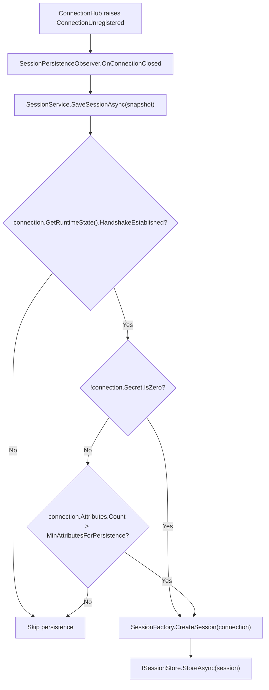

**Namespace:** `Nalix.Runtime.Options`  
**Assembly:** `Nalix.Runtime`

`SessionStoreOptions` controls how long disconnected sessions are retained for resumption (`SessionTtl`) and the minimum attribute threshold (`MinAttributesForPersistence`) required by `DefaultSessionPersistencePolicy` before a closing connection's state is persisted.

## Source Mapping

- `src/Nalix.Runtime/Options/SessionStoreOptions.cs`
- `src/Nalix.Runtime/Sessions/SessionService.cs`
- `src/Nalix.Runtime/Sessions/InMemorySessionStore.cs`
- `src/Nalix.Runtime/Sessions/SessionFactory.cs`
- `src/Nalix.Runtime/Sessions/DefaultSessionPersistencePolicy.cs`
- `src/Nalix.Runtime/Sessions/SessionPersistenceObserver.cs`

## Defaults and Validation

| Property | Type | Default | Validation | Runtime Consumer |
| :--- | :--- | ---: | :--- | :--- |
| `SessionTtl` | `TimeSpan` | `00:05:00` (5 min) | `[Required]`, `> TimeSpan.Zero` | `SessionFactory.CreateSession(IConnection)` sets `ExpiresAtUnixMilliseconds`. |
| `MinAttributesForPersistence` | `int` | `10` | `[ValueRange(0, int.MaxValue)]` | `DefaultSessionPersistencePolicy.ShouldPersist(IConnection)` fallback when `Secret.IsZero`. |

`Validate()` runs DataAnnotations validation (`ValidationException`) and verifies `SessionTtl > TimeSpan.Zero` (`ValidationException`).

:::note[Session TTL vs. Idle Timeout]
`SessionTtl` retains disconnected session state in `ISessionStore` so a client can resume after reconnecting. It does not control live socket idle disconnects—use [TimingWheelOptions.IdleTimeoutMs](./timing-wheel-options.md) for live connection reaping.
:::

## Session Persistence Flow



When `SessionFactory.CreateSession(IConnection connection)` snapshots a closing connection into a pooled `SessionEntry`:
- `SessionToken` is set to `connection.ConnectionId`.
- `CreatedAtUnixMilliseconds` and `ExpiresAtUnixMilliseconds` (`now + (long)_options.SessionTtl.TotalMilliseconds`) are recorded using `Clock.UnixMillisecondsNow()`.
- `Secret`, `Algorithm`, `Level`, and TCP/UDP sequence counters are copied from the connection.
- `connection.Attributes` are copied into a pooled `ObjectMap<AttributeKey, object>`.

## Automatic Persistence Policy (`DefaultSessionPersistencePolicy`)

`SessionPersistenceObserver` subscribes to `IConnectionHub.ConnectionUnregistered` and invokes `SessionService.SaveSessionAsync(snapshot)` asynchronously. `DefaultSessionPersistencePolicy.ShouldPersist(IConnection)` evaluates three rules in order:
1. **Policy 1 (Handshake Gate)**: If `!connection.GetRuntimeState().HandshakeEstablished`, returns `false`.
2. **Policy 2 (Active Cryptographic Session)**: If `!connection.Secret.IsZero` (active 32-byte encryption key established), returns `true` immediately.
3. **Policy 3 (Attribute Count Fallback)**: Otherwise returns `connection.Attributes.Count > _options.MinAttributesForPersistence` (default `10`).

## `InMemorySessionStore` Mechanics

When no custom `ISessionStore` is injected into `SessionService`, it creates an `InMemorySessionStore` (default capacity `MaxSessions = 65_536`) and schedules it as an `IWorker` on `TaskManager`:
- **Minute-Bucketed Expiration**: Sessions are indexed in a `ConcurrentDictionary<ulong, SessionEntry>` alongside 1-minute expiry buckets (`BucketSpanMilliseconds = 60_000`) so the background `IWorker` scavenger only inspects buckets whose timestamp has elapsed.
- **One-Shot Atomic Consumption**: `ConsumeAsync(ulong sessionToken, Func<SessionEntry, bool>? predicate, CancellationToken)` checks expiration and the optional `predicate` before atomically removing the entry and returning a `ValueTask<SessionScope>` (`new SessionScope(null)` with `scope.IsValid == false` if not found, expired, or rejected by `predicate`). Disposing a valid `SessionScope` automatically returns the `SessionEntry` and its `ObjectMap<AttributeKey, object>` to the pool.

## Configuration Examples

### Programmatic Configuration

```csharp
using System;
using Nalix.Hosting;
using Nalix.Runtime.Options;

INetworkApplicationBuilder builder = NetworkApplication.CreateBuilder();

builder.Configure<SessionStoreOptions>(options =>
{
    options.SessionTtl = TimeSpan.FromMinutes(10);
    options.MinAttributesForPersistence = 3;
});
```

### INI Configuration (`default.ini`)

```ini
[SessionStore]
SessionTtl = 00:05:00
MinAttributesForPersistence = 10
```

## Related APIs

- [Session Store](../../network/session-store.md)
- [Session Resume](../../security/session-resume.md)
- [Timing Wheel Options](./timing-wheel-options.md)
- [Network Options](./options.md)
