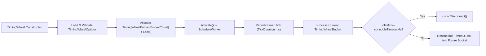

**Namespace:** `Nalix.Network.Options`  
**Assembly:** `Nalix.Network`

`TimingWheelOptions` (`public sealed partial class TimingWheelOptions : ConfigurationLoader, IValidatableConfiguration`) configures the hashed wheel timer ([TimingWheel](../../network/time/timing-wheel.md)) used by `Nalix.Network` to detect and close idle connections.

## Source Mapping

- `src/Nalix.Network/Options/TimingWheelOptions.cs`
- `src/Nalix.Network/Internal/Time/TimingWheel.cs`
- `src/Nalix.Network/Connections/Connection.cs`

## Defaults and Validation

Loaded from the `[TimingWheel]` section of `default.ini`:

| Property | Type | Default | Validation | Runtime Effect |
| :--- | :--- | ---: | :--- | :--- |
| `BucketCount` | `int` | `512` | `[ValueRange(1, int.MaxValue)]` | Number of `TimingWheelBucket` slots in the wheel (power-of-two values enable bitmask indexing). |
| `TickDuration` | `int` | `1000` | `[ValueRange(1, int.MaxValue)]` | Tick interval in milliseconds for the background `PeriodicTimer` worker loop. |
| `IdleTimeoutMs` | `int` | `60_000` (`60s`) | `[ValueRange(1, int.MaxValue)]` | Default connection idle threshold in milliseconds before `Disconnect()` is called. |
| `WheelDrainTimeoutMs` | `int` | `5000` (`5s`) | `[ValueRange(0, 60000)]` | Maximum milliseconds to wait for the timing wheel worker to drain gracefully during `Deactivate`. |

`Validate()` runs `this.ValidateDataAnnotations()` and throws `ValidationException` when constraints are violated.

:::note[Idle Timeout vs. Session TTL]
`IdleTimeoutMs` closes a live connection that stops sending frames. It is separate from [SessionStoreOptions.SessionTtl](./session-store-options.md), which controls how long a disconnected session snapshot remains resumable.
:::

## Runtime Bucket & Task Flow

- Each `TimingWheelBucket` uses a doubly-linked list of pooled `TimeoutTask` instances guarded by a per-bucket monitor lock (`lock (bucket)`) for $O(1)$ insertion and removal.
- `Connection`, `WebSocketConnection`, and `PassthroughConnection` initialize their per-connection `IdleTimeoutMs` from `TimingWheelOptions.IdleTimeoutMs` and can override it dynamically via `connection.UpdateIdleTimeout(newTimeoutMs)`.

## Related APIs

- [Timing Wheel](../../network/time/timing-wheel.md)
- [TCP Listener](../../network/tcp-listener.md)
- [Session Store Options](./session-store-options.md)
- [Network Options](./options.md)
