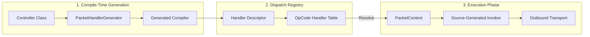

`Nalix.Runtime.Handlers` provides the core controller pattern and built-in protocol handlers that manage the basic handshaking, session management, and system control logic of the Nalix framework.

## Packet Controller Execution Model

The following diagram illustrates how your controller classes are transformed into high-performance execution units during startup.



## Built-in Handlers

Nalix includes industrial-strength handlers for standard protocol features. You can explore their implementations in the `src/Nalix.Runtime/Handlers` directory.

### `HandshakeHandlers`

Manages the server-side **X25519 Handshake** flow using session protocol frames.

- **Session Init**: `HandleSessionInitAsync(IPacketContext<SessionInit>)` processes the client's `SessionInit` frame, generates server ephemeral keys, computes the shared secret, and replies with `SessionChallenge`.
- **Session Proof**: `HandleSessionProofAsync(IPacketContext<SessionProof>)` verifies the client's proof, derives the session key, sets `connection.Secret` and `connection.Algorithm`, persists resumable session state, and replies with `SessionEstablished`.
- **Security**: Marked with `[ReservedOpcodePermitted]`, `[PacketEncryption(false)]`, and `[PacketPermission(PermissionLevel.NONE)]` as the handshake runs before secure communications are established.
- **Session Integration**: Automatically creates a resumable session entry upon a successful handshake.

### `SessionHandlers`

Manages the **Session Resumption** protocol (`HandleAsync(IPacketContext<SessionResume>)`, opcode `ProtocolOpCode.SESSION_SIGNAL`).

- **Token Verification**: Validates session tokens against the `ISessionService`.
- **State Restoration**: Reloads secret keys, permission levels, and connection attributes to restore a dropped connection instantly.
- **Stream only**: Returns without acting when `context.Connection.Transport` is an `IDatagramTransport`.

### `ProofOfWorkHandlers`

Handles the client's solution packet (`HandleAsync(IPacketContext<ProofOfWorkProof>)`, opcode `ProtocolOpCode.POW_PROOF`). It is `static` and synchronous (`void`), ignores datagram connections, and returns early when the connection is already at `PermissionLevel.POW_VERIFIED` or above.

### `SystemControlHandlers`

Handles global **Control Signaling** (`ProtocolOpCode.SYSTEM_CONTROL`, `HandleAsync(IPacketContext<Control>)`).

- **Teardown**: Manages orderly `DISCONNECT` sequences.
- **Security control**: `SESSION_REKEY`, `CIPHER_UPDATE`, `POW_REQUEST` and `PUBLIC_KEY_REQUEST` are answered here; `ERROR`, `FAIL` and `NOTICE` are logged.
- **PING / TIMESYNCREQUEST**: not handled here; `PING` is a no-op in this handler because `SystemTimeSyncHandlers` owns them.

### `SystemTimeSyncHandlers`

Handles `ProtocolOpCode.SYSTEM_TIMESYNC` (`HandleAsync(IPacketContext<TimeSync>)`): answers `PING` with `PONG` (echoing `Timestamp` and `MonoTicks`) and `TIMESYNCREQUEST` with `TIMESYNCRESPONSE`.

### `DatagramTicketHandlers`

Issues **datagram session tickets** over an established stream connection (`[PacketHandler("Nalix.Datagram")]`, opcode `ProtocolOpCode.DATAGRAM_TICKET`, `HandleAsync(IPacketContext<DatagramTicket>)`). It only answers `DatagramTicketStage.REQUEST` frames and replies with a ticket from the registered `IDatagramTicketIssuer`, or with a refusal reason:

| Condition | Refusal (`ProtocolReason`) |
| :--- | :--- |
| Handshake not established or `connection.Secret` is zero | `UNAUTHENTICATED` |
| The request itself arrived over an `IDatagramTransport` | `STATE_VIOLATION` |
| No `IDatagramTicketIssuer` registered, or `IssueTicket` throws `InvalidOperationException` | `SERVICE_UNAVAILABLE` |

The datagram connection inherits the completed handshake of the stream connection (`HandshakeEstablished = true`). Source: `src/Nalix.Runtime/Handlers/DatagramTicketHandlers.cs`. The client side is [DatagramSession](../../sdk/udp-session.md).

### Static configuration (`HandshakeHandlers`)

`HandshakeHandlers` additionally exposes `Initialize()` (loads `certificate.private` from the configuration directory once), `SetCertificatePath(string path)`, `ConfigureContextPool(int maxCapacity, int preallocCount = 0)` and the `ServerPublicKey` property (`Bytes32`). Like the other session handlers, `HandleSessionInitAsync` ignores datagram connections. Certificates are loaded and saved through `FileCertificateStore` (`ICertificateStore.Load(path)` / `Save(path, privateKey, publicKey)`), which generates an X25519 key pair when the file is missing.

## Controller Implementation (Source-Verified)

To implement a custom handler, use the following pattern:

```csharp
[PacketHandler("MyModule")]
public class MyController 
{
    [PacketOpcode(0x1000)]
    public async ValueTask HandleRequestAsync(IPacketContext<MyPacket> context)
    {
        // Business logic here
        // ReplyAsync copies the request SequenceId so the client's RequestAsync can match the response.
        await context.Sender.ReplyAsync(new MyResponse());
    }
}
```

### Key Attributes

- `[PacketHandler(string tag)]`: Identifies a class as a candidate for source-generation by `PacketHandlerGenerator`.
- `[PacketOpcode(ushort opcode)]`: Maps a specific opcode to a method.
- `[PacketEncryption(bool, CipherSuiteType)]`: Overrides the default security requirement and algorithm for this handler.
- `[PacketPermission(PermissionLevel)]`: Enforces specific access levels before execution starts. Defaults to `PermissionLevel.USER`.

## Related Information

- [Implementing Packet Handlers](../../../guides/application/packet-handlers.md)
- [Packet Attributes](../../abstractions/packet-attributes.md)
- [Packet Metadata](../../abstractions/packet-metadata.md)
- [Handler Result Types](../routing/handler-results.md)
