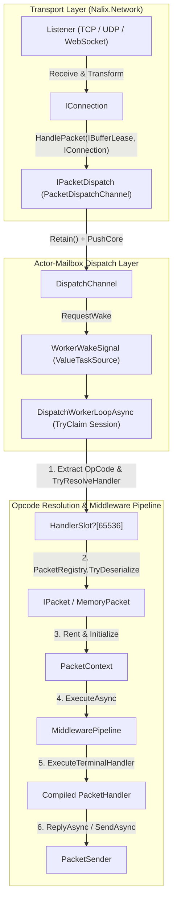

**Namespaces:** `Nalix.Runtime.Dispatching`, `Nalix.Runtime.Routing`, `Nalix.Runtime.Middleware`, `Nalix.Runtime.Middleware.Standard`, `Nalix.Runtime.Throttling`, `Nalix.Runtime.Handlers`, `Nalix.Runtime.Sessions`, `Nalix.Runtime.Options`  
**Assembly:** `Nalix.Runtime`

`Nalix.Runtime` is the server-side execution engine that bridges raw transport frames (`IBufferLease`) and strongly-typed `[PacketHandler]` controllers. It owns the connection-isolated dispatch queues, middleware pipeline, per-endpoint and per-policy rate limiters, built-in handshake/session/control handlers, and pooled execution contexts.

## Runtime Execution Landscape

## Core Public Namespaces & Types

### 1. Dispatching & Routing (`Nalix.Runtime.Dispatching`, `Nalix.Runtime.Routing`)

| Type | Role | Reference |
| :--- | :--- | :--- |
| `IPacketDispatch` | Entry-point interface (`HandlePacket(IBufferLease, IConnection)`, `IActivatable`, `IReportable`) used by listeners to hand off frames. | [Dispatch Contracts](./routing/dispatch-contracts.md) |
| `IDispatchChannel<TPacket>` / `IDispatchSession` | Actor-mailbox queue contract ensuring strict per-connection ordering across concurrent worker loops. | [Dispatch Contracts](./routing/dispatch-contracts.md) |
| `PacketDispatchChannel` | Production dispatcher with coalesced `WorkerWakeSignal` wake-ups, weighted round-robin priority draining, and zero-allocation sync fast paths. | [Packet Dispatch](./routing/packet-dispatch.md) |
| `PacketDispatcherBase<TPacket>` | Abstract base class holding `PacketDispatchOptions<TPacket>`. | [Dispatch Channel and Router](./routing/dispatch-channel-and-router.md) |
| `PacketDispatchOptions<TPacket>` | Fluent builder (`WithHandler`, `WithMiddleware`, `WithErrorHandling`, `WithDispatchLoopCount`) and $O(1)$ 65,536-slot handler table. | [Packet Dispatch Options](../options/runtime/packet-dispatch-options.md) |
| `PacketContext<TPacket>` | Pooled execution context (`IPacketContext<TPacket>`) carrying `Packet`, `Connection`, `Attributes`, `Sender`, `Scope`, `IsReliable`, and `EncryptedOnWire`. | [Packet Context](./routing/packet-context.md) |
| `PacketSender` | Metadata-aware outbound sender (`SendAsync`, `ReplyAsync`) bound to `PacketContext<TPacket>`. | [Packet Sender](./routing/packet-sender.md) |

### 2. Middleware & Throttling (`Nalix.Runtime.Middleware`, `Nalix.Runtime.Throttling`)

| Type | Role | Reference |
| :--- | :--- | :--- |
| `MiddlewarePipeline<TPacket>` | Three-stage (`Inbound`, `OutboundAlways`, `Outbound`) pipeline with pooled `PooledPipelineContext` runners. | [Middleware Pipeline](./middleware/pipeline.md) |
| `PermissionMiddleware` | Fail-closed inbound security guard (`Order = -50`) enforcing `[PacketPermission]`. | [Permission Middleware](./middleware/permission-middleware.md) |
| `RateLimitMiddleware` | Inbound throttling guard (`Order = 50`) routing between `PolicyRateLimiter` and `TokenBucketLimiter`. | [Middleware Overview](./middleware/index.md) |
| `TimeoutMiddleware` | Inbound execution timeout guard (`Order = 75`) using pooled `PooledCancellationTokenSource` instances. | [Timeout Middleware](./middleware/timeout-middleware.md) |
| `PolicyRateLimiter` | Stateless `[PacketRateLimit]` evaluator backed by `ScopedEndpoint` caching and the shared `TokenBucketLimiter`. | [Policy Rate Limiter](./middleware/policy-rate-limiter.md) |
| `TokenBucketLimiter` | Sharded, fixed-point micro-token rate limiter with CPU-adaptive scaling and soft-to-hard lockout escalation. | [Token Bucket Limiter](./middleware/token-bucket-limiter.md) |

### 3. Configuration Options (`Nalix.Runtime.Options`)

- [DispatchOptions](../options/runtime/dispatch-options.md) — Per-connection queue bounds (`MaxPerConnectionQueue = 4096`), `DropPolicy`, and `PriorityWeights`.
- [PacketDispatchOptions and PacketDrainOptions](../options/runtime/packet-dispatch-options.md) — Worker loop counts, CPU core affinities, and per-wake drain budgets.
- [TokenBucketOptions](../options/network/token-bucket-options.md) — Burst capacity, refill rate, shard count, and soft/hard violation windows.
- [DirectiveGuardOptions](../options/network/directive-guard-options.md) — Per-connection cooldown (`DefaultCooldownMs = 1000`) suppressing repeated failure directives.

## Related APIs

- [Routing Overview](./routing/index.md)
- [Middleware Overview](./middleware/index.md)
- [Handler Return Types](./routing/handler-results.md)
- [Packet Handler Generator](../analyzers/autogen/packet-handler-generator.md)
