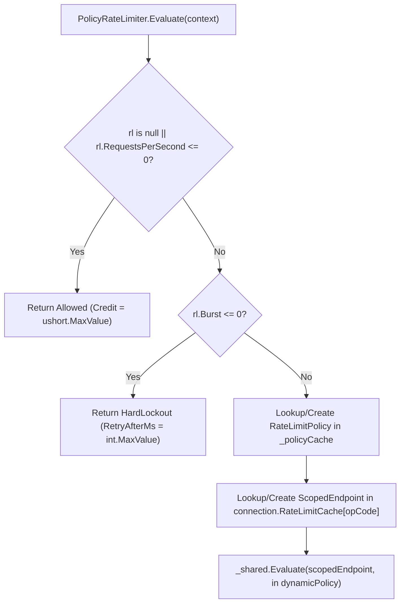

**Namespaces:** `Nalix.Runtime.Throttling`, `Nalix.Runtime.Middleware.Standard`  
**Assembly:** `Nalix.Runtime`

`PolicyRateLimiter` (`[Injectable] public sealed class PolicyRateLimiter : IReportable, IDisposable`) evaluates handler-level `[PacketRateLimit]` policies using a stateless `RateLimitPolicy` cache, per-connection `ScopedEndpoint` caching (`connection.RateLimitCache`), and the shared singleton `TokenBucketLimiter` engine.

## Source Mapping

- `src/Nalix.Runtime/Throttling/PolicyRateLimiter.cs`
- `src/Nalix.Runtime/Middleware/Standard/RateLimitMiddleware.cs`
- `src/Nalix.Abstractions/Networking/Packets/PacketRateLimitAttribute.cs`
- `src/Nalix.Runtime/Throttling/TokenBucketLimiter.cs`
- `src/Nalix.Runtime/Options/TokenBucketOptions.cs`

## `[PacketRateLimit]` Attribute

```csharp
[AttributeUsage(AttributeTargets.Method, AllowMultiple = false, Inherited = true)]
public sealed class PacketRateLimitAttribute(
    int requestsPerSecond,
    double burst = 1.0) : Attribute
{
    public int RequestsPerSecond { get; } = requestsPerSecond;
    public double Burst { get; } = burst;
    public string? PolicyId { get; init; }
    public int HardLockoutSeconds { get; init; } = -1;
    public int MaxSoftViolations { get; init; } = -1;
}
```

| Property | Type | Default | Description |
| :--- | :--- | :---: | :--- |
| `RequestsPerSecond` | `int` | — | Sustained refill rate in requests/sec (`<= 0` bypasses policy limits). |
| `Burst` | `double` | `1.0` | Bucket capacity in tokens (`<= 0` is treated as an invalid hard lockout denial). |
| `HardLockoutSeconds` | `int` | `-1` | Hard lockout duration in seconds when soft violations escalate (`<= 0` falls back to `TokenBucketOptions.HardLockoutSeconds`). |
| `MaxSoftViolations` | `int` | `-1` | Soft violations before escalating to hard lockout (`<= 0` falls back to `TokenBucketOptions.MaxSoftViolations`). |
| `PolicyId` | `string?` | `null` | Optional shared policy group identifier. Handlers sharing the same `PolicyId` share the same per-IP token bucket across opcodes. |

## How `RateLimitMiddleware` & `PolicyRateLimiter` Work Together

`RateLimitMiddleware` (`[MiddlewareOrder(50)] [MiddlewareStage(MiddlewareStage.Inbound)]`) inspects `context.Attributes.RateLimit`:

- **When `[PacketRateLimit]` is present**: Calls `_policy.Evaluate(context)`.
- **When `[PacketRateLimit]` is absent**: Calls `_global.Evaluate(context.Connection.NetworkEndpoint)` using the global endpoint `TokenBucketLimiter`.
- **On Denial (`!decision.Allowed`)**: If `DirectiveGuard.TryAcquire` permits (using `RuntimeConnectionState.InboundDirectiveRateLimitedLastSentAtMs`), sends `Directive(ControlType.FAIL, ProtocolReason.RATE_LIMITED, ProtocolAdvice.RETRY, sequenceId, ControlFlags.IS_TRANSIENT, arg0: OpCode, arg1: (uint)decision.RetryAfterMs, arg2: decision.Credit)`.

## Zero-Allocation `ScopedEndpoint` & Direct State Caching



To avoid allocations and hash table lookups on the packet hot path:

1. **Composite Key (`ScopedEndpoint`)**: Isolates buckets by `(PolicyId ?? OpCode, Remote IP Address)` (ignoring remote port to prevent port-rotation bypass).
2. **Per-Connection Cache (`connection.RateLimitCache`)**: The `ScopedEndpoint` for a given `OpCode` is allocated once per connection and stored in `connection.RateLimitCache`.
3. **Direct `EndpointState` Reference (`ScopedEndpoint.CachedState`)**: On the first evaluation, `TokenBucketLimiter` caches the resolved `EndpointState` reference and `Generation` directly on `ScopedEndpoint`. Subsequent packets on that connection bypass the shard `ConcurrentDictionary` lookup entirely!

## Diagnostics (`IReportable`)

- `GenerateReport()` prints the `Evaluate Counter` (`CheckCounter`) followed by the embedded `--- Shared TokenBucket Engine Report ---` (`_shared.GenerateReport()`).
- `WriteReportData(Utf8JsonWriter)` writes `UtcNow`, `CheckCounter`, and nested `SharedEngine` JSON object.

## Related APIs

- [Token Bucket Limiter](./token-bucket-limiter.md)
- [Token Bucket Options](../../options/network/token-bucket-options.md)
- [Middleware Pipeline](./pipeline.md)
- [Packet Attributes](../../abstractions/packet-attributes.md)
