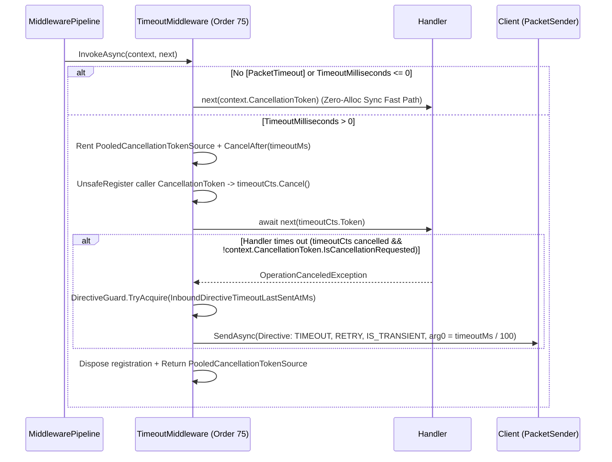

**Namespace:** `Nalix.Runtime.Middleware.Standard`  
**Assembly:** `Nalix.Runtime`

`TimeoutMiddleware` (`[MiddlewareOrder(75)] [MiddlewareStage(MiddlewareStage.Inbound)] public sealed class TimeoutMiddleware : IPacketMiddleware<IPacket>`) enforces per-handler execution time limits configured via `[PacketTimeout(timeoutMilliseconds)]`.

## Source Mapping

- `src/Nalix.Runtime/Middleware/Standard/TimeoutMiddleware.cs`
- `src/Nalix.Abstractions/Networking/Packets/PacketTimeoutAttribute.cs`
- `src/Nalix.Runtime/Internal/RateLimiting/DirectiveGuard.cs`
- `src/Nalix.Codec/ProtocolFrames/Directive.cs`

## Pooled Timer Architecture (`PooledCancellationTokenSource`)

To avoid allocating a new `CancellationTokenSource` on every timed packet, `TimeoutMiddleware` maintains an internal `PooledCancellationTokenSource` class registered in `ObjectPoolManager.Shared` (`MaxCapacity = 2048`, `Prealloc = 16`) that calls `CancellationTokenSource.TryReset()` when returned to the pool.



## Timeout Directive Format

When `timeoutCts.Token` fires while `context.CancellationToken` is **not** cancelled (distinguishing a handler timeout from a normal connection disconnect), and `DirectiveGuard` permits sending, `TimeoutMiddleware` sends a pooled `Directive` (`0x0008`, 21 bytes) using `CancellationToken.None`:

| Field | Value |
| :--- | :--- |
| `Type` | `ControlType.TIMEOUT` |
| `Reason` | `ProtocolReason.TIMEOUT` |
| `Action` | `ProtocolAdvice.RETRY` |
| `SequenceId` | `context.Packet.Header.SequenceId` |
| `Control` | `ControlFlags.IS_TRANSIENT` |
| `Arg0` | `(uint)(timeoutMilliseconds / 100)` |

## Usage Example

```csharp
using System.Threading;
using System.Threading.Tasks;
using Nalix.Abstractions.Networking.Packets;
using Nalix.Runtime.Middleware.Standard;

// 1. Register TimeoutMiddleware in PacketDispatchOptions
builder.ConfigureDispatch(options =>
{
    options.WithMiddleware(new TimeoutMiddleware());
});

// 2. Decorate slow/IO-bound handlers with [PacketTimeout]
[PacketHandler]
public sealed class MatchmakingController
{
    [PacketOpcode(0x4001)]
    [PacketTimeout(3000)] // 3000 ms (3 seconds)
    public async ValueTask FindMatchAsync(IPacketContext<FindMatchPacket> context, CancellationToken ct)
    {
        // ct is automatically linked to the 3-second PooledCancellationTokenSource
        await MatchmakerService.WaitForOpponentAsync(context.Connection, ct);
    }
}
```

## Related APIs

- [Middleware Pipeline](./pipeline.md)
- [Permission Middleware](./permission-middleware.md)
- [Policy Rate Limiter](./policy-rate-limiter.md)
- [Directive Guard Options](../../options/network/directive-guard-options.md)
