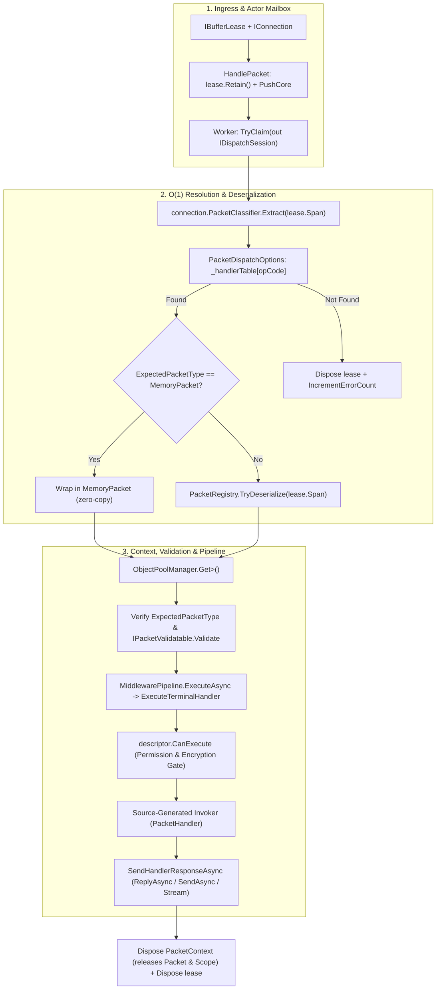

**Namespaces:** `Nalix.Runtime.Dispatching`, `Nalix.Runtime.Routing`  
**Assembly:** `Nalix.Runtime`

`Nalix.Runtime.Dispatching` and `Nalix.Runtime.Routing` contain the execution APIs that transform retained `IBufferLease` frames into strongly-typed handler invocations with strict per-connection ordering and zero-allocation synchronous fast paths.

## OpCode Dispatch Pipeline

## Internal Workflow (Source-Verified)

1. **$O(1)$ Handler Resolution**: `PacketDispatchOptions<TPacket>` stores compiled `PacketHandler<TPacket>` descriptors in a flat 65,536-element array (`HandlerSlot?[ushort.MaxValue + 1]`). Resolving an opcode is a single `Volatile.Read` array index lookup.
2. **Actor-Mailbox Session Claiming**: `DispatchChannel<IPacket>` groups queued frames by connection and priority (`URGENT` down to `NONE`). A worker claims exclusive ownership of a connection via `TryClaim(out IDispatchSession session)`, guaranteeing that packets from the same connection are processed sequentially in arrival/priority order without cross-worker races.
3. **Pooled `PacketContext<TPacket>`**: Before invoking middleware or the handler, the runtime rents a `PacketContext<TPacket>` from `ObjectPoolManager.Shared` (preallocated to `128` instances) and initializes it with `ownsPacket: true`. When the context is disposed, it automatically disposes both the deserialized packet and any scoped `[FromScope]` services.
4. **Built-in Type, Validation, Permission & Encryption Gates**:
   - Runtime type verification (`expectedType.IsInstanceOfType(context.Packet)`) sends `Directive(FAIL, REQUEST_INVALID, FIX_AND_RETRY)` on mismatch.
   - Structural validation (`IPacketValidatable.Validate(out string? failureReason)`) sends `Directive(FAIL, MALFORMED_PACKET, FIX_AND_RETRY)` on invalid payloads.
   - Terminal policy check (`descriptor.CanExecute`) verifies `[PacketEncryption]` (`context.EncryptedOnWire`) and `[PacketPermission]` (`context.Connection.Level`) even when no middleware is registered.
5. **Return-Value Dispatch**: Source-generated invokers support `void`, `Task`, `ValueTask`, `TPacket` / `IPacket`, `byte[]`, `Memory<byte>`, `ReadOnlyMemory<byte>`, and `IAsyncEnumerable<TPacket>` (streaming with automatic `IPacketStreamable.IsEndOfStream` marking on the final item).

## Public Surface

- [Dispatch Contracts (IPacketDispatch, IDispatchChannel<TPacket>, IDispatchSession)](./dispatch-contracts.md)
- [Packet Dispatch (PacketDispatchChannel)](./packet-dispatch.md)
- [Dispatch Channel and Router (DispatchChannel<TPacket>, PacketDispatcherBase<TPacket>)](./dispatch-channel-and-router.md)
- [Packet Context (PacketContext<TPacket>)](./packet-context.md)
- [Packet Sender (PacketSender)](./packet-sender.md)
- [Handler Return Types](./handler-results.md)

## Related APIs

- [Packet Dispatch Options](../../options/runtime/packet-dispatch-options.md)
- [Dispatch Options](../../options/runtime/dispatch-options.md)
- [Packet Handler Generator](../../analyzers/autogen/packet-handler-generator.md)
- [Middleware Pipeline](../middleware/pipeline.md)
