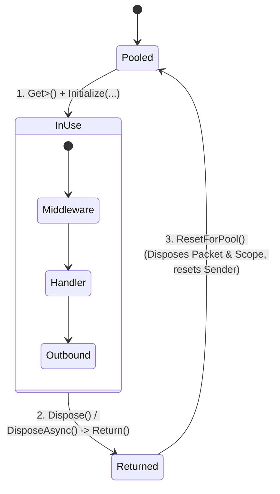

**Namespace:** `Nalix.Runtime.Dispatching`  
**Assembly:** `Nalix.Runtime`

`PacketContext<TPacket>` (`public sealed class PacketContext<TPacket> : IPacketContext<TPacket>, IPoolable, IDisposable, IAsyncDisposable where TPacket : IPacket`) is the concrete pooled runtime object representing a single packet execution. Application handlers and middleware consume it through `IPacketContext<TPacket>`.

## Source Mapping

- `src/Nalix.Abstractions/Networking/Packets/IPacketContext.cs`
- `src/Nalix.Runtime/Dispatching/PacketContext.cs`
- `src/Nalix.Runtime/Dispatching/PacketScope.cs`

## Context Lifecycle & Pooling

The static constructor pre-configures `ObjectPoolManager.Shared` with `SetMaxCapacity<PacketContext<TPacket>>(128)` and `Prealloc<PacketContext<TPacket>>(128)`.

## Public Properties (`IPacketContext<TPacket>`)

| Property | Type | Description |
| :--- | :--- | :--- |
| `Packet` | `TPacket` | The deserialized request packet for the current invocation. |
| `Connection` | `IConnection` | The client connection that sent the packet. |
| `Attributes` | `PacketMetadata` | Compile-time/registration-time handler metadata (`PacketOpcode`, `Timeout`, `Permission`, `Encryption`, `Transport`, `RateLimit`, `CustomAttributes`). |
| `Sender` | `IPacketSender` | Context-bound `PacketSender` initialized with `Connection`, `Attributes`, `IsReliable`, and the request's `SequenceId`. |
| `Scope` | `IPacketScope` | Per-packet dependency injection scope used to resolve `[FromScope]` handler parameters (`GetRequiredService<T>`, `GetService<T>`, `GetOrAdd<T>`). |
| `CancellationToken` | `CancellationToken` | Token linked to the dispatch worker loop (and wrapped by `TimeoutMiddleware` when `[PacketTimeout]` is active). |
| `IsReliable` | `bool` | `true` when the packet arrived over a reliable transport (TCP/WebSocket); `false` when it arrived over UDP. |
| `EncryptedOnWire` | `bool` | `true` when the inbound frame arrived encrypted and was authenticated/decrypted by `FramePipeline` / `FrameCipher`. |
| `SkipOutbound` | `bool` | When `true`, skips the normal `Outbound` middleware stage (automatically set to `true` for `void`, `Task`, and `ValueTask` handlers). |

## Lifecycle & Ownership Rules

1. **Automatic Packet & Scope Disposal**: `ExecuteResolvedHandlerAsync` initializes `PacketContext<TPacket>` with `ownsPacket: true`. When `ResetForPool()` / `DisposeAsync()` runs at the end of dispatch:
   - If `Packet` implements `IDisposable` (such as any `PacketBase<TSelf>` subclass), `Packet.Dispose()` is called automatically to return the packet to its object pool.
   - `Scope` (`PacketScope`) is disposed (supporting both `IAsyncDisposable` and `IDisposable` scoped services) and reset for pooling.
2. **Never Store `IPacketContext<TPacket>` Beyond Handler Scope**: Because the context, its `Packet`, and its `Scope` are recycled as soon as the handler's `ValueTask`/`Task` completes, never capture `context` or `context.Packet` in background tasks or static fields (enforced by analyzer **`NALIX076`**).
3. **Idempotent Return**: `Dispose()` and `DisposeAsync()` transition `_state` atomically from `InUse` to `Returned` via `Interlocked.Exchange`, preventing double-return bugs.

## Related APIs

- [Packet Sender (PacketSender)](./packet-sender.md)
- [Packet Metadata](../../abstractions/packet-metadata.md)
- [Packet Dispatch (PacketDispatchChannel)](./packet-dispatch.md)
- [Object Pooling](../../framework/memory/object-pooling.md)
