**Namespace:** `Nalix.Runtime.Dispatching`  
**Assembly:** `Nalix.Runtime`

`PacketDispatchChannel` (`public sealed class PacketDispatchChannel : PacketDispatcherBase<IPacket>, IPacketDispatch, IDisposable, IActivatable`) is the runtime bridge between transport buffers (`IBufferLease`) and `[PacketHandler]` methods. It manages background worker loops, coalesced wake signaling (`WorkerWakeSignal`), $O(1)$ opcode resolution, `PacketRegistry` deserialization, and deterministic lease/packet disposal.

## Source Mapping

- `src/Nalix.Runtime/Dispatching/PacketDispatchChannel.cs`
- `src/Nalix.Runtime/Internal/Routing/DispatchChannel.cs`
- `src/Nalix.Runtime/Internal/Routing/WorkerWakeSignal.cs`
- `src/Nalix.Runtime/Dispatching/Options/PacketDispatchOptions.cs`
- `src/Nalix.Runtime/Options/PacketDrainOptions.cs`

## Runtime Flow

```mermaid
flowchart LR
    A["Transport IBufferLease"] --> B["HandlePacket(lease, connection)"]
    B --> C["lease.Retain() + _dispatch.PushCore(...)"]
    C -->|readyEmitted == true| D["RequestWake() -> WorkerWakeSignal.Set()"]
    D --> E["DispatchWorkerLoopAsync: _dispatch.TryClaim(out session)"]
    E --> F["Extract OpCode & Options.TryResolveHandler"]
    F --> G["PacketRegistry.TryDeserialize / MemoryPacket"]
    G --> H["ExecuteResolvedHandlerAsync (Middleware + Handler)"]
    H --> I["Dispose PacketContext + Dispose lease"]
```



## `HandlePacket` Handoff Semantics

`HandlePacket(IBufferLease lease, IConnection connection)` executes on the transport receive thread:

1. Disposes `lease` and returns immediately if `lease` or `connection` is `null`.
2. If `connection.TCP.Framing == TransportFraming.UInt16LengthPrefixed` and `lease.Length < PacketConstants.HeaderSize` (`6` bytes), disposes `lease`, calls `connection.IncrementErrorCount()`, and returns.
3. Calls `lease.Retain()` to increment the buffer's reference count before asynchronous handoff.
4. Enqueues via `_dispatch.PushCore(connection, lease, out bool readyEmitted, noBlock: true)`. If the queue rejects the packet (full or connection closed), disposes the retained `lease` and increments `_totalDropped`.
5. If `readyEmitted` is `true` (the connection just became claimable), calls `RequestWake()` to wake one parked worker.

## Worker Loop Sizing & CPU Affinity (`Activate`)

`Activate(CancellationToken)` schedules worker loops through `TaskManager.ScheduleWorker` (`net.dispatch.process.{i}` in group `net/dispatch` with `WorkerPriority.HIGH`). The number of loops (`_dispatchLoops`) is resolved in priority order:

| Condition | Resolved `_dispatchLoops` | Execution Mode |
| :--- | :--- | :--- |
| `Options.Drain.DispatchProcessorAffinities` is non-empty (e.g. `"0,2,4,6"`) | Number of parsed core indices (`affinityCores.Length`) | Dedicated OS thread (`OSPriority = ThreadPriority.Normal`) pinned to `affinityCores[i]` |
| `Options.Drain.Count > 0` (set via `WithDispatchLoopCount(n)` or INI) | `Options.Drain.Count` | Async `ThreadPool` worker |
| Default (`Options.Drain.Count == 0` and no affinities) | `Math.Clamp(Environment.ProcessorCount, Options.Drain.MinDispatchLoops, Options.Drain.MaxDispatchLoops)` | Async `ThreadPool` worker |

## Coalesced Wake & Drain Mechanics

Each worker owns an allocation-free `WorkerWakeSignal` (backed by `ManualResetValueTaskSourceCore<bool>`) and an atomic parked flag (`_parked[i]`):

- **Drain Budget (`_maxDrainPerWake`)**: Calculated in the constructor as:
  ```csharp
  Math.Clamp(
      Environment.ProcessorCount * Options.Drain.MaxDrainPerWakeMultiplier,
      Options.Drain.MinDrainPerWake,
      Options.Drain.MaxDrainPerWake)
  ```
- **Burst Fan-Out**: When a worker claims a connection (`_dispatch.TryClaim(out session)`) and observes `_dispatch.HasClaimableConnection == true`, it immediately calls `RequestWake()` so another parked worker wakes up in parallel.
- **Lost-Wake Prevention**: Before parking, a worker sets `_parked[index] = 1` via `Interlocked.Exchange`, spins briefly (`16` iterations of `Thread.SpinWait(8)`), and re-checks `_dispatch.HasClaimableConnection` before awaiting `signal.WaitAsync()`.

## Execution and Disposal Guarantees (`ExecutePacketAsync`)

For each dequeued `IBufferLease`:

1. **OpCode Extraction**: Calls `connection.PacketClassifier.Extract(lease.Span)` and reads `lease.IsReliable` and `lease.EncryptedOnWire`.
2. **Early Handler Lookup**: Calls `Options.TryResolveHandler(opcode, out handler)` **before** deserializing. If no handler is registered for `opcode`, logs a throttled warning, disposes `lease`, increments `connection.IncrementErrorCount()`, and skips deserialization entirely.
3. **Deserialization / `MemoryPacket` Fast Path**:
   - If `handler.ExpectedPacketType == typeof(MemoryPacket)`, wraps `lease.Memory` directly in a `MemoryPacket` without calling `PacketRegistry`.
   - Otherwise calls `PacketRegistry.TryDeserialize(lease.Span, out IPacket? deserialized)`. On failure, increments `_deserializationErrors`, disposes `lease`, and increments `connection.IncrementErrorCount()`.
4. **Synchronous vs. Asynchronous Completion**:
   - Calls `Options.ExecuteResolvedHandlerAsync(in handler, packet, connection, isReliable, encryptedOnWire, ct)`.
   - If the `ValueTask` completes synchronously (`IsCompletedSuccessfully`), disposes `lease` immediately on the worker loop with zero continuation allocation.
   - If the handler awaits asynchronous I/O, rents a pooled `DispatchContinuation` from `ObjectPoolManager.Shared` (`workItem.Initialize(connection, lease, pending.AsTask(), ct)`) so the worker loop is not blocked and `lease` is disposed when the task finishes.

## Diagnostics (`IReportable`)

`GenerateReport()` and `WriteReportData(Utf8JsonWriter)` emit:

- **Worker & Channel Metrics**: `Running`, `DispatchLoops`, `WakeSignals`, `WakeReads`, `IdleWorkers`, `TotalPackets`, `PeakPackets`, `TotalConnections`, `ReadyConnections`, and `PendingPerPriority` (`URGENT` down to `NONE`).
- **Pipeline Metrics (`Options.Metrics`)**: `ActiveExecutions`, `TotalExecutions`, `TotalDropped` (`_totalDropped + _dispatch.TotalEvicted`), `TotalErrors`, `DeserializationErrors`, `AverageTimeMs`, `MaxTimeMs`, and per-middleware breakdowns (`MiddlewareMetrics`).

## Related APIs

- [Dispatch Contracts](./dispatch-contracts.md)
- [Packet Dispatch Options](../../options/runtime/packet-dispatch-options.md)
- [Dispatch Channel and Router](./dispatch-channel-and-router.md)
- [Middleware Pipeline](../middleware/pipeline.md)
