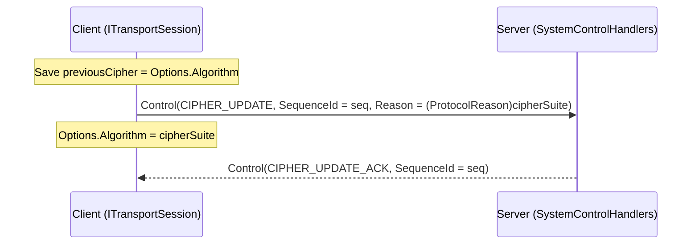
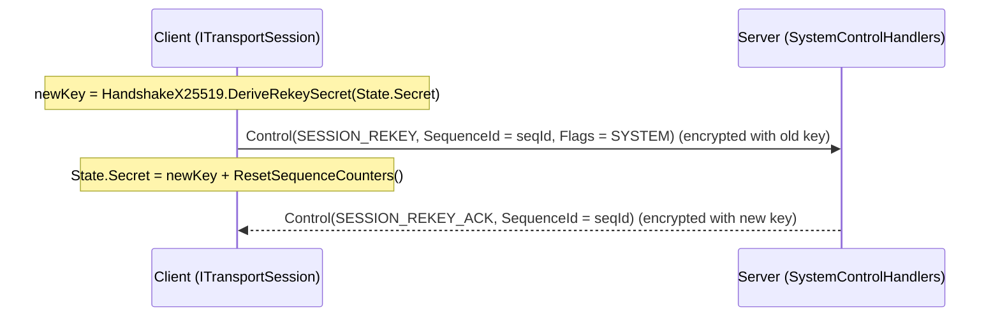

**Namespace:** `Nalix.SDK.Transport.Extensions`  
**Assembly:** `Nalix.SDK`

`Nalix.SDK.Transport.Extensions` provides two post-handshake cryptographic management extensions on `ITransportSession`:
1. **`CipherExtensions.UpdateCipherAsync`**: Negotiates a live symmetric `CipherSuiteType` switch (`ControlType.CIPHER_UPDATE` $\rightarrow$ `CIPHER_UPDATE_ACK`) without re-running the X25519 handshake.
2. **`RekeyExtensions.RekeyAsync`**: Rotates the 32-byte `SessionState.Secret` using `HandshakeX25519.DeriveRekeySecret` (`ControlType.SESSION_REKEY` $\rightarrow$ `SESSION_REKEY_ACK`) and resets sequence counters.

## Source Mapping

- `src/Nalix.SDK/Transport/Extensions/CipherExtensions.cs`
- `src/Nalix.SDK/Transport/Extensions/RekeyExtensions.cs`
- `src/Nalix.Abstractions/Security/CipherSuiteType.cs`
- `src/Nalix.Codec/ProtocolFrames/Control.cs`
- `src/Nalix.Abstractions/Networking/Protocols/ControlType.cs`

## Public Signatures

```csharp
namespace Nalix.SDK.Transport.Extensions;

public static class CipherExtensions
{
    public static ValueTask UpdateCipherAsync(
        this ITransportSession session,
        CipherSuiteType cipherSuite,
        int timeoutMs = 5000,
        CancellationToken ct = default);
}

public static class RekeyExtensions
{
    public static ValueTask RekeyAsync(
        this ITransportSession session,
        CancellationToken ct = default);
}
```

## 1. Live Cipher-Suite Switching (`UpdateCipherAsync`)



- **Preconditions**: Throws `ArgumentNullException` if `session` is `null`.
- **Negotiation & Rollback**: Sends a `Control` packet with `Type = ControlType.CIPHER_UPDATE`, `SequenceId = seq`, and `Reason = (ProtocolReason)cipherSuite`, immediately switches `session.Options.Algorithm = cipherSuite` so the encrypted `CIPHER_UPDATE_ACK` can be decrypted under the new cipher, and awaits `Control(ControlType.CIPHER_UPDATE_ACK, SequenceId == seq)` up to `timeoutMs` (rolling back `session.Options.Algorithm = previousCipher` if the server does not acknowledge).

:::caution[Only switch to an AEAD suite]
Neither the client nor the server rejects a non-AEAD suite: the server accepts any defined `CipherSuiteType` except `None`. `CipherSuiteType.Chacha20` and `CipherSuiteType.Salsa20` only encrypt — they carry no authentication tag. After switching to them, someone on the path can flip ciphertext bits and the matching plaintext bits change without detection, and the packet header is no longer authenticated either. Use `Chacha20Poly1305` (the handshake default) or `Salsa20Poly1305`.
:::

## 2. Mid-Session Key Rotation (`RekeyAsync`)



- **Key Derivation**: Both client and server derive `newKey` via `HandshakeX25519.DeriveRekeySecret(currentSecret)`.
- **Sequence Counter Reset & Rollback**: Immediately after sending `SESSION_REKEY`, updates `session.State.Secret = newKey` and calls `session.ResetSequenceCounters()`, then awaits `Control(ControlType.SESSION_REKEY_ACK, SequenceId == seqId)` (rolling back `session.State.Secret = previousKey` on timeout or error).

## Usage Example

```csharp
using Nalix.Abstractions.Security;
using Nalix.SDK.Transport.Extensions;

// 1. Switch from default Chacha20Poly1305 to Salsa20Poly1305
await session.UpdateCipherAsync(CipherSuiteType.Salsa20Poly1305, timeoutMs: 5_000);

// 2. Rotate the 32-byte session secret
await session.RekeyAsync();
```

## Related APIs

- [Handshake Extensions](./handshake-extensions.md)
- [Resume Extensions](./resume-extensions.md)
- [AEAD Cipher Suites](../security/aead-and-envelope.md)
- [Key Agreement & HKDF](../security/hashing-and-mac.md)
