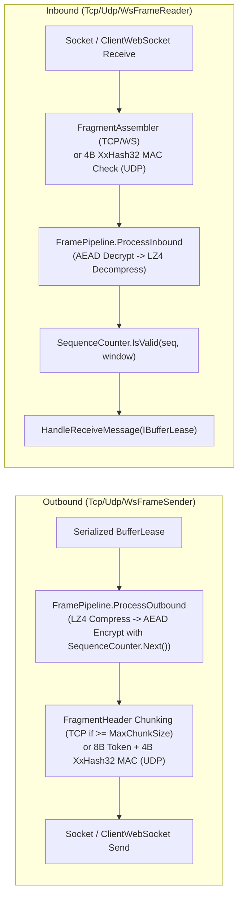

**Namespaces:** `Nalix.SDK.Transport.Internal`, `Nalix.Environment.Sequencing`  
**Assembly:** `Nalix.SDK`

Each concrete session in `Nalix.SDK` delegates low-level wire I/O, fragmentation, `FramePipeline` transforms (LZ4 compression and AEAD encryption), and replay window validation to an internal reader/sender pair plus a lock-free `SequenceCounter`.

:::warning[Internal Transport Machinery]
`TcpFrameReader`, `TcpFrameSender`, `UdpFrameReader`, `UdpFrameSender`, `WsFrameReader`, and `WsFrameSender` are `internal sealed` types. Application code interacts with them through [TcpSession](./tcp-session.md), [UdpSession](./udp-session.md), and [WebSocketSession](./websocket-session.md).
:::

## Source Mapping

- `src/Nalix.SDK/Transport/Internal/Tcp/TcpFrameReader.cs`
- `src/Nalix.SDK/Transport/Internal/Tcp/TcpFrameSender.cs`
- `src/Nalix.SDK/Transport/Internal/Udp/UdpFrameReader.cs`
- `src/Nalix.SDK/Transport/Internal/Udp/UdpFrameSender.cs`
- `src/Nalix.SDK/Transport/Internal/Ws/WsFrameReader.cs`
- `src/Nalix.SDK/Transport/Internal/Ws/WsFrameSender.cs`
- `src/Nalix.Environment/Sequencing/SequenceCounter.cs`

## Transport Framing Comparison

| Transport | Reader / Sender | Wire Framing | Fragmentation | Replay / Sequence Protection |
| :--- | :--- | :--- | :--- | :--- |
| **TCP** (`TcpSession`) | `TcpFrameReader` / `TcpFrameSender` | 2-byte little-endian `ushort` total frame length prefix (`HeaderSize = 2`) | Outbound `FragmentHeader` chunking (`>= MaxChunkSize`) / Inbound `FragmentAssembler` | `SequenceCounter.IsValid(seq, TcpWindow)` (`1024`-bit sliding window) |
| **UDP** (`UdpSession`) | `UdpFrameReader` / `UdpFrameSender` | `[8B SessionToken (outbound)][Payload][4B XxHash32 MAC]` (`<= MaxUdpDatagramSize`) | None (single datagram MTU guard) | `SequenceCounter.IsValid(seq, UdpWindow)` (`512`-bit sliding window) |
| **WebSocket** (`WebSocketSession`) | `WsFrameReader` / `WsFrameSender` | `WebSocketMessageType.Binary` (`EndOfMessage` frames) | Inbound `FragmentAssembler` (outbound sends complete binary WebSocket messages directly) | `SequenceCounter.IsValid(seq, TcpWindow)` (`1024`-bit sliding window) |

## Outbound & Inbound Transform Pipeline

### Key Internal Invariants

1. **Serialized Outbound Sends**: `TcpFrameSender` and `WsFrameSender` guard socket writes with a `SemaphoreSlim(1, 1)` (`_sendLock`) so concurrent `SendAsync` callers never interleave frames or fragment chunks on the stream.
2. **Symmetric Compress-then-Encrypt**: Outbound frames run `FramePipeline.ProcessOutbound` (compressing payloads $\ge$ `CompressionOptions.MinSizeToCompress` before AEAD encryption when `encrypt == true`), while inbound frames run `FramePipeline.ProcessInbound` (decrypting `PacketFlags.ENCRYPTED` before decompressing `PacketFlags.COMPRESSED`).
3. **`SequenceCounter` Replay Window**: Tracks the 32-bit transport sequence number embedded in encrypted frames and rejects duplicate or out-of-window packets before they reach `OnMessageReceived`.

## Related APIs

- [TCP Session](./tcp-session.md)
- [UDP Session](./udp-session.md)
- [WebSocket Session](./websocket-session.md)
- [Packet Compression](../codec/frame-pipeline.md)
- [AEAD Ciphers](../security/aead-and-envelope.md)
