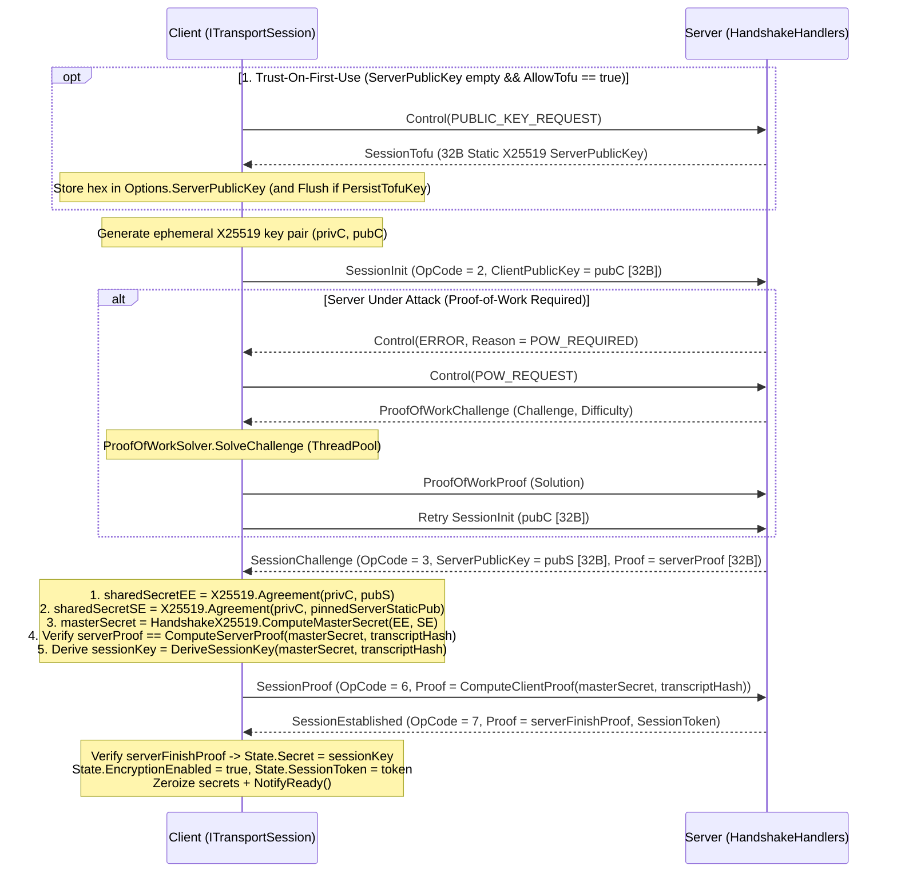

**Namespace:** `Nalix.SDK.Transport.Extensions`  
**Assembly:** `Nalix.SDK`

`HandshakeExtensions.HandshakeAsync` performs the client-side cryptographic handshake over any `ITransportSession` ([TcpSession](./tcp-session.md), [UdpSession](./udp-session.md), or [WebSocketSession](./websocket-session.md)), deriving a 32-byte symmetric key (`session.State.Secret`), enabling frame encryption (`session.State.EncryptionEnabled = true`), capturing the 8-byte `session.State.SessionToken`, and signaling `TransportSession.NotifyReady()`.

## Source Mapping

- `src/Nalix.SDK/Transport/Extensions/HandshakeExtensions.cs`
- `src/Nalix.SDK/Options/TransportOptions.cs`
- `src/Nalix.Codec/ProtocolFrames/SessionInit.cs`
- `src/Nalix.Codec/ProtocolFrames/SessionChallenge.cs`
- `src/Nalix.Codec/ProtocolFrames/SessionProof.cs`
- `src/Nalix.Codec/ProtocolFrames/SessionEstablished.cs`
- `src/Nalix.Codec/ProtocolFrames/SessionTofu.cs`
- `src/Nalix.Codec/ProtocolFrames/ProofOfWorkChallenge.cs`
- `src/Nalix.Codec/ProtocolFrames/ProofOfWorkProof.cs`

## Public Signature

```csharp
namespace Nalix.SDK.Transport.Extensions;

public static class HandshakeExtensions
{
    public static ValueTask HandshakeAsync(
        this ITransportSession session,
        CancellationToken ct = default);
}
```

## Multi-Stage Handshake State Machine



## Security Modes & Protections

### 1. Pinned Identity vs. Trust-On-First-Use (TOFU)

| Configuration | Behavior |
| :--- | :--- |
| **`Options.ServerPublicKey` (`string?` hex) provided** | Parses the 32-byte pinned static X25519 server public key (`Bytes32.Parse`) and performs dual-ECDH (`sharedSecretEE` + `sharedSecretSE`) without sending `PUBLIC_KEY_REQUEST`. |
| **`ServerPublicKey` null/empty and `Options.AllowTofu == true` (default)** | Sends `Control(ControlType.PUBLIC_KEY_REQUEST)` first, awaits `SessionTofu` (`OpCode = 8`), stores the hex key in `Options.ServerPublicKey`, and persists via `ConfigurationManager.Instance.UpdateValue<TransportOptions>` + `Flush()` when `Options.PersistTofuKey == true`. |
| **`ServerPublicKey` null/empty and `Options.AllowTofu == false`** | Throws `NetworkException` before transmitting any packets. |

### 2. Automatic Proof-of-Work Solving (`POW_REQUIRED`)

When `ConnectionGuard` requires Proof-of-Work on the server, the server replies to `SessionInit` with `Control(ControlType.ERROR, ProtocolReason.POW_REQUIRED)`. `HandshakeAsync` handles this transparently:
1. Sends `Control(ControlType.POW_REQUEST)` and awaits `ProofOfWorkChallenge`.
2. Solves the SHA-256 leading-zero-bit puzzle on the `ThreadPool` (`ProofOfWorkSolver.SolveChallenge`) using a dedicated `30_000` ms solver budget (`PowSolveTimeoutMs`).
3. Sends `ProofOfWorkProof` and automatically re-sends `SessionInit`.

### 3. Ephemeral Key Zeroization & Rollback

- `HandshakeAsync` sets `TransportSession.IsNegotiating = true` while running (pausing background keepalive pings) and zeroes the ephemeral X25519 private key and intermediate ECDH secrets (`CryptographicOperations.ZeroMemory`) in a `finally` block.
- Each handshake step uses `session.Options.ConnectTimeoutMillis` (or `5000` ms when `ConnectTimeoutMillis <= 0`).

## Usage Example

```csharp
using System;
using Nalix.SDK.Options;
using Nalix.SDK.Transport;
using Nalix.SDK.Transport.Extensions;

TransportOptions options = new()
{
    Address = "127.0.0.1",
    Port = 57206,
    // Optional: Pin the server's 32-byte static X25519 public key in hex (disables TOFU)
    ServerPublicKey = "a1b2c3d4e5f60718293a4b5c6d7e8f90a1b2c3d4e5f60718293a4b5c6d7e8f90",
    AllowTofu = false
};

using TcpSession session = new(options);
await session.ConnectAsync();
await session.HandshakeAsync();

Console.WriteLine($"Encrypted: {session.State.EncryptionEnabled}, Token: 0x{session.State.SessionToken:X16}");
```

## Related APIs

- [Resume Extensions](./resume-extensions.md)
- [Cipher Extensions](./cipher-extensions.md)
- [Transport Session](./transport-session.md)
- [Handshake Protocol (Server)](../security/handshake.md)
- [Transport Options](../options/sdk/transport-options.md)
