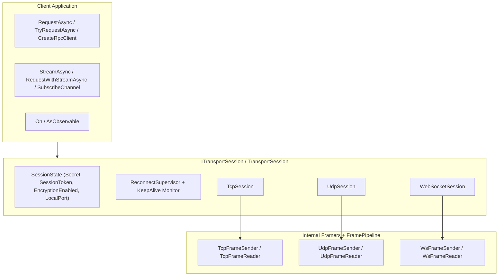

**Namespaces:** `Nalix.SDK`, `Nalix.SDK.Transport`, `Nalix.SDK.Transport.Extensions`, `Nalix.SDK.Extensions`, `Nalix.SDK.Options`  
**Assembly:** `Nalix.SDK`

`Nalix.SDK` is the client-side transport and protocol package for Nalix. It provides concrete client sessions (`TcpSession`, `UdpSession`, `WebSocketSession`), an abstract/interface session contract (`TransportSession` / `ITransportSession`), X25519 handshakes with TOFU/pinning and Proof-of-Work solving, 0-RTT session resumption, HKDF key rotation (`RekeyAsync`), correlated request/response helpers (`RequestAsync` / `TryRequestAsync`), streaming (`StreamAsync` / `RequestWithStreamAsync`), and source-generated RPC client proxies (`CreateRpcClient<T>`).

:::important[Client-Side Package Only]
`Nalix.SDK` is designed exclusively for client applications (desktop, mobile, Unity, Godot, Blazor WASM, console clients). Server applications should use `Nalix.Hosting`, `Nalix.Runtime`, and `Nalix.Network`.
:::

## Source Mapping

- `src/Nalix.SDK/Transport/` (`ITransportSession.cs`, `TransportSession.cs`, `SessionState.cs`, `TcpSession.cs`, `UdpSession.cs`, `WebSocketSession.cs`)
- `src/Nalix.SDK/Transport/Extensions/` (`HandshakeExtensions.cs`, `ResumeExtensions.cs`, `CipherExtensions.cs`, `RekeyExtensions.cs`, `RequestExtensions.cs`, `StreamExtensions.cs`, `HeaderStreamExtensions.cs`, `ChannelExtensions.cs`, `ObservableExtensions.cs`, `RpcExtensions.cs`, `PingExtensions.cs`, `DisconnectExtensions.cs`, `TimeSyncExtensions.cs`, `ControlExtensions.cs`, `TransportSessionSubscriptions.cs`)
- `src/Nalix.SDK/Extensions/` (`ProtocolStringExtensions.cs`, `SubscriptionExtensions.cs`)
- `src/Nalix.SDK/Options/` (`TransportOptions.cs`, `WebSocketTransportOptions.cs`, `RequestOptions.cs`, `RequestOutcome.cs`)
- `src/Nalix.SDK/IThreadDispatcher.cs`, `src/Nalix.SDK/InlineDispatcher.cs`, `src/Nalix.SDK/TimeSyncCalculator.cs`

## Client Architecture



## API Reference Map

### Transport Sessions
- [Transport Session (ITransportSession & TransportSession)](./transport-session.md): Base contract, `SessionState`, `ReconnectSupervisor`, keepalive probing, and direct pending-request dispatch.
- [TCP Session (TcpSession)](./tcp-session.md): Framed reliable stream client with `ConnectWithProxyAsync` and synchronous `Send`.
- [UDP Session (UdpSession)](./udp-session.md): Authenticated datagram client (`[8B SessionToken][Payload][4B XxHash32 MAC]`) with companion TCP port pinning.
- [WebSocket Session (WebSocketSession)](./websocket-session.md): `ws://` and `wss://` binary WebSocket client (compatible with desktop and Blazor WASM).
- [Frame Reader and Sender](./frame-reader-and-sender.md): Internal TCP, UDP, and WebSocket framing, fragmentation, and sequence tracking.

### Security, Control & Request Extensions
- [Session Extensions Overview](./tcp-session-extensions.md): Complete guide to `RequestExtensions`, `StreamExtensions`, `HeaderStreamExtensions`, `ChannelExtensions`, `ObservableExtensions`, `RpcExtensions`, and `RekeyExtensions`.
- [Handshake Extensions (HandshakeAsync)](./handshake-extensions.md): Authenticated X25519 ECDH handshake, TOFU key discovery, and automatic Proof-of-Work challenge solving.
- [Resume Extensions (ResumeSessionAsync & ConnectWithResumeAsync)](./resume-extensions.md): 0-RTT session resumption with `HmacKeccak256` proof-of-possession and automatic handshake fallback.
- [Cipher Extensions (UpdateCipherAsync & RekeyAsync)](./cipher-extensions.md): Live cipher-suite switching and mid-session HKDF key rotation.
- [Control Utilities (PingAsync, DisconnectGracefullyAsync, SyncTimeAsync)](./control-utilities.md): RTT measurement, graceful disconnect signaling, and EMA clock synchronization.
- [Subscriptions (On&lt;TPacket&gt;, CompositeSubscription)](./subscriptions.md): Strongly-typed packet subscriptions.

### Utilities & Options
- [Thread Dispatching (IThreadDispatcher, InlineDispatcher)](./thread-dispatching.md): UI/main-thread marshalling for Unity, MAUI, WPF, and Godot.
- [Protocol String Extensions (ToDisplayString)](./protocol-string-extensions.md): Human-readable UI descriptions for `ProtocolReason` and `ProtocolAdvice`.
- [Session Diagnostics](./diagnostics.md): Client lifecycle and error observability patterns.
- [Transport Options](../options/sdk/transport-options.md)
- [WebSocket Transport Options](../options/sdk/websocket-transport-options.md)
- [Request Options & RequestOutcome&lt;T&gt;](../options/sdk/request-options.md)

## Quick Start Example

```csharp
using Nalix.SDK.Options;
using Nalix.SDK.Transport;
using Nalix.SDK.Transport.Extensions;

TransportOptions options = new()
{
    Address = "127.0.0.1",
    Port = 57206,
    AutoReconnectEnabled = true,
    KeepAliveIntervalMillis = 15_000
};

using TcpSession client = new(options);

// 1. Connect and perform authenticated X25519 handshake
await client.ConnectAsync();
await client.HandshakeAsync();

// 2. Send a correlated request and await the response
LoginResponse reply = await client.RequestAsync<LoginResponse>(
    new LoginRequest { Username = "Alice" },
    RequestOptions.Default.WithTimeout(3_000).WithEncrypt());

// 3. Gracefully disconnect
await client.DisconnectGracefullyAsync();
```

## Related APIs

- [Packet Contracts](../abstractions/packet-contracts.md)
- [Network Application (Hosting)](../hosting/network-application.md)
- [Handshake Protocol](../security/handshake.md)
