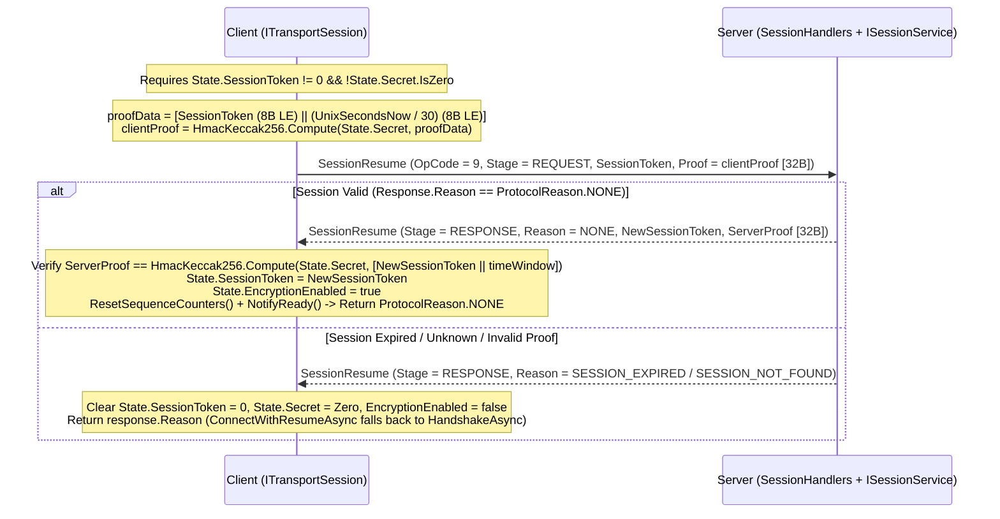

**Namespace:** `Nalix.SDK.Transport.Extensions`  
**Assembly:** `Nalix.SDK`

`ResumeExtensions` enables **0-RTT cryptographic session resumption** over any `ITransportSession` when reconnecting to a server within [SessionStoreOptions.SessionTtl](../options/network/session-store-options.md) (default `5` minutes). If the server's session snapshot has expired or been evicted, `ConnectWithResumeAsync` and `ConnectWithResumeDetailedAsync` automatically fall back to a full [HandshakeAsync](./handshake-extensions.md).

## Source Mapping

- `src/Nalix.SDK/Transport/Extensions/ResumeExtensions.cs`
- `src/Nalix.Codec/ProtocolFrames/SessionResume.cs`
- `src/Nalix.Codec/Security/Hashing/HmacKeccak256.cs`

## Public API Reference

```csharp
namespace Nalix.SDK.Transport.Extensions;

public static class ResumeExtensions
{
    public static ValueTask<ProtocolReason> ResumeSessionAsync(
        this ITransportSession session,
        CancellationToken ct = default);

    public static ValueTask<bool> ConnectWithResumeAsync(
        this ITransportSession session,
        string? host = null,
        ushort? port = null,
        CancellationToken ct = default);

    public static ValueTask<ProtocolReason> ConnectWithResumeDetailedAsync(
        this ITransportSession session,
        string? host = null,
        ushort? port = null,
        CancellationToken ct = default);
}
```

## 0-RTT Resumption & Proof-of-Possession Flow



### Cryptographic Proof-of-Possession (`HmacKeccak256`)

1. **Client Proof**: `ResumeSessionAsync` constructs a 16-byte buffer containing `SessionToken` (`ulong`, little-endian at `0..8`) and the 30-second time bucket `Clock.UnixSecondsNow() / 30` (`long`, little-endian at `8..16`), and computes a 32-byte `HmacKeccak256.Compute(session.State.Secret.AsSpan(), proofData)` without exposing `Secret` on the wire.
2. **Mutual Server Proof Verification**: When the server accepts the resume request (`response.Reason == ProtocolReason.NONE`), it rotates the token to a new `SessionToken` and signs `[NewSessionToken (8B LE) || (UnixSecondsNow / 30) (8B LE)]` with the same `Secret`. The client verifies `response.Proof` in constant time (`CryptographicOperations.FixedTimeEquals`) before enabling encryption.
3. **Sequence Reset**: Because the server resets its transport sequence counters on a new connection, `ResumeSessionAsync` calls `session.ResetSequenceCounters()` upon successful verification so client and server sequence windows remain synchronized.

## Method Comparison

| Method | Return Type | Behavior |
| :--- | :--- | :--- |
| `ResumeSessionAsync` | `ValueTask<ProtocolReason>` | Assumes socket is already connected (`session.IsConnected == true`). Returns `ProtocolReason.NONE` if the session was resumed, or the failure `ProtocolReason` (`UNAUTHENTICATED`, `SESSION_EXPIRED`, `INTERNAL_ERROR`, etc.). |
| `ConnectWithResumeAsync` | `ValueTask<bool>` | Calls `ConnectAsync`, attempts `ResumeSessionAsync` (returning `true` when `ProtocolReason.NONE`), and automatically falls back to `HandshakeAsync` (returning `false`) when `Options.ResumeFallbackToHandshake` is `true`. |
| `ConnectWithResumeDetailedAsync` | `ValueTask<ProtocolReason>` | Identical to `ConnectWithResumeAsync`, returning `ProtocolReason.NONE` when the existing session was resumed or the underlying `ProtocolReason` why resumption failed before `HandshakeAsync` fallback. Used internally by `ReconnectSupervisor`. |

## Usage Example

```csharp
using System;
using Nalix.SDK.Options;
using Nalix.SDK.Transport;
using Nalix.SDK.Transport.Extensions;

using TcpSession client = new(new TransportOptions
{
    Address = "127.0.0.1",
    Port = 57206
});

// Connect and automatically resume if State.SessionToken is populated,
// or perform a fresh X25519 handshake on first connect:
bool wasResumed = await client.ConnectWithResumeAsync();
Console.WriteLine(wasResumed ? "Resumed existing session (0-RTT)." : "Established new session.");
```

## Related APIs

- [Handshake Extensions](./handshake-extensions.md)
- [Transport Session](./transport-session.md)
- [Session Resume (Server)](../security/session-resume.md)
- [Session Store Options](../options/network/session-store-options.md)
