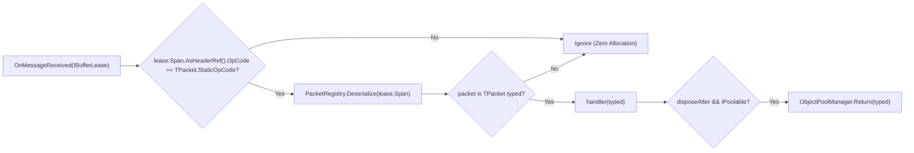

**Namespaces:** `Nalix.SDK.Transport.Extensions`, `Nalix.SDK.Extensions`  
**Assembly:** `Nalix.SDK`

`TransportSessionSubscriptions` and `SubscriptionExtensions` provide strongly-typed `IDisposable` subscriptions (`On<TPacket>`, `OnExact<TPacket>`, `On(predicate, handler)`, `SubscribeTemp`) over `ITransportSession.OnMessageReceived`, along with `CompositeSubscription` for lifecycle grouping.

## Source Mapping

- `src/Nalix.SDK/Transport/Extensions/TransportSessionSubscriptions.cs`
- `src/Nalix.SDK/Extensions/SubscriptionExtensions.cs`

## Public API Reference

### 1. `TransportSessionSubscriptions` & `CompositeSubscription` (`Nalix.SDK.Transport.Extensions`)

```csharp
namespace Nalix.SDK.Transport.Extensions;

public static class TransportSessionSubscriptions
{
    public static IDisposable On<TPacket>(
        this ITransportSession client,
        Action<TPacket> handler,
        bool disposeAfter = true)
        where TPacket : class, IPacket, IPacketStaticOpcode;

    public static IDisposable OnExact<TPacket>(
        this ITransportSession client,
        Action<TPacket> handler)
        where TPacket : class, IPacket, IPacketStaticOpcode;

    public static IDisposable On(
        this ITransportSession client,
        Func<IPacket, bool> predicate,
        Action<IPacket> handler);

    [Obsolete("Use PacketAwaiter instead for single-use packet awaiting.")]
    public static IDisposable OnOnce<TPacket>(
        this ITransportSession client,
        Func<TPacket, bool> predicate,
        Action<TPacket> handler,
        bool disposeAfter = true)
        where TPacket : class, IPacket, IPacketStaticOpcode;

    [Obsolete("Use On<TPacket> instead.")]
    public static IDisposable SubscribeTemp<TPacket>(
        this ITransportSession client,
        Action<TPacket> onMessage,
        Action<Exception>? onDisconnected = null)
        where TPacket : class, IPacket, IPacketStaticOpcode;

    [Obsolete("Use On<TPacket> instead.")]
    public static IDisposable SubscribeTemp<TPacket>(
        this ITransportSession client,
        Func<TPacket, bool> predicate,
        Action<TPacket> onMessage,
        Action<Exception>? onDisconnected = null)
        where TPacket : class, IPacket, IPacketStaticOpcode;

    public static CompositeSubscription Subscribe(
        this ITransportSession _,
        params IDisposable[] subs);
}

public sealed class CompositeSubscription : IDisposable
{
    public CompositeSubscription(params IDisposable[] subs);

    public void Add(IDisposable sub);
    public void Dispose();
}
```

### 2. `SubscriptionExtensions` (`Nalix.SDK.Extensions`)

```csharp
namespace Nalix.SDK.Extensions;

public static class SubscriptionExtensions
{
    public static IDisposable SubscribeTemp(
        this TransportSession @this,
        EventHandler<IBufferLease> onMessageReceived,
        EventHandler<Exception> onDisconnected);
}
```

## How Subscription Dispatch Works



- **Fast Static OpCode Pre-Filter**: `On<TPacket>` and `OnExact<TPacket>` check `lease.Span.AsHeaderRef().OpCode == TPacket.StaticOpCode` before calling `PacketRegistry.Deserialize(lease.Span)`, avoiding deserialization allocations for unrelated packets.
- **Automatic Pool Return (`disposeAfter`)**: When `disposeAfter == true` (the default on `On<TPacket>`), if `TPacket` implements `IPoolable`, the deserialized packet is automatically returned to `ObjectPoolManager` inside a `finally` block after `handler(typed)` completes.
- **Grouped Disposal (`CompositeSubscription`)**: Collects multiple `IDisposable` handles returned by `On<TPacket>`, `OnExact<TPacket>`, `On(predicate, handler)`, or `AsObservable` and unsubscribes all of them atomically when a screen, scene, or view model is destroyed.

## Usage Example

```csharp
using System;
using Nalix.SDK.Transport;
using Nalix.SDK.Transport.Extensions;

// 1. Group multiple subscriptions using session.Subscribe(...)
using CompositeSubscription subscriptions = session.Subscribe(
    session.On<ChatBroadcastPacket>(pkt =>
        Console.WriteLine($"[{pkt.Channel}] {pkt.Sender}: {pkt.Text}")),

    session.OnExact<PlayerSpawnPacket>(pkt =>
        SpawnTeammateAvatar(pkt))
);

// 2. Or add another subscription dynamically
subscriptions.Add(
    session.On(
        predicate: pkt => pkt is WorldEventPacket,
        handler: pkt => HandleWorldEvent((WorldEventPacket)pkt)));

// 3. Unsubscribe all handlers at once on scene teardown
subscriptions.Dispose();
```

## Related APIs

- [Thread Dispatching (IThreadDispatcher)](./thread-dispatching.md)
- [Session Extensions (SubscribeChannel, AsObservable)](./tcp-session-extensions.md)
- [Transport Session](./transport-session.md)
