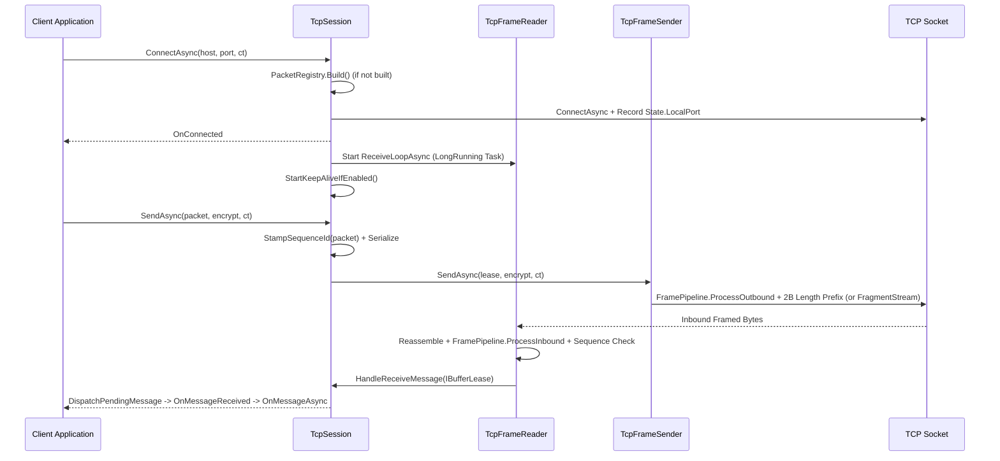

**Namespace:** `Nalix.SDK.Transport`  
**Assembly:** `Nalix.SDK`

`TcpSession` (`[UnsupportedOSPlatform("browser")] public class TcpSession : TransportSession`) is the reliable stream transport session in `Nalix.SDK`, built on `TcpFrameSender` and `TcpFrameReader`.

## Source Mapping

- `src/Nalix.SDK/Transport/TcpSession.cs`
- `src/Nalix.SDK/Transport/Internal/Tcp/TcpFrameReader.cs`
- `src/Nalix.SDK/Transport/Internal/Tcp/TcpFrameSender.cs`
- `src/Nalix.Codec/Transforms/FramePipeline.cs`

## Connection & Frame Lifecycle



## Public API Reference

```csharp
namespace Nalix.SDK.Transport;

[UnsupportedOSPlatform("browser")]
public class TcpSession : TransportSession
{
    public const int HeaderSize = 2;

    public TcpSession(TransportOptions options, SessionState? state = null);

    public override TransportOptions Options { get; }
    public override bool IsConnected { get; }

    public override event EventHandler? OnConnected;
    public override event EventHandler<Exception>? OnDisconnected;
    public override event EventHandler<IBufferLease>? OnMessageReceived;
    public override event EventHandler<Exception>? OnError;
    public event Func<ReadOnlyMemory<byte>, Task>? OnMessageAsync;

    public override Task ConnectAsync(string? host = null, ushort? port = null, CancellationToken ct = default);
    public Task ConnectWithProxyAsync(byte[] proxyProtocolV2, string? host = null, ushort? port = null, CancellationToken ct = default);
    public override Task DisconnectAsync();

    public void Send(ReadOnlySpan<byte> data, bool encrypt = true);
    public override Task SendAsync(IPacket packet, CancellationToken ct = default);
    public override Task SendAsync(IPacket packet, bool? encrypt = null, CancellationToken ct = default);
    public override Task SendAsync(ReadOnlyMemory<byte> payload, bool? encrypt = null, CancellationToken ct = default);
    public override void ResetSequenceCounters();
}
```

### Key Capabilities

| Feature | Details |
| :--- | :--- |
| **Connect Coalescing** | Concurrent `ConnectAsync` calls targeting the same `host` and `port` share the in-flight connection task rather than opening duplicate sockets. |
| **Local Port Capture (`State.LocalPort`)** | Upon connecting, `TcpSession` records `localEp.Port` into `this.State.LocalPort` so a companion `UdpSession` sharing `this.State` can bind to the exact same local port. |
| **`ConnectWithProxyAsync`** | Connects and immediately transmits a raw PROXY Protocol v2 header (`byte[] proxyProtocolV2`) before firing `OnConnected` or starting the receive loop (used for testing reverse-proxy client IP extraction). |
| **Synchronous `Send(ReadOnlySpan<byte>, bool)`** | Zero-allocation synchronous send helper for pre-serialized spans. |
| **Direct Pending-Request Dispatch** | `HasDirectPendingDispatch = true` dispatches inbound frames to active `RequestAsync` / `PacketAwaiter` observers via a lock-protected slot table before invoking `OnMessageReceived`, avoiding per-request multicast delegate allocations. |
| **`OnMessageAsync`** | When subscribed, `TcpSession` calls `lease.Retain()`, invokes `OnMessageAsync(lease.Memory)`, and automatically disposes the retained lease when the returned `Task` completes. |

## Usage Example

```csharp
using System;
using System.Threading.Tasks;
using Nalix.Environment.Configuration;
using Nalix.SDK.Options;
using Nalix.SDK.Transport;
using Nalix.SDK.Transport.Extensions;

TransportOptions options = ConfigurationManager.Instance.Get<TransportOptions>();
options.Address = "127.0.0.1";
options.Port = 57206;

using TcpSession client = new(options);

client.OnConnected += (_, _) => Console.WriteLine("TCP connected.");
client.OnReady += (_, _) => Console.WriteLine("Session secured and ready.");
client.OnDisconnected += (_, ex) => Console.WriteLine($"Disconnected: {ex.Message}");

await client.ConnectAsync();
await client.HandshakeAsync();

LoginResponse response = await client.RequestAsync<LoginResponse>(
    new LoginPacket { Username = "Ghost" },
    RequestOptions.Default.WithTimeout(5_000).WithEncrypt());
```

## Related APIs

- [Transport Session](./transport-session.md)
- [UDP Session](./udp-session.md)
- [WebSocket Session](./websocket-session.md)
- [Session Extensions](./tcp-session-extensions.md)
- [Transport Options](../options/sdk/transport-options.md)
