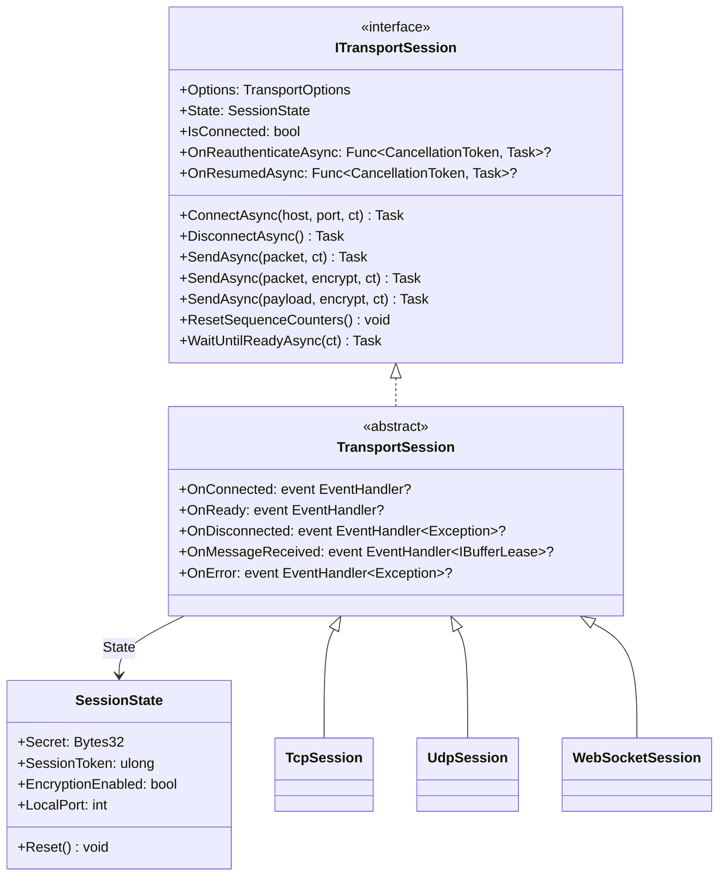

**Namespace:** `Nalix.SDK.Transport`  
**Assembly:** `Nalix.SDK`

`ITransportSession` and its abstract base implementation `TransportSession` define the unified client session contract across [TcpSession](./tcp-session.md), [UdpSession](./udp-session.md), and [WebSocketSession](./websocket-session.md). Ephemeral security and connection state (`Secret`, `SessionToken`, `EncryptionEnabled`, `LocalPort`) is stored in `SessionState`, allowing a `TcpSession` and companion `UdpSession` to share negotiated keys and tokens seamlessly.

## Source Mapping

- `src/Nalix.SDK/Transport/ITransportSession.cs`
- `src/Nalix.SDK/Transport/TransportSession.cs`
- `src/Nalix.SDK/Transport/SessionState.cs`
- `src/Nalix.SDK/Transport/Internal/ReconnectSupervisor.cs`

## Class Hierarchy



## `SessionState` Reference

```csharp
namespace Nalix.SDK.Transport;

public class SessionState
{
    public Bytes32 Secret { get; set; }
    public ulong SessionToken { get; set; }
    public bool EncryptionEnabled { get; set; }
    public int LocalPort { get; set; }

    public SessionState();
    public void Reset();
}
```

| Property | Type | Default | Description |
| :--- | :--- | :--- | :--- |
| `Secret` | `Bytes32` | `Bytes32.Zero` | 32-byte symmetric encryption key derived during `HandshakeAsync` or rotated via `RekeyAsync`. |
| `SessionToken` | `ulong` | `0` | 8-byte Snowflake session token assigned by the server in `SessionEstablished` / `SessionResume` (used for 0-RTT resume and UDP authentication). |
| `EncryptionEnabled` | `bool` | `false` | `true` once `HandshakeAsync` or `ResumeSessionAsync` completes; controls whether outbound packets are encrypted by default. |
| `LocalPort` | `int` | `0` | Local TCP socket port recorded by `TcpSession.ConnectAsync`; used by a companion `UdpSession` sharing the same `SessionState` to bind to the same local port for server endpoint pinning (`SEC-30`). |

:::tip[Sharing `SessionState` Between TCP and UDP]
Pass `tcpSession.State` into the `UdpSession(options, tcpSession.State)` constructor so the UDP session automatically inherits the negotiated `Secret`, `SessionToken`, `EncryptionEnabled`, and `LocalPort` from the TCP handshake!
:::

## `ITransportSession` & `TransportSession` Members

### Properties

| Property | Type | Description |
| :--- | :--- | :--- |
| `Options` | `TransportOptions` | Persistent client configuration ([TransportOptions](../options/sdk/transport-options.md)). |
| `State` | `SessionState` | Ephemeral session state (`Secret`, `SessionToken`, `EncryptionEnabled`, `LocalPort`). |
| `IsConnected` | `bool` | `true` when the underlying socket is open and the session is not disposed. |
| `OnReauthenticateAsync` | `Func<CancellationToken, Task>?` | Optional callback invoked by `ReconnectSupervisor` after an automatic reconnect performs a fresh handshake (before `OnReady` is signaled). |
| `OnResumedAsync` | `Func<CancellationToken, Task>?` | Optional callback invoked by `ReconnectSupervisor` after an automatic reconnect successfully resumes an existing session (before `OnReady` is signaled). |

### Events

| Event | Type | Description |
| :--- | :--- | :--- |
| `OnConnected` | `EventHandler?` | Raised when the physical transport socket connects. |
| `OnReady` | `EventHandler?` | Raised after `HandshakeAsync` or `ResumeSessionAsync` completes (and after `OnReauthenticateAsync` / `OnResumedAsync` on auto-reconnect). |
| `OnDisconnected` | `EventHandler<Exception>?` | Raised when the connection closes or drops. |
| `OnMessageReceived` | `EventHandler<IBufferLease>?` | Raised synchronously for each decrypted/decompressed inbound frame. The transport owns the `IBufferLease` and disposes it when the event returns (call `lease.Retain()` if retaining beyond the callback). |
| `OnError` | `EventHandler<Exception>?` | Raised when a transport, framing, or cryptographic error occurs. |

### Methods

| Method | Signature | Description |
| :--- | :--- | :--- |
| `ConnectAsync` | `Task ConnectAsync(string? host = null, ushort? port = null, CancellationToken ct = default)` | Connects to `host`/`port` (defaulting to `Options.Address` and `Options.Port`) and automatically calls `PacketRegistry.Build()` if not yet built. |
| `DisconnectAsync` | `Task DisconnectAsync()` | Marks the disconnect as intentional (suppressing auto-reconnect) and closes the underlying transport. |
| `SendAsync(IPacket, ...)` | `Task SendAsync(IPacket packet, CancellationToken ct = default)` | Auto-stamps `packet.Header.SequenceId` if `0`, serializes `packet`, and transmits it using `State.EncryptionEnabled`. |
| `SendAsync(IPacket, bool?, ...)` | `Task SendAsync(IPacket packet, bool? encrypt = null, CancellationToken ct = default)` | Serializes and transmits `packet` with an explicit encryption override. |
| `SendAsync(ReadOnlyMemory<byte>, ...)` | `Task SendAsync(ReadOnlyMemory<byte> payload, bool? encrypt = null, CancellationToken ct = default)` | Transmits raw pre-serialized bytes with an optional encryption override. |
| `ResetSequenceCounters` | `void ResetSequenceCounters()` | Resets outbound and inbound `SequenceCounter` state (called automatically during `ConnectAsync`, `ResumeSessionAsync`, and `RekeyAsync`). |
| `WaitUntilReadyAsync` | `Task WaitUntilReadyAsync(CancellationToken ct = default)` | Awaits any in-flight `ReconnectSupervisor` recovery (including handshake/resume and `OnReauthenticateAsync` / `OnResumedAsync`). Completes immediately if already connected. |
| `Dispose` | `void Dispose()` | Marks the disconnect as intentional, stops keepalive monitoring, closes the transport, and releases locks. |

## Built-In Resilience Mechanics

### 1. Automatic Reconnect (`ReconnectSupervisor`)
When `Options.AutoReconnectEnabled = true` and an unexpected disconnect occurs (`DisconnectAsync()` was not called by the application):
1. `ReconnectSupervisor` backs off exponentially from `Options.ReconnectBaseDelayMillis` (`500` ms) up to `Options.ReconnectMaxDelayMillis` (`30,000` ms), retrying up to `Options.ReconnectMaxAttempts` (`0` = unlimited).
2. Calls `ConnectWithResumeDetailedAsync` to attempt a 0-RTT session resume first, falling back to `HandshakeAsync` when needed.
3. Invokes `OnResumedAsync` (if resumed) or `OnReauthenticateAsync` (if fresh handshake) before unblocking `WaitUntilReadyAsync` and firing `OnReady`.

### 2. Keepalive Probing
When `Options.KeepAliveIntervalMillis > 0`, `TransportSession` runs a background loop that calls `PingAsync(Options.KeepAliveTimeoutMillis)` every `KeepAliveIntervalMillis` (skipping while a handshake/resume negotiation is active). If `Options.KeepAliveMissThreshold` (`3`) consecutive pings fail, `FaultFromKeepAliveAsync` tears down the dead socket as an unexpected fault so `ReconnectSupervisor` can recover it.

## Related APIs

- [TCP Session](./tcp-session.md)
- [UDP Session](./udp-session.md)
- [WebSocket Session](./websocket-session.md)
- [Session Extensions](./tcp-session-extensions.md)
- [Transport Options](../options/sdk/transport-options.md)
