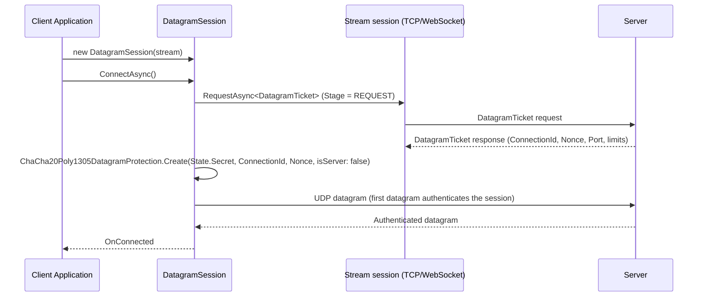

**Namespace:** `Nalix.SDK.Transport`  
**Assembly:** `Nalix.SDK`

`DatagramSession` (`[UnsupportedOSPlatform("browser")] public sealed class DatagramSession : TransportSession`) is the client side of a Nalix Datagram Protocol session (NDP over UDP). It obtains a **ticket** over an established stream session (`TcpSession` or `WebSocketSession`), derives its own keys from that stream session's secret, and then runs on UDP alone: closing the stream afterwards does not affect it.

:::note[Replaces `UdpSession`]
`UdpSession`, the UDP datagram-size transport option, and the `UdpFrameReader` / `UdpFrameSender` pair (the `[8B SessionToken][Payload][4B XxHash32 MAC]` datagram format) no longer exist. This page keeps its original URL.
:::

## Source Mapping

- `src/Nalix.SDK/Transport/DatagramSession.cs`
- `src/Nalix.Abstractions/Networking/Datagrams/IDatagramTicketIssuer.cs`
- `src/Nalix.Abstractions/Networking/Datagrams/DeliveryMethod.cs`
- `src/Nalix.Codec/ProtocolFrames/Datagram/DatagramTicket.cs`
- `src/Nalix.Codec/Security/Datagram/ChaCha20Poly1305DatagramProtection.cs`
- `src/Nalix.Environment/Datagrams/DatagramEngine.cs`

## How a Session Is Established



1. `ConnectAsync` requests a `DatagramTicket` over the stream session (`RequestOptions.WithTimeout(Math.Max(1000, Options.ConnectTimeoutMillis))`). A refusal (`response.Reason != ProtocolReason.NONE`) throws `NetworkException("The server refused the datagram ticket: ...")`.
2. It resolves `host` (default: the stream session's `Options.Address`), connects a UDP `Socket` to `port` (default: `Ticket.Port`), and sets `DontFragment` when the platform allows it.
3. It creates a `ChaCha20Poly1305DatagramProtection` from `State.Secret`, the ticket's `ConnectionId` and `Nonce`, and starts a `DatagramEngine` configured from the ticket (`ChannelCount`, `IdleTimeoutMs`, `MaxMessageSize`, `ReceiveBufferBytes`, `ChannelReceiveBufferBytes`).
4. It waits until the server authenticated the first datagram, at most `Ticket.ExpiresInSeconds` seconds, otherwise throws `NetworkException("The datagram session was not established before the ticket expired.")`.

Every datagram is sealed with ChaCha20-Poly1305 by the session, so frames are **not encrypted a second time**: the `encrypt` argument of the `TransportSession` send methods is ignored.

## Public API Reference

```csharp
namespace Nalix.SDK.Transport;

[UnsupportedOSPlatform("browser")]
public sealed class DatagramSession : TransportSession
{
    public DatagramSession(TransportSession stream);

    public override TransportOptions Options { get; }          // the stream session's options
    public override bool IsConnected { get; }                  // engine is Established
    public DatagramTicketInfo? Ticket { get; }
    public string? EngineReport { get; }

    public override event EventHandler? OnConnected;
    public override event EventHandler<Exception>? OnDisconnected;
    public override event EventHandler<IBufferLease>? OnMessageReceived;
    public override event EventHandler<Exception>? OnError;

    public override Task ConnectAsync(string? host = null, ushort? port = null, CancellationToken ct = default);
    public override Task DisconnectAsync();

    public override Task SendAsync(IPacket packet, CancellationToken ct = default);
    public override Task SendAsync(IPacket packet, bool? encrypt = null, CancellationToken ct = default);
    public override Task SendAsync(ReadOnlyMemory<byte> payload, bool? encrypt = null, CancellationToken ct = default);
    public Task SendAsync(IPacket packet, DeliveryMethod method, byte channel = 0, CancellationToken ct = default);
    public Task<bool> SendWithReceiptAsync(IPacket packet, DeliveryMethod method = DeliveryMethod.ReliableOrdered, byte channel = 0);

    public override void ResetSequenceCounters();              // no-op: datagram frames carry no stream sequence numbers
}
```

| Member | Description |
| :--- | :--- |
| `DatagramSession(TransportSession stream)` | Binds the session to an established stream session; its handshake must be complete. Shares `stream.State`. Throws `ArgumentNullException` when `stream` is `null`. |
| `Ticket` | The `DatagramTicketInfo` of the current session once connected, otherwise `null`. |
| `EngineReport` | Session statistics string from the datagram engine, or `null` when not connected. |
| `ConnectAsync(host, port, ct)` | Requests a ticket and opens the UDP session (see above). Throws `NetworkException` when the ticket is refused or the session is not established in time. |
| `DisconnectAsync()` | Closes the engine with `DatagramCloseCode.NoError`, flushes the close datagram, and tears the socket down (raises `OnDisconnected`). |
| `SendAsync(packet, ct)` / `SendAsync(packet, encrypt, ct)` / `SendAsync(payload, encrypt, ct)` | Send with `DeliveryMethod.ReliableOrdered` on channel `0`. |
| `SendAsync(packet, method, channel, ct)` | Stamps the packet `SequenceId` and sends it with the chosen `DeliveryMethod` on a `channel` below the ticket's `ChannelCount`. Throws `NetworkException` when the session is closed, the packet is too large for the method, or the send queue is full. |
| `SendWithReceiptAsync(packet, method, channel)` | Sends reliably and completes with `true` once the server acknowledged every fragment, or `false` when the session closed first. |

### `DeliveryMethod` (`Nalix.Abstractions.Networking.Datagrams`)

| Member | Value | Behavior |
| :--- | ---: | :--- |
| `Unreliable` | `0` | Delivered at most once, in any order; never retransmitted. |
| `UnreliableSequenced` | `1` | Delivered at most once; a message older than the newest already delivered on its channel is dropped. |
| `ReliableUnordered` | `2` | Delivered exactly once, in any order. |
| `ReliableOrdered` | `3` | Delivered exactly once, in send order within its channel. |
| `ReliableSequenced` | `4` | The newest message of the channel is guaranteed to arrive; older ones may be skipped. |

Ordering and sequencing are per channel. Stream transports deliver every method reliably and in order.

### `DatagramTicketInfo` (`Nalix.Abstractions.Networking.Datagrams`)

`public readonly record struct DatagramTicketInfo(ulong ConnectionId, UInt128 Nonce, ushort Port, ushort ExpiresInSeconds, int IdleTimeoutMs, int MaxMessageSize, byte ChannelCount, long ReceiveBufferBytes, long ChannelReceiveBufferBytes)`

| Field | Meaning |
| :--- | :--- |
| `ConnectionId` | Datagram connection identifier (from the CSPRNG). |
| `Nonce` | 16-byte ticket nonce that makes the session keys fresh. |
| `Port` | UDP port to send to; the host is the stream session's host. |
| `ExpiresInSeconds` | Seconds within which the first datagram must arrive. |
| `IdleTimeoutMs` | Idle timeout of the session. |
| `MaxMessageSize` | Largest message either side accepts. |
| `ChannelCount` | Number of channels. |
| `ReceiveBufferBytes` / `ChannelReceiveBufferBytes` | Bytes the server buffers per session / per channel for ordering and reassembly. |

## Usage Example

```csharp
using System;
using System.Threading.Tasks;
using Nalix.Abstractions.Networking.Datagrams;
using Nalix.SDK.Options;
using Nalix.SDK.Transport;
using Nalix.SDK.Transport.Extensions;

TransportOptions options = new()
{
    Address = "127.0.0.1",
    Port = 57206
};

// 1. Connect the stream session and complete the X25519 handshake.
using TcpSession stream = new(options);
await stream.ConnectAsync();
await stream.HandshakeAsync();

// 2. Open the datagram session; it derives its keys from stream.State.Secret.
using DatagramSession datagram = new(stream);
datagram.OnMessageReceived += (_, lease) =>
{
    Console.WriteLine($"Received authenticated datagram message ({lease.Length} bytes)");
};

await datagram.ConnectAsync();

// Request/response works as on any ITransportSession.
EchoPacket reply = await datagram.RequestAsync<EchoPacket>(new EchoPacket { Text = "over udp" });

// Fire-and-forget state update on channel 1 where only the newest message matters.
await datagram.SendAsync(new PlayerInputPacket { X = 12.5f, Y = 4.0f }, DeliveryMethod.UnreliableSequenced, channel: 1);

// Reliable send with an acknowledgement.
bool acknowledged = await datagram.SendWithReceiptAsync(new ChatPacket { Text = "hi" });
```

## Related APIs

- [Transport Session](./transport-session.md)
- [TCP Session](./tcp-session.md)
- [WebSocket Session](./websocket-session.md)
- [UDP Listener (Server)](../network/udp-listener.md)
- [Transport Options](../options/sdk/transport-options.md)
