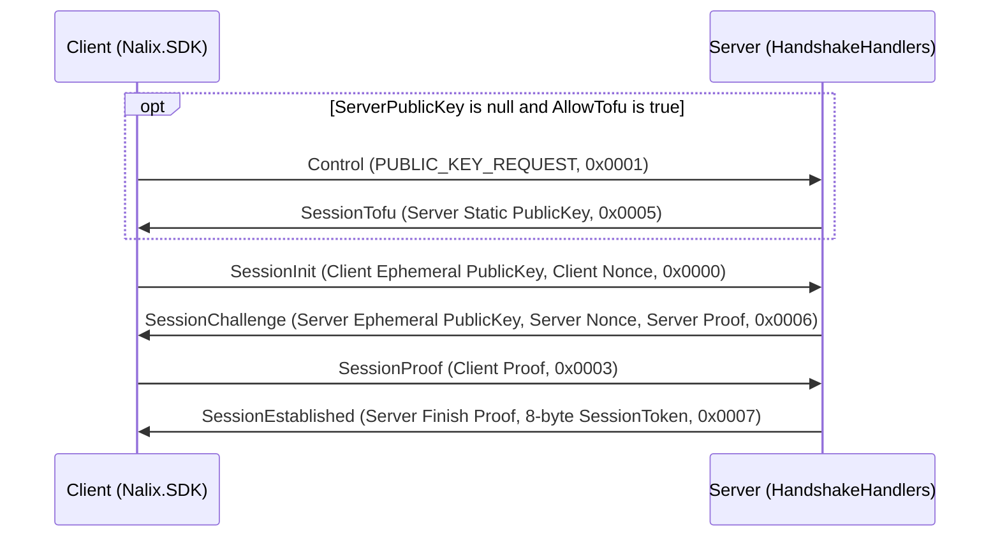

Nalix implements an authenticated Noise-inspired X25519 handshake using built-in session protocol frames (`SessionInit`, `SessionChallenge`, `SessionProof`, `SessionEstablished`, `SessionTofu`), `HandshakeX25519` in `Nalix.Codec.Security`, `HandshakeHandlers` in `Nalix.Runtime.Handlers`, and `HandshakeExtensions` in `Nalix.SDK.Transport.Extensions`.

## Source Mapping

- `src/Nalix.Codec/ProtocolFrames/Session/SessionInit.cs`
- `src/Nalix.Codec/ProtocolFrames/Session/SessionChallenge.cs`
- `src/Nalix.Codec/ProtocolFrames/Session/SessionProof.cs`
- `src/Nalix.Codec/ProtocolFrames/Session/SessionEstablished.cs`
- `src/Nalix.Codec/ProtocolFrames/Session/SessionTofu.cs`
- `src/Nalix.Codec/Security/HandshakeX25519.cs`
- `src/Nalix.Runtime/Handlers/HandshakeHandlers.cs`
- `src/Nalix.SDK/Transport/Extensions/HandshakeExtensions.cs`

## 1. 4-Message Handshake Flow

| Step | Direction | Frame (`OpCode`, Size) | Payload Fields |
| :---: | --- | --- | --- |
| **1** | Client $\rightarrow$ Server | `SessionInit` (`0x0000`, `70` B) | `PublicKey` (`Bytes32` ephemeral), `Nonce` (`Bytes32`) |
| **2** | Server $\rightarrow$ Client | `SessionChallenge` (`0x0006`, `102` B) | `PublicKey` (`Bytes32` ephemeral), `Nonce` (`Bytes32`), `Proof` (`Bytes32`) |
| **3** | Client $\rightarrow$ Server | `SessionProof` (`0x0003`, `38` B) | `Proof` (`Bytes32`) |
| **4** | Server $\rightarrow$ Client | `SessionEstablished` (`0x0007`, `46` B) | `Proof` (`Bytes32`), `SessionToken` (`ulong`) |



---

## 2. Trust on First Use (TOFU)

If `TransportOptions.ServerPublicKey` is `null` or empty and `TransportOptions.AllowTofu` is `true` (default):

1. The client sends a `Control` frame with `ControlType.PUBLIC_KEY_REQUEST` (`0x0001`).
2. `SystemControlHandlers` responds with `SessionTofu` (`0x0005`, 38 bytes) containing `HandshakeHandlers.ServerPublicKey`.
3. The client pins the received key on `options.ServerPublicKey` (and saves it to disk if `PersistTofuKey = true`), then proceeds with `SessionInit`.

---

## 3. Cryptographic Construction (`HandshakeX25519`)

`HandshakeX25519` combines **ephemeral-ephemeral** (`SharedSecret_EE`) and **static-ephemeral** (`SharedSecret_SE`, against the server's static X25519 identity key) agreements using HKDF-Keccak256:

| Step | Method | HKDF Construction | Inputs |
| --- | --- | --- | --- |
| **Transcript Hash** | `ComputeTranscriptHash` | `Keccak256.HashDataToFixed(144-byte length-prefixed transcript)` | `clientPublicKey`, `clientNonce`, `serverPublicKey`, `serverNonce` |
| **Master Secret** | `ComputeMasterSecret` | `Hkdf.Extract(salt: Empty, ikm: sharedSecretEE \|\| sharedSecretSE)` | `sharedSecretEE`, `sharedSecretSE` (64 bytes total) |
| **Server Proof** | `ComputeServerProof` | `Hkdf.Expand(masterSecret, "nalix-handshake/server-proof" \|\| transcriptHash)` | `masterSecret`, `transcriptHash` |
| **Client Proof** | `ComputeClientProof` | `Hkdf.Expand(masterSecret, "nalix-handshake/client-proof" \|\| transcriptHash)` | `masterSecret`, `transcriptHash` |
| **Server Finish Proof** | `ComputeServerFinishProof` | `Hkdf.Expand(masterSecret, "nalix-handshake/server-finish" \|\| transcriptHash)` | `masterSecret`, `transcriptHash` |
| **Session Key** | `DeriveSessionKey` | `Hkdf.Expand(masterSecret, "nalix-handshake/session" \|\| clientNonce \|\| serverNonce \|\| transcriptHash)` | `masterSecret`, `clientNonce`, `serverNonce`, `transcriptHash` |
| **Rekey Secret** | `DeriveRekeySecret` | `Hkdf.Expand(currentSecret, "nalix-session/rekey")` | `currentSecret` |

### Public Methods on `HandshakeX25519`

- `Bytes32 ComputeMasterSecret(Bytes32 sharedSecretEE, Bytes32 sharedSecretSE)`
- `Bytes32 ComputeServerProof(Bytes32 masterSecret, Bytes32 transcriptHash)`
- `Bytes32 ComputeClientProof(Bytes32 masterSecret, Bytes32 transcriptHash)`
- `Bytes32 ComputeServerFinishProof(Bytes32 masterSecret, Bytes32 transcriptHash)`
- `Bytes32 DeriveSessionKey(Bytes32 masterSecret, Bytes32 clientNonce, Bytes32 serverNonce, Bytes32 transcriptHash)`
- `Bytes32 DeriveRekeySecret(Bytes32 currentSecret)`
- `Bytes32 ComputeTranscriptHash(Bytes32 clientPublicKey, Bytes32 clientNonce, Bytes32 serverPublicKey, Bytes32 serverNonce)` — Zero-allocation stack path (`stackalloc byte[144]`).
- `bool TryComposeTranscriptBuffer(Span<byte> destination, out int written, Bytes32 clientPublicKey, Bytes32 clientNonce, Bytes32 serverPublicKey, Bytes32 serverNonce)` — Writes the 144-byte transcript (`4 * (sizeof(int) + 32)`) into `destination` without heap allocation.
- `byte[] ComposeTranscriptBuffer(Bytes32 clientPublicKey, Bytes32 clientNonce, Bytes32 serverPublicKey, Bytes32 serverNonce)`

---

## 4. Server Implementation (`HandshakeHandlers`)

Enabled on the server via `builder.UseSecureConnections(string? certificatePath = null)`:

- Stores per-connection negotiation state via `HandshakeState` / `HandshakeContext` on `connection.GetRuntimeState()`.
- If `IProofOfWorkPolicy.IsUnderAttack` is `true` and `connection.Level < PermissionLevel.POW_VERIFIED`, `HandleSessionInitAsync` replies with `Control(ControlType.ERROR, reasonCode: ProtocolReason.POW_REQUIRED)` before allowing key agreement.
- Upon verifying `SessionProof`:
  1. Derives the 32-byte session secret via `HandshakeX25519.DeriveSessionKey` and assigns `connection.Secret`.
  2. Sets `connection.Level = PermissionLevel.ESTABLISHED` (if `< ESTABLISHED`) and marks the handshake state as established.
  3. Uses `connection.ConnectionId.ToUInt64()` as the 64-bit `SessionToken`, persists the session via `ISessionService.SaveSessionAsync(connection)` (when `.UseSessions()` is enabled), and sends `SessionEstablished`.

## 5. Client SDK Usage (`HandshakeExtensions`)

```csharp
using Nalix.SDK.Options;
using Nalix.SDK.Transport;
using Nalix.SDK.Transport.Extensions;

using TcpSession session = new(new TransportOptions { Address = "127.0.0.1", Port = 57206 });
await session.ConnectAsync(ct);

// Executes TOFU (if needed), PoW (if challenged), and the 4-step X25519 handshake
await session.HandshakeAsync(timeoutMs: 10_000, ct: ct);

// session.State.EncryptionEnabled is now true, and session.State.SessionToken is populated
```

## Related Topics

- [AEAD & Envelope Encryption](./aead-and-envelope.md)
- [Proof-of-Work](./proof-of-work.md)
- [Session Resumption](./session-resume.md)
- [Session Rekey](./session-rekey.md)
- [Handshake Extensions (SDK)](../sdk/handshake-extensions.md)
