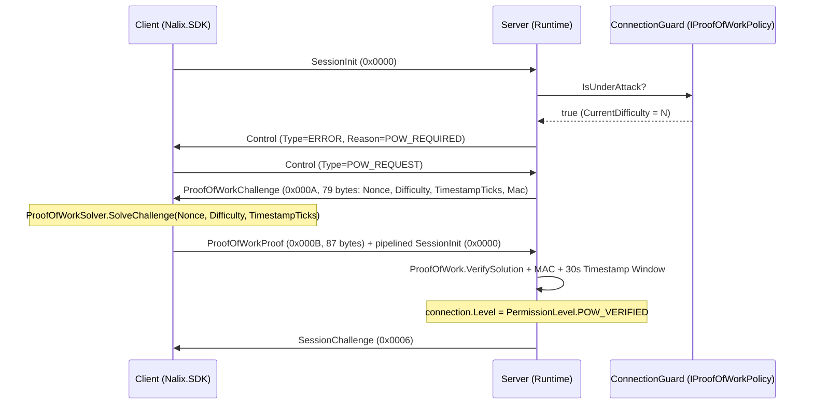

Nalix includes a stateless, adaptive Proof-of-Work (PoW) challenge-response system integrated into the X25519 handshake flow. When `ConnectionGuard` detects elevated connection rates or capacity pressure, clients must solve a `Keccak256` leading-zero puzzle before the server performs expensive X25519 operations.

## Source Mapping

- `src/Nalix.Codec/Security/ProofOfWork.cs` — Stateless challenge generation and solution verification
- `src/Nalix.Codec/Security/ProofOfWorkSolver.cs` — Client-side puzzle solver
- `src/Nalix.Codec/ProtocolFrames/Security/ProofOfWorkChallenge.cs` — Challenge packet (`0x000A`, `79` bytes)
- `src/Nalix.Codec/ProtocolFrames/Security/ProofOfWorkProof.cs` — Proof packet (`0x000B`, `87` bytes)
- `src/Nalix.Abstractions/Security/IProofOfWorkPolicy.cs` — Dynamic difficulty policy contract
- `src/Nalix.Runtime/Handlers/ProofOfWorkHandlers.cs` — Server-side proof verification handler
- `src/Nalix.Runtime/Handlers/SystemControlHandlers.cs` — Handles `ControlType.POW_REQUEST`
- `src/Nalix.Network/RateLimiting/Connection.Guard.cs` — Implements `IProofOfWorkPolicy`

## How It Works

### 1. Adaptive Difficulty (`ConnectionGuard : IProofOfWorkPolicy`)

`ConnectionGuard` computes `CurrentDifficulty` from two inputs configured on `ConnectionQuotaOptions`:

1. **EWMA Connection Rate (`EnableAdaptiveMode`)**:
   - `rate <= AdaptivePowStartRate` $\rightarrow$ `AdaptivePowMinDifficulty`
   - `rate >= AdaptivePowMaxRate` $\rightarrow$ `AdaptivePowMaxDifficulty`
   - Linear interpolation in between.
2. **Capacity-Based PoW (`EnableCapacityBasedPoW`)**:
   - Triggers PoW scaling when active connections exceed `CapacityPoWThreshold` (`0.0..1.0`, default `0.75` of `MaxConnections`).

When `CurrentDifficulty > AdaptivePowMinDifficulty`, `IsUnderAttack` returns `true`.

### 2. Challenge-Response Flow



### 3. Stateless Challenge Construction (`ProofOfWork`)

- **`(Bytes32 Nonce, Bytes32 Mac) CreateChallenge(byte difficulty, ulong connectionId, long timestampTicks)`**:
  - Generates a 32-byte CSPRNG `Nonce`.
  - Computes a 32-byte `HmacKeccak256` `Mac` over `Nonce (32B) || Difficulty (1B) || TimestampTicks (8B) || ConnectionId (8B)` using a process-ephemeral 32-byte secret key.
- **`bool VerifySolution(ReadOnlySpan<byte> nonce, byte difficulty, long timestampTicks, ulong connectionId, ReadOnlySpan<byte> providedMac, long solution)`**:
  - Verifies the `HmacKeccak256` tag in constant time and checks that the challenge timestamp is within the allowed TTL window (`30_000` ms).
  - Verifies that `Keccak256(Nonce || Difficulty || TimestampTicks || Solution)` has at least `difficulty` leading zero bits.

### 4. Client Solver (`ProofOfWorkSolver`)

```csharp
using Nalix.Codec.Security;

long solution = ProofOfWorkSolver.SolveChallenge(
    nonce: challenge.Nonce.AsSpan(),
    difficulty: challenge.Difficulty,
    timestampTicks: challenge.TimestampTicks);
```

### 5. Protocol Frames

| Frame | OpCode | Wire Size | Fields |
| --- | :---: | ---: | --- |
| `ProofOfWorkChallenge` | `0x000A` (`POW_CHALLENGE`) | `79` bytes | `Header` (6B) + `Nonce` (32B) + `Difficulty` (1B) + `TimestampTicks` (8B) + `Mac` (32B) |
| `ProofOfWorkProof` | `0x000B` (`POW_PROOF`) | `87` bytes | `Header` (6B) + `Nonce` (32B) + `Difficulty` (1B) + `TimestampTicks` (8B) + `Mac` (32B) + `Solution` (8B) |

## Configuration (`ConnectionQuotaOptions`)

| Property | Default | Description |
| --- | ---: | --- |
| `EnableAdaptiveMode` | `false` | Enables EWMA connection-rate adaptive PoW difficulty scaling. |
| `AdaptivePowMinDifficulty` | `12` | Baseline difficulty when traffic is normal (`0..32`). |
| `AdaptivePowMaxDifficulty` | `24` | Maximum PoW difficulty under flood conditions (`0..32`). |
| `AdaptivePowStartRate` | `10.0` | Connection rate (connections/sec) where PoW scaling starts. |
| `AdaptivePowMaxRate` | `100.0` | Connection rate (connections/sec) where `AdaptivePowMaxDifficulty` is reached. |
| `EnableCapacityBasedPoW` | `true` | Enables PoW scaling when active connection count exceeds `CapacityPoWThreshold`. |
| `CapacityPoWThreshold` | `0.5` | Active connection ratio (`0.1..1.0` of `MaxConnections`) that triggers capacity-based PoW. |

## Related APIs

- [Built-in Frames](./../codec/packets/built-in-frames.md)
- [Connection Quota Options](../options/network/connection-quota-options.md)
- [Permission Levels](./permission-level.md)
- [Connection Guard](../network/connection/connection-guard.md)
- [Handshake Protocol](./handshake.md)
