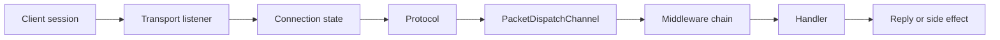
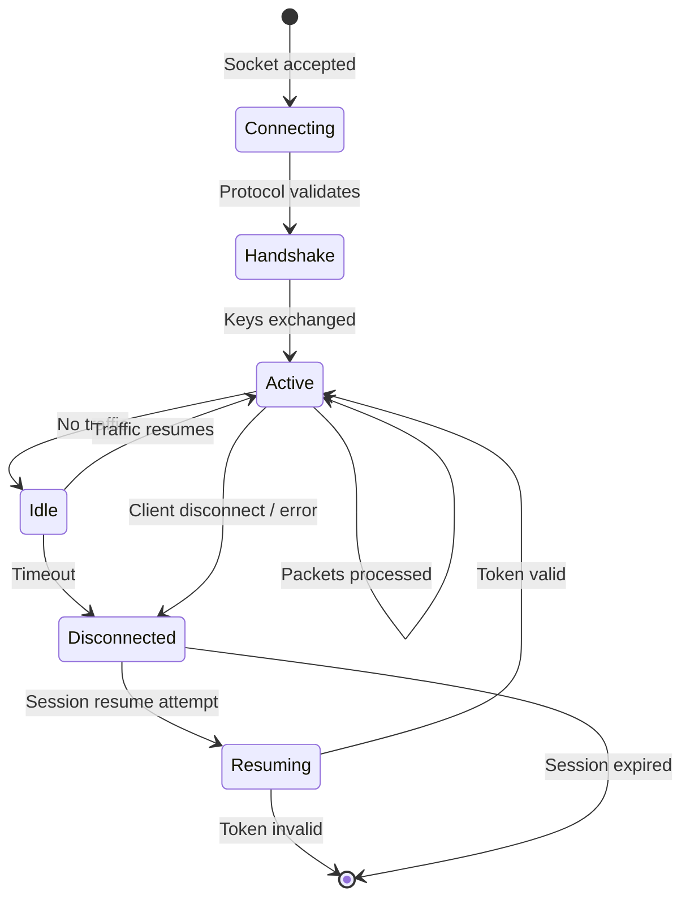
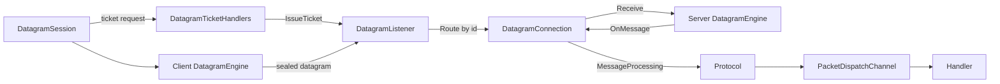

Nalix is designed around a real-time server model with long-lived sessions, predictable dispatch flow, and explicit throttling controls. This page explains the runtime mindset behind the network layer — how sessions, dispatch, and protection work together.

## Mental Model



## Session Lifecycle

At runtime, Nalix maintains state around each connection — not just around individual messages. This persistent state is what makes real-time patterns possible.



Connection state includes:

| State | Description |
| :--- | :--- |
| Connection ID | Unique identifier for the session |
| Remote endpoint | Source IP and port |
| Permission level | Authorization level (`NONE`, `USER`, `TENANT_ADMINISTRATOR`, `SYSTEM_ADMINISTRATOR`, etc.) |
| Cipher state | Active encryption algorithm and shared secret |
| Diagnostics | Bytes sent/received, uptime, ping time, error count |

This is why `Connection` and `ConnectionHub` sit at the center of the real-time model.

## Request Flow

A typical TCP request follows this path:

1. Socket accepted by `TcpListenerBase`.
2. The listener and protocol bring the connection into the active receive path.
3. The **Listener** receives a frame and executes the `FramePipeline` (decrypt/decompress).
4. The resolved **Protocol** receives the processed message via `ProcessMessage(...)`.
5. Messages are forwarded into `PacketDispatchChannel`.
6. Dispatch deserializes the packet, runs middleware, and invokes the handler.
7. Handler returns or sends a response.

For client applications, the simplest mental model is:

- **TCP** = reliable, ordered command/request flow
- **Dispatch** = application entry point
- **Middleware** = policy enforcement layer

## Low-Latency Datagrams (UDP)

Nalix supports a datagram runtime (the Nalix Datagram Protocol, NDP over UDP) through `DatagramListener` for use cases where reliability is not required:

| Use case | Why UDP |
| :--- | :--- |
| Game state updates | Position/velocity updates where latest value matters, not every value |
| Telemetry | High-frequency sensor or metric data where occasional loss is acceptable |
| Discovery | Service discovery broadcasts |
| Non-critical signals | Heartbeats, status pings |

The UDP path still requires session identity and authentication. Think of it as the same application logic, but with a different transport characteristic:

- A stream session (TCP or WebSocket) must be established and handshaken first
- The client requests a ticket over that session; the datagram keys are derived from the stream secret
- Every datagram is sealed with ChaCha20-Poly1305 and carries the connection id in cleartext
- Each message can choose a `DeliveryMethod` (unreliable, sequenced or reliable) and a channel

These points reflect the built-in listener flow in `src/Nalix.Network/Listeners/Datagram/DatagramListener.Receive.cs`, where datagrams are resolved by connection id first and then authenticated by the session engine.

The diagram follows one datagram session end to end: the ticket travels over the stream session, then sealed datagrams are routed by connection id, authenticated by the server engine and handed to the same dispatch path as stream traffic (sources: `DatagramSession.cs:132`, `DatagramListener.Receive.cs:100`, `DatagramConnection.Transport.cs:142,169`). Per-component detail lives in [DatagramSession](../../api/sdk/datagram-session.md), [DatagramEngine](../../api/environment/datagram-engine.md) and [DatagramListener](../../api/network/datagram-listener.md).



## Throttling and Protection

Real-time systems fail fastest when they do not control pressure. Nalix integrates protection at multiple levels:

| Component | Layer | Purpose |
| :--- | :--- | :--- |
| `ConnectionGuard` | Socket | Reject endpoints before resource allocation |
| `ConnectionGuard` (datagram sessions) | Transport | Per-endpoint admission checked when a datagram session is accepted |
| `TokenBucketLimiter` | Dispatch | Protect against request spikes with burst budgets |
| `PolicyRateLimiter` | Dispatch | Per-opcode and per-endpoint rate limiting |
| `TimingWheel` | Transport | O(1) idle timeout management for connection cleanup |

These are not optional extras. They are part of making the engine stable under production traffic.

## Packet Metadata in the Real-time Path

Handler attributes become runtime behavior through cached metadata:

```csharp
[PacketOpcode(0x3001)]
[PacketPermission(PermissionLevel.USER)]
[PacketTimeout(3000)]
[PacketRateLimit(requestsPerSecond: 30, burst: 10)]
public ValueTask<PositionAck> HandlePosition(
    IPacketContext<PositionUpdate> context)
{
    // Metadata-driven enforcement happens before this code runs
}
```

Metadata is resolved once during handler registration, then reused through dispatch and middleware on every request. This keeps the real-time path fast and consistent.

## Recommended Next Pages

- [Architecture](./architecture.md) — Layered component overview
- [Middleware](./middleware-pipeline.md) — Buffer vs. packet middleware
- [Packet Dispatch](../../api/runtime/routing/packet-dispatch.md) — Dispatch API reference
- [TCP Request/Response](../../guides/networking/tcp-patterns.md) — TCP pattern guide
- [UDP Auth Flow](../../guides/networking/datagram-security.md) — UDP authentication guide
