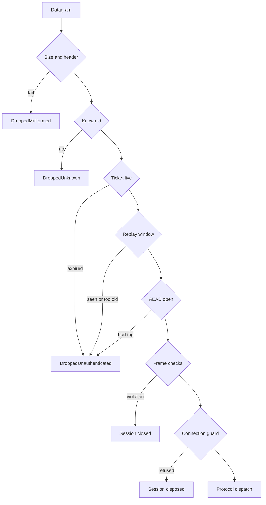

:::warning[Advanced Topic]
This page deals with low-level protocol details of the datagram transport.
:::

This guide explains the session shape used by `DatagramListener` and `DatagramSession` (the Nalix Datagram Protocol, NDP over UDP) today, in a client-friendly way.

Use it when you already know you need UDP and want to understand the trust and replay rules before implementing a client.

## Source Mapping

- `src/Nalix.Network/Listeners/Datagram/DatagramListener.Receive.cs`
- `src/Nalix.Network/Listeners/Datagram/DatagramListener.PublicMethods.cs`
- `src/Nalix.Runtime/Handlers/DatagramTicketHandlers.cs`
- `src/Nalix.Codec/Security/Datagram/DatagramKeySchedule.cs`
- `src/Nalix.SDK/Transport/DatagramSession.cs`

## What the runtime expects

A datagram session is bound to an authenticated stream session (TCP or WebSocket) through a one-time **ticket**:

1. The client requests a ticket over the stream session (`DatagramTicket`, stage `REQUEST`). The server refuses with a `ProtocolReason` when the handshake is not complete (`UNAUTHENTICATED`), when the request already arrives on a datagram session (`STATE_VIOLATION`), or when no datagram listener is running (`SERVICE_UNAVAILABLE`).
2. `IDatagramTicketIssuer.IssueTicket(...)` snapshots the stream connection's user, permission level, algorithm and secret, generates a random 16-byte nonce and returns a `DatagramTicketInfo` (`ConnectionId`, `Nonce`, `Port`, `ExpiresInSeconds`, `IdleTimeoutMs`, `MaxMessageSize`, `ChannelCount`, `ReceiveBufferBytes`, `ChannelReceiveBufferBytes`). One outstanding ticket exists per stream connection: a new request replaces the previous one.
3. Both sides derive the session keys from the stream secret, the connection id and the ticket nonce with an HKDF built on Keccak-256 (`DatagramKeySchedule`), with separate client-to-server and server-to-client secrets.
4. Every datagram is sealed with ChaCha20-Poly1305 (`ChaCha20Poly1305DatagramProtection`). Only the connection id travels in cleartext.
5. The first datagram must authenticate within `DatagramOptions.TicketLifetimeSeconds` (default `10`); then the pending ticket is promoted to a session.

In source (`DatagramListener.Receive.cs`) the listener:

- drops datagrams longer than `DatagramEngine.MaxDatagramSize` (`1472` bytes) or with a malformed header (`DroppedMalformed`)
- drops datagrams whose connection id is neither a session nor a pending ticket (`DroppedUnknown`)
- drops datagrams that fail authentication or decryption (`DroppedUnauthenticated`)
- consults the `ConnectionGuard`, when one is configured, before accepting the session (`TotalGuardRejections`)

Replay protection is part of the session engine (a replay window inside `DatagramEngine`), and long-lived sessions rotate keys after `KeyUpdatePacketInterval` packets or `KeyUpdateIntervalMs` milliseconds.

## Defence layers

The diagram shows the defence layers in the order a datagram is checked (`DatagramListener.Receive.cs:102-189`, `DatagramEngine.cs:425-452`); the ticket flow lives on [UDP Listener](../../api/network/datagram-listener.md).



## Server shape

Host the listener with the builder; there is nothing to subclass:

```csharp
using var app = NetworkApplication.CreateBuilder()
    .UseSecureConnections()
    .MapTcp<MyProtocol>().OnPort(57206).Bind()
    .MapDatagram<MyProtocol>().OnPort(57206).Bind()
    .Build();
```

`MapDatagram<T>()` also maps `DatagramTicketHandlers`, and can be called once per application.

### Keep the stream and datagram sessions tied

The datagram session lives on its own once accepted: closing the stream connection does not close it. Each `DatagramConnection` exposes `StreamConnectionId`, so a kick or a permission change must also disconnect the datagram connections whose `StreamConnectionId` matches.

## Client shape

```csharp
using TcpSession tcp = new(tcpOptions);
await tcp.ConnectAsync(host, port);
await tcp.HandshakeAsync();

// DatagramSession requests the ticket over the stream session and derives its own keys.
using DatagramSession udp = new(tcp);
await udp.ConnectAsync();           // host defaults to the stream address, port to ticket.Port
await udp.SendAsync(packet);
await udp.SendAsync(packet, DeliveryMethod.ReliableOrdered, channel: 0);
```

`ConnectAsync` throws `NetworkException` when the ticket is refused or the session is not established before the ticket expires. The `encrypt` arguments of the send methods are ignored because every datagram is already sealed by the session.

## Transport rules

For clients, that means:

- complete the stream handshake first; the datagram secret is derived from it
- keep each datagram within `DatagramEngine.MaxDatagramSize` (`1472` bytes); larger messages are fragmented by the engine up to the ticket's `MaxMessageSize`
- pick a `DeliveryMethod` and channel per message when you need reliability or ordering
- treat UDP as a fast datagram path bound to an established stream session, not a standalone authentication protocol

## What happens on failure

The listener records diagnostics for:

- malformed datagrams
- unknown sessions
- unauthenticated datagrams
- receive errors

Invalid datagrams are dropped before they reach your protocol logic.

## Related pages

- [UDP Listener](../../api/network/datagram-listener.md)
- [UDP Session](../../api/sdk/datagram-session.md)
- [Connection Hub](../../api/network/connection/connection-hub.md)
- [Network Options](../../api/options/network/options.md)
