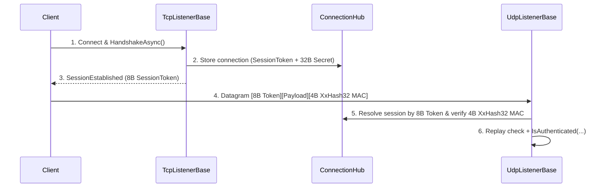

:::warning[Advanced Topic]
This page deals with low-level protocol multiplexing and custom listener implementations.
:::

This guide explains the actual UDP session shape used by `UdpListenerBase` today, in a client-friendly way.

Use it when you already know you need UDP and want to understand the trust and replay rules before implementing a client.

## What the runtime expects

When `UdpListenerBase` receives a datagram, it expects a 12-byte authentication wrapper around the serialized Nalix packet (minimum datagram size is **18 bytes** = `SessionTokenSize (8) + PacketHeader.Size (6) + UdpMacTagSize (4)`):

- session token (`Snowflake`, 8 bytes at `[0..8]`)
- payload (at least the 6-byte Nalix `PacketHeader` at `[8..^4]`: `[OpCode(2), Flags(1), Priority(1), SequenceId(2)]`)
- `XxHash32` authentication tag (4 bytes at `[^4..^0]`)

In source (`UdpListener.Receive.cs`), the listener validates:

- the datagram is at least `18` bytes long (`8` token + `6` `PacketHeader.Size` + `4` `XxHash32` tag)
- the 8-byte token resolves to an active, non-disposed connection in `ConnectionHub` with a non-zero `Secret`
- the trailing 4-byte `XxHash32` tag matches `XxHash32.Compute(connection.Secret.AsSpan(), seed: XxHash32.Compute(datagram[..^4]))`
- the remote endpoint matches the connection's pinned endpoint (`IsPinnedEndpointMatch`)
- the UDP replay window (`connection.UdpReplayWindow.TryCheck(header.SequenceId)`) accepts the packet sequence
- your overridden `IsAuthenticated(...)` or hosting predicate returns `true`

## High-level flow



## Server shape

### 1. Subclass `UdpListenerBase`

```csharp
public sealed class SampleUdpListener : UdpListenerBase
{
    public SampleUdpListener(IProtocol protocol, IConnectionHub hub) : base(protocol, hub) { }

    public override bool IsAuthenticated(IConnection connection, EndPoint remoteEndPoint, ReadOnlySpan<byte> payload)
    {
        // Add your own checks here:
        // - allowed endpoint
        // - session state
        // - region / shard ownership
        return !connection.Secret.IsZero;
    }
}
```

:::tip[Preferred Modern Pattern]
Instead of subclassing `UdpListenerBase`, use the hosting predicate before
calling `Build()`:
```csharp
using var app = NetworkApplication.CreateBuilder()
    .MapTcp<MyProtocol>().OnPort(57206).Bind()
    .MapUdp<MyProtocol>().OnPort(57206).WithAuthentication((conn, ep, data) =>
        conn.Level >= PermissionLevel.USER).Bind()
    .Build();
```
:::

### 2. Keep TCP and UDP tied to the same session

The UDP path assumes there is already a known connection in `ConnectionHub`.

That means a common pattern is:

1. authenticate or handshake on TCP first
2. create/populate the connection secret
3. store the session in `ConnectionHub`
4. allow UDP packets to reference that session ID

## Conceptual client packet layout

The listener validates these three parts:

```text
[8-byte session-token][payload (>= 6B PacketHeader)][4-byte XxHash32 MAC]
```

The token is the `Snowflake` session ID assigned to the connection after TCP handshake, and the trailing 4-byte tag is computed over `[session-token][payload]` seeded with the 32-byte `connection.Secret`.

## Pseudocode for client-side send

```csharp
// Using Nalix.SDK UdpSession handles this automatically:
await using var udp = new UdpSession(udpOptions, tcpSession.State);
await udp.ConnectAsync(host, port);
await udp.SendAsync(packet);

// Or manually constructing the wire datagram:
uint bodyHash = XxHash32.Compute(tokenAndPayload, seed: 0);
uint macTag = XxHash32.Compute(sharedSecret.AsSpan(), seed: bodyHash);
```

## Transport rules

The runtime uses an 8-byte `SessionToken` prefix and a trailing 4-byte `XxHash32` authentication tag keyed by the 32-byte X25519 session secret established through TCP.

For clients, that means:

- send the 8-byte session token first and append the 4-byte `XxHash32` tag last (or use `UdpSession` which does both automatically)
- keep the total datagram small enough to fit `MaxUdpDatagramSize` (`1440` bytes default)
- treat UDP as a fast datagram path bound to an established TCP session, not a standalone authentication protocol

## What happens on failure

The listener records diagnostics for:

- short packets
- unknown sessions
- unauthenticated packets
- receive errors

Invalid packets are dropped before they reach your protocol logic.

## Recommended rollout

For a simple deployment:

1. establish session over TCP
2. assign/store session secret
3. return session ID to the client
4. let the client send UDP datagrams prefixed with the session token
5. verify in `IsAuthenticated(...)` that the session is ready for UDP

## Related pages

- [UDP Listener](../../api/network/udp-listener.md)
- [UDP Session](../../api/sdk/udp-session.md)
- [Connection Hub](../../api/network/connection/connection-hub.md)
- [Network Options](../../api/options/network/options.md)
